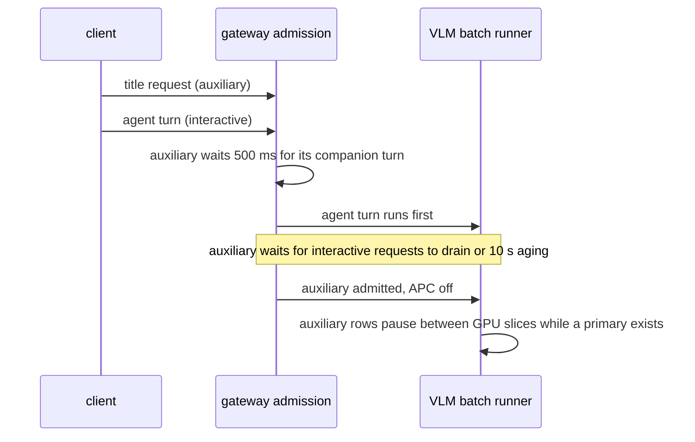

An agent client sends more than one request per user action. opencode, for example, starts a title-generation request next to the main agent turn. On a single GPU the title request can sit in front of a long prefill that the user is waiting for. Yunshu recognizes captured auxiliary requests exactly, lets interactive turns go first, and keeps every output token-identical to ordinary scheduling. This page is the design reference for maintainers; for client behavior see [Agent clients](/docs/guides/agents).

## What it does

Two cooperating policies run on the VLM batch runner, and both are on by default only for a loaded backend that engages the qualified batch-invariant kernels (`_prefix_invariant_dispatch`, the tuned Qwen3.5 family such as 27B):

- **Auxiliary yielding** (`YUNSHU_AUXILIARY_SCHEDULING`). `python/yunshu_gateway/admission.py` classifies the validated Chat Completions body with `auxiliary_kind`. A request is auxiliary only when it matches the captured opencode title fingerprint: no tools or functions, the captured client model name, `max_tokens` of 32000, exactly three plain-text messages with roles `system,user,user`, and a SHA-256 of the system message equal to the captured one. Anything else, including requests from Claude Code and Codex, keeps priority 0, because no auxiliary request from those clients was captured and no fingerprint is invented. The result is `scheduling_priority = -1` on the request record; it never enters the prompt or the sampling parameters.
- **Uncached-work ordering** (`YUNSHU_UNCACHED_SCHEDULING`). Canonical prefill atoms of interactive requests are ordered by estimated uncached RAM-prefix work and wait time (`python/yunshu_engine/serving/work_scheduler.py`), and measured decode time is reserved between atoms so decoding rows keep streaming.

The sequence below shows one title request and one agent turn arriving together.

### Gateway behavior

A recognized auxiliary request waits 500 ms (`defer_auxiliary`) so the companion agent turn can arrive, then waits until no interactive request is active, or until it has aged 10 seconds (`AGING_S`), before entering the engine. Ordinary requests pay no wait. The deferral also keeps auxiliary work out of the serialized text fast path while a primary is present.

### Runner behavior

- The VLM runner holds pending auxiliary rows while primary work exists, keeps the two priorities in separate batches, and pauses an active auxiliary batch while a primary is present. Speculative lanes keep their own cache and sampling state, and the shared drafter's state is restored when switching. The experimental [round driver](/docs/developers/round-driver) has a separate auxiliary driver with the same model, chunking and sampling path.
- An auxiliary row that has waited 10 seconds since its last service gets a service opportunity. That is not a completion deadline: in-flight atoms, older work, client cancellation and deadlines still apply.
- Interactive prefills gain persistent FIFO protection after one overtaking atom, so later short arrivals cannot repeatedly skip a long cold request. A selected request finishes its last 2048-token window and delivers its first token before decode debt is repaid.
- Decode time owed to running rows after a prefill atom is at least 75 ms (`DECODE_QUANTUM_S`) and at most `DECODE_QUANTUM_MAX_S`, with a larger share for rows still in their first tokens. A short primary completion handoff (`PRIMARY_HANDOFF_S`, 100 ms) keeps a finishing primary ahead of auxiliary admission, with a CPU-only timer so MLX work stays on the single executor thread.

## Why

Evidence comes from saved client traffic, not a client-name or small-model heuristic. `scripts/research/agentic/characterize_auxiliary.py` inventories captured request bodies. In the captured set, opencode sent title requests (small prompts, large output limit) next to agent turns, while no auxiliary request was captured for Claude Code or Codex. A broader heuristic would risk deprioritizing real user work. The cost of being narrow is that unknown side requests stay interactive.

## Guarantees

- **Output identity.** Auxiliary scheduling changes order, not token spans, sampling or grammar state. Captured replays on the 27B checkpoint compare complete content, reasoning, tool-call and finish-reason digests with the policy on and off, for both primary and auxiliary responses; the gate requires every comparison to match.
- **No cancellation of auxiliary work.** Auxiliary output is never cancelled, dropped, restarted or truncated; a paused row resumes with its state. Cancelled paused rows are cleaned up at the next slice.
- **Cache isolation.** Auxiliary requests do not read or write the prefix cache (APC), cannot supersede or evict primary RAM or disk checkpoints, and do not update the prefill cost model. They still run the same canonical checkpoint arithmetic, which keeps their numerics equal to ordinary scheduling. The text fast path bypasses prefix and prompt caching for them too.
- **Unqualified backends keep ordinary scheduling** (FIFO admission and normal APC) unless the setting is explicitly enabled.
- **Non-preemptible kernels.** A GPU operation already submitted cannot be interrupted. A primary arriving after auxiliary prefill started waits for the current slice, never for the whole auxiliary generation. The text-only `mlx-lm` fast path still runs a started request to completion; only the gateway deferral and cache protection apply there.
- **Exact token counts for the context guard.** Qualified VLM backends keep a tokenizer-scoped LRU of successful text token counts (128 strings, 2 MiB of estimated text) so repeated prompts are not re-tokenized in the gateway context and prefill guard. Role and tool overhead and media costs are still counted per request, and a failed encode is never cached. This saves host work only.

## Knobs

| Setting | Default | Effect |
|---|---|---|
| `YUNSHU_AUXILIARY_SCHEDULING` | `true` for qualified backends only | `0` disables, `1` also opts an unqualified backend in. A stable deployment override |
| `YUNSHU_UNCACHED_SCHEDULING` | `true` for qualified backends only | Uncached-work ordering with FIFO protection, 10 s aging and a decode reserve between atoms. `0` restores upstream ordering |

The default resolves in `settings.scheduling_enabled`: when the value comes from the default source, the loaded backend's qualification decides; an explicit value always wins. The runner logs `Scheduling policy: qualified=... uncached=... auxiliary=...` at load, which is the engagement check.

## Limits

- Only the captured opencode title fingerprint is recognized. Requests that differ in model name, output limit or system text are interactive.
- The measured claim is the 27B VLM runner. Evidence comes from one captured session replayed in interleaved fresh-server pairs; it is a scheduling tradeoff, not a general speed improvement. The captured median time to first token was slightly worse with the policy on, while the tail, the six-turn completion time and a long-prefill mix improved (below).
- Auxiliary latency gets worse by design: the mean title time to first token was higher with the policy on in the replay.
- The round driver retains strict auxiliary priority without aging, so endless primary driver traffic can defer auxiliary service indefinitely.
- Non-captured clients and APIs (Responses, Messages) are not classified.

## How to verify

- Unit tests: `tests/unit/test_auxiliary_inventory.py`, `tests/unit/test_auxiliary_scheduling.py`, `tests/unit/test_priority_scheduling.py` and `tests/unit/test_priority_queue.py` cover fingerprint near misses, opt-out, priority propagation across executor threads, pending and active priority inversion, state-preserving resume, separate speculative and driver lanes, and APC exclusion.
- GPU replay: `scripts/research/agentic/i8_summarize.py` rejects incomplete runs and compares complete response digests for primary and auxiliary requests; CPU-only ordering is simulated by `scripts/research/agentic/i8_admission_sim.py`. These run through the GPU queue; see [Verification](/docs/developers/verification).
- Measured result (Qwen3.8-27B, 2026-10-03, `docs/reports/PERF_TREND.md`): captured main time to first token p50 0.7515 s to 0.7570 s, p90 8.5990 s to 7.6239 s, six-turn completion sum 40.226 s to 33.504 s; long-prefill mix p50 23.098 s to 8.6795 s. Digests matched in all pairs.
