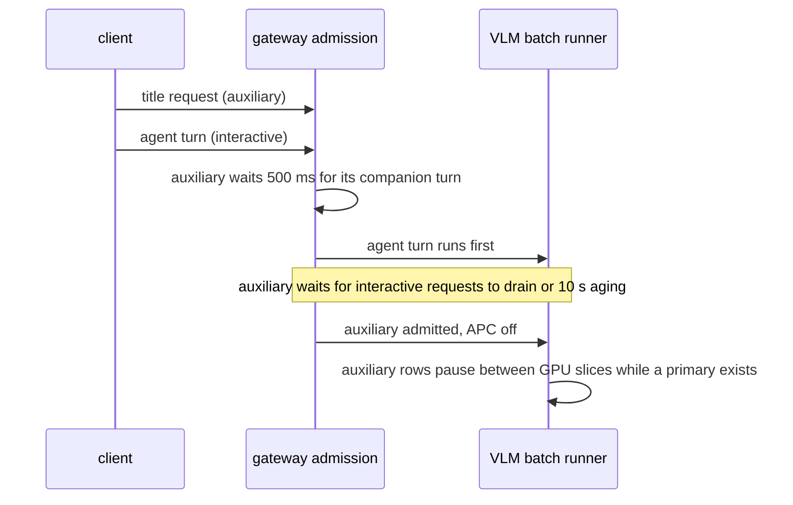

Agent 客户端在用户的一次操作中，可能发出不止一个请求。例如 opencode 会在主要 agent 回合旁同时启动标题生成请求。在单一 GPU 上，标题请求可能卡在用户正在等待的长 prefill 前面。Yunshu 精确识别已捕获的辅助请求，让交互式回合先运行，并保持每个输出与普通调度逐 token 相同。本页是维护者的设计参考；客户端行为请见 [Agent 客户端](/docs/guides/agents)。

## 它做什么

两个互相配合的策略在 VLM batch runner 上运作，且只有在已加载的后端实际启用合格的 batch-invariant kernel（`_prefix_invariant_dispatch`，即 27B 等调优过的 Qwen3.5 系列）时才默认打开：

- **辅助请求让位**（`YUNSHU_AUXILIARY_SCHEDULING`）。`python/yunshu_gateway/admission.py` 的 `auxiliary_kind` 对已验证的 Chat Completions 请求本体分类。只有符合已捕获的 opencode 标题指纹的请求，才算辅助请求：没有 tools 或 functions、已捕获的客户端模型名称、`max_tokens` 为 32000、恰好三条纯文本消息且角色为 `system,user,user`，且 system 消息的 SHA-256 等于已捕获的值。其他请求，包括 Claude Code 与 Codex，维持优先级 0，因为这两者没有捕获到辅助请求，也不凭空编造指纹。结果是请求记录上的 `scheduling_priority = -1`；它不会进入 prompt 或采样参数。
- **未缓存工作排序**（`YUNSHU_UNCACHED_SCHEDULING`）。交互式请求的标准 prefill atom 依估计的未缓存 RAM 前缀工作量与等待时间排序（`python/yunshu_engine/serving/work_scheduler.py`），并在 atom 之间保留测量到的解码时间，让解码中的 row 持续输出。

下方的时序图显示一个标题请求与一个 agent 回合同时到达的情形。

### Gateway 行为

被识别为辅助的请求先等待 500 ms（`defer_auxiliary`），让随行的 agent 回合到达，然后等到没有交互式请求进行中，或自己已等待 10 秒（`AGING_S`），才进入引擎。普通请求不会多等。这个延后也让辅助工作在有主要请求时，不会进入串行化的文本快速路径。

### Runner 行为

- VLM runner 在有主要工作时保留待处理的辅助 row，把两种优先级放在不同 batch，并在有主要请求时暂停进行中的辅助 batch。推测 lane 保有自己的缓存与采样状态，切换时会还原共用 drafter 的状态。实验性的 [round driver](/docs/developers/round-driver) 有独立的辅助 driver，使用相同的模型、chunk 与采样路径。
- 自上次服务起已等待 10 秒的辅助 row 会得到一次服务机会。这不是完成期限：进行中的 atom、较旧的工作、客户端取消与期限仍然适用。
- 交互式 prefill 在被一个 atom 超越后获得持续的 FIFO 保护，所以之后到达的短请求，不能一再插到长的冷请求前面。被选中的请求会先完成最后 2048 token 的窗口并送出第一个 token，才偿还解码负债。
- prefill atom 之后欠解码中 row 的解码时间至少 75 ms（`DECODE_QUANTUM_S`），上限为 `DECODE_QUANTUM_MAX_S`，仍在前几个 token 的 row 获得较大的份额。简短的主要请求完成交接（`PRIMARY_HANDOFF_S`，100 ms）让即将完成的主要请求排在辅助请求进入之前，并使用只在 CPU 上的计时器，使 MLX 工作留在单一 executor 线程。

## 为什么

证据来自保存的客户端流量，而不是客户端名称或小模型的启发式判断。`scripts/research/agentic/characterize_auxiliary.py` 会盘点已捕获的请求本体。在捕获的数据中，opencode 会在 agent 回合旁送出标题请求（prompt 很短、输出上限很大），而 Claude Code 与 Codex 没有捕获到辅助请求。更广泛的启发式可能让真正的用户工作被降低优先级。范围收窄的代价是，未知的附带请求仍维持交互式。

## 保证

- **输出相同。** 辅助调度只改变顺序，不改变 token 区段、采样或 grammar 状态。在 27B checkpoint 上的捕获重播，会在策略打开与关闭下比较完整的内容、推理、tool-call 与 finish-reason 摘要，涵盖主要与辅助响应；门控要求每项比较都一致。
- **不取消辅助工作。** 辅助输出不会被取消、丢弃、重启或截断；暂停的 row 带着状态继续。已取消的暂停 row 在下一个 slice 被清理。
- **缓存隔离。** 辅助请求不读写前缀缓存（APC），不能取代或驱逐主要请求的 RAM 或磁盘 checkpoint，也不更新 prefill 成本模型。它们仍运行相同的标准 checkpoint 运算，使数值与普通调度相同。文本快速路径同样对它们略过前缀与 prompt 缓存。
- **不合格的后端维持普通调度**（FIFO 准入与普通 APC），除非明确启用该配置。
- **不可抢占的 kernel。** 已提交的 GPU 运算无法中断。在辅助 prefill 开始后才到达的主要请求，等的是目前的 slice，而不是整个辅助生成。纯文本 `mlx-lm` 快速路径仍会让已开始的请求跑完；那里只套用 gateway 延后与缓存保护。
- **context 防护使用精确 token 数。** 合格的 VLM 后端为成功的文本 token 计数保留以 tokenizer 为范围的 LRU（128 个字符串、估计 2 MiB 文本），让重复的 prompt 不必在 gateway 的 context 与 prefill 防护中重新分词。角色与工具的额外开销与媒体成本仍逐次计算，失败的编码不会被缓存。这只节省主机端工作。

## 设置

| 设置 | 默认 | 效果 |
|---|---|---|
| `YUNSHU_AUXILIARY_SCHEDULING` | 仅合格后端为 `true` | `0` 关闭，`1` 也让不合格的后端启用。稳定的部署覆写项 |
| `YUNSHU_UNCACHED_SCHEDULING` | 仅合格后端为 `true` | 未缓存工作排序，含 FIFO 保护、10 秒老化与 atom 之间的解码保留。`0` 还原 upstream 排序 |

默认值由 `settings.scheduling_enabled` 解析：当值来自默认来源时，由已加载后端的资格决定；明确设置的值永远优先。Runner 在加载时记录 `Scheduling policy: qualified=... uncached=... auxiliary=...`，这就是确认已启用的方式。

## 限制

- 只识别已捕获的 opencode 标题指纹。模型名称、输出上限或 system 文本不同的请求都是交互式。
- 测量结果只涵盖 27B VLM runner。证据来自一次捕获的 session，在交错的全新服务器配对中重播；这是调度取舍，不是通用的速度提升。打开策略后，捕获数据的首 token 时间中位数略差，而尾部、六回合完成时间与长 prefill 混合负载有改善（见下）。
- 辅助请求的延迟是刻意牺牲的：重播中，打开策略后标题的平均首 token 时间较高。
- round driver 维持严格的辅助优先级且没有老化，所以持续不断的主要 driver 流量可能无限期延后辅助服务。
- 未捕获的客户端与 API（Responses、Messages）不会被分类。

## 如何验证

- 单元测试：`tests/unit/test_auxiliary_inventory.py`、`tests/unit/test_auxiliary_scheduling.py`、`tests/unit/test_priority_scheduling.py` 与 `tests/unit/test_priority_queue.py` 涵盖指纹近似但不符、关闭、跨 executor 线程的优先级传递、待处理与进行中的优先级反转、保留状态的恢复、独立的推测与 driver lane，以及排除 APC。
- GPU 重播：`scripts/research/agentic/i8_summarize.py` 会拒绝不完整的运行，并比较主要与辅助请求的完整响应摘要；仅用 CPU 的排序由 `scripts/research/agentic/i8_admission_sim.py` 模拟。这些通过 GPU 队列运行；见[验证](/docs/developers/verification)。
- 测量结果（Qwen3.8-27B，2026-10-03，`docs/reports/PERF_TREND.md`）：捕获的主要请求首 token 时间 p50 0.7515 s 至 0.7570 s，p90 8.5990 s 至 7.6239 s，六回合完成时间总和 40.226 s 至 33.504 s；长 prefill 混合负载 p50 23.098 s 至 8.6795 s。所有配对的摘要皆一致。
