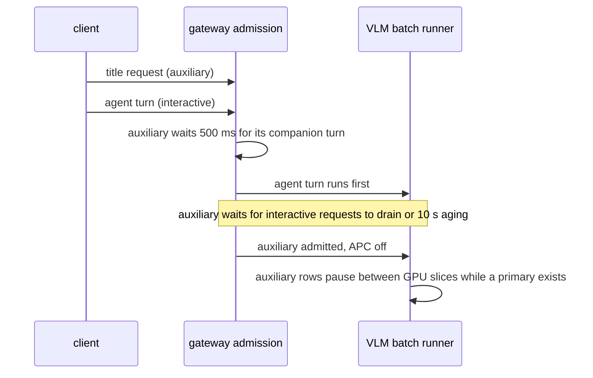

Agent 客戶端的一個使用者動作可能送出不只一個請求。例如 opencode 會在主要 agent 回合旁同時啟動標題生成請求。在單一 GPU 上，標題請求可能卡在使用者正在等待的長 prefill 前面。Yunshu 精確辨識已擷取的輔助請求，讓互動式回合先執行，並保持每個輸出與一般排程逐 token 相同。本頁是維護者的設計參考；客戶端行為請見 [Agent 客戶端](/docs/guides/agents)。

## 它做什麼

兩個互相配合的策略在 VLM batch runner 上運作，且只有在已載入的後端實際啟用合格的 batch-invariant kernel（`_prefix_invariant_dispatch`，即 27B 等調校過的 Qwen3.5 系列）時才預設開啟：

- **輔助請求讓位**（`YUNSHU_AUXILIARY_SCHEDULING`）。`python/yunshu_gateway/admission.py` 的 `auxiliary_kind` 對已驗證的 Chat Completions 請求本體分類。只有符合已擷取的 opencode 標題指紋才算輔助請求：沒有 tools 或 functions、已擷取的客戶端模型名稱、`max_tokens` 為 32000、恰好三則純文字訊息且角色為 `system,user,user`，且 system 訊息的 SHA-256 等於已擷取的值。其他請求，包括 Claude Code 與 Codex，維持優先度 0，因為這兩者沒有擷取到輔助請求，也不憑空編造指紋。結果是請求記錄上的 `scheduling_priority = -1`；它不會進入 prompt 或取樣參數。
- **未快取工作排序**（`YUNSHU_UNCACHED_SCHEDULING`）。互動式請求的標準 prefill atom 依估計的未快取 RAM 前綴工作量與等待時間排序（`python/yunshu_engine/serving/work_scheduler.py`），並在 atom 之間保留量測到的解碼時間，讓解碼中的 row 持續輸出。

下方的時序圖顯示一個標題請求與一個 agent 回合同時到達的情形。

### Gateway 行為

被辨識為輔助的請求先等待 500 ms（`defer_auxiliary`），讓同伴的 agent 回合到達，然後等到沒有互動式請求進行中，或自己已等待 10 秒（`AGING_S`），才進入引擎。一般請求不會多等。這個延後也避免輔助工作在有主要請求時進入序列化的文字快速路徑。

### Runner 行為

- VLM runner 在有主要工作時保留待處理的輔助 row，把兩種優先度放在不同 batch，並在有主要請求時暫停進行中的輔助 batch。推測 lane 保有自己的快取與取樣狀態，切換時會還原共用 drafter 的狀態。實驗性的 [round driver](/docs/developers/round-driver) 有獨立的輔助 driver，使用相同的模型、chunk 與取樣路徑。
- 自上次服務起已等待 10 秒的輔助 row 會得到一次服務機會。這不是完成期限：進行中的 atom、較舊的工作、客戶端取消與期限仍然適用。
- 互動式 prefill 在被一個 atom 超越後獲得持續的 FIFO 保護，所以之後的短請求不能一再插隊長的冷請求。被選中的請求會先完成最後 2048 token 的視窗並送出第一個 token，才償還解碼負債。
- prefill atom 之後欠解碼中 row 的解碼時間至少 75 ms（`DECODE_QUANTUM_S`），上限為 `DECODE_QUANTUM_MAX_S`，仍在前幾個 token 的 row 獲得較大的份額。簡短的主要請求完成交接（`PRIMARY_HANDOFF_S`，100 ms）讓即將完成的主要請求排在輔助請求進入之前，並使用只在 CPU 上的計時器，使 MLX 工作留在單一 executor 執行緒。

## 為什麼

證據來自儲存的客戶端流量，而不是客戶端名稱或小模型的啟發式判斷。`scripts/research/agentic/characterize_auxiliary.py` 會盤點已擷取的請求本體。在擷取的資料中，opencode 會在 agent 回合旁送出標題請求（prompt 很短、輸出上限很大），而 Claude Code 與 Codex 沒有擷取到輔助請求。更廣泛的啟發式有可能降低真正使用者工作的優先度。窄範圍的代價是，未知的附帶請求維持互動式。

## 保證

- **輸出相同。** 輔助排程只改變順序，不改變 token 區段、取樣或 grammar 狀態。在 27B checkpoint 上的擷取重播，會在策略開啟與關閉下比較完整的內容、推理、tool-call 與 finish-reason 摘要，涵蓋主要與輔助回應；閘門要求每項比較都相符。
- **不取消輔助工作。** 輔助輸出不會被取消、丟棄、重啟或截斷；暫停的 row 帶著狀態繼續。已取消的暫停 row 在下一個 slice 被清理。
- **快取隔離。** 輔助請求不讀寫前綴快取（APC），不能取代或驅逐主要請求的 RAM 或磁碟 checkpoint，也不更新 prefill 成本模型。它們仍執行相同的標準 checkpoint 運算，使數值與一般排程相同。文字快速路徑同樣對它們略過前綴與 prompt 快取。
- **不合格的後端維持一般排程**（FIFO 準入與一般 APC），除非明確啟用該設定。
- **不可搶佔的 kernel。** 已提交的 GPU 運算無法中斷。在輔助 prefill 開始後才到達的主要請求，等的是目前的 slice，而不是整個輔助生成。純文字 `mlx-lm` 快速路徑仍會讓已開始的請求跑完；那裡只套用 gateway 延後與快取保護。
- **context 防護使用精確 token 數。** 合格的 VLM 後端為成功的文字 token 計數保留以 tokenizer 為範圍的 LRU（128 個字串、估計 2 MiB 文字），讓重複的 prompt 不必在 gateway 的 context 與 prefill 防護中重新分詞。角色與工具的額外開銷與媒體成本仍逐次計算，失敗的編碼不會被快取。這只節省主機端工作。

## 調整項目

| 設定 | 預設 | 作用 |
|---|---|---|
| `YUNSHU_AUXILIARY_SCHEDULING` | 僅合格後端為 `true` | `0` 關閉，`1` 也讓不合格的後端啟用。穩定的部署覆寫項 |
| `YUNSHU_UNCACHED_SCHEDULING` | 僅合格後端為 `true` | 未快取工作排序，含 FIFO 保護、10 秒老化與 atom 之間的解碼保留。`0` 還原 upstream 排序 |

預設值由 `settings.scheduling_enabled` 解析：當值來自預設來源時，由已載入後端的資格決定；明確設定的值永遠優先。Runner 在載入時記錄 `Scheduling policy: qualified=... uncached=... auxiliary=...`，這就是確認已啟用的方式。

## 限制

- 只辨識已擷取的 opencode 標題指紋。模型名稱、輸出上限或 system 文字不同的請求都是互動式。
- 量測結果只涵蓋 27B VLM runner。證據來自一次擷取的 session，在交錯的全新伺服器配對中重播；這是排程取捨，不是通用的速度提升。開啟策略後，擷取資料的首 token 時間中位數略差，而尾部、六回合完成時間與長 prefill 混合負載有改善（見下）。
- 輔助請求的延遲刻意變差：重播中，開啟策略後標題的平均首 token 時間較高。
- round driver 維持嚴格的輔助優先度且沒有老化，所以持續不斷的主要 driver 流量可能無限期延後輔助服務。
- 未擷取的客戶端與 API（Responses、Messages）不會被分類。

## 如何驗證

- 單元測試：`tests/unit/test_auxiliary_inventory.py`、`tests/unit/test_auxiliary_scheduling.py`、`tests/unit/test_priority_scheduling.py` 與 `tests/unit/test_priority_queue.py` 涵蓋指紋近似但不符、關閉、跨 executor 執行緒的優先度傳遞、待處理與進行中的優先度反轉、保留狀態的恢復、獨立的推測與 driver lane，以及排除 APC。
- GPU 重播：`scripts/research/agentic/i8_summarize.py` 會拒絕不完整的執行，並比較主要與輔助請求的完整回應摘要；僅用 CPU 的排序由 `scripts/research/agentic/i8_admission_sim.py` 模擬。這些透過 GPU 佇列執行；見[驗證](/docs/developers/verification)。
- 量測結果（Qwen3.8-27B，2026-10-03，`docs/reports/PERF_TREND.md`）：擷取的主要請求首 token 時間 p50 0.7515 s 至 0.7570 s，p90 8.5990 s 至 7.6239 s，六回合完成時間總和 40.226 s 至 33.504 s；長 prefill 混合負載 p50 23.098 s 至 8.6795 s。所有配對的摘要皆相符。
