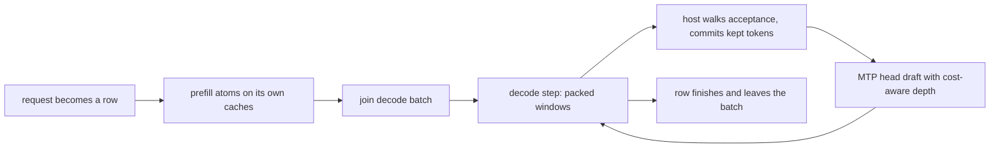

The round driver (`python/yunshu_engine/round_driver/`) is the serving path for every model loaded through `mlx-vlm`. Each request is a row, and the driver serves rows through one of three model layers: the packed Qwen3.5 layer (dense and MoE Qwen3.5-family models), the packed Flash-Next layer (Qwen4), and the generic layer (the model's own upstream forward per row, no drafter by default) for every other family and for Apple Paravirtual Metal. Speculative decoding runs on the packed layers: concurrent requests draft too (MTP chains, or DFlash2 drafts sharing a fair 32-node verify budget). With `YUNSHU_VLM_DRAFT=off` the driver still serves every request, without drafting, and speculation on equals speculation off, token for token. This page is a maintainer reference; for the other serving paths see [Architecture](/docs/developers/architecture).

## What it does

Every request is a **row**. A row prefills on its own single-row caches (a `KVCache` per attention layer, an `ArraysCache` per GatedDeltaNet layer, a `KVCache` for its MTP head). When its prompt is done it joins the decode batch (`round_driver/batch.py`, `DecodeBatch`), where all decoding rows share slot buffers:

- attention K/V in slot buffers per attention layer, the row owning one slot, with capacity that grows in 512-key steps;
- GDN state and conv window as batch arrays per layer (a join concatenates, a finish takes);
- the MTP head's KV in the same kind of slot buffers.

`RoundDriver` (`driver.py`) advances rows in **steps**, each one forward of one kind:

- **Decode step**: every decoding row's window (the pending token plus `d >= 0` drafts), right-padded to the longest window. Norms, projections and the MLP run over the packed rows; attention writes all rows' keys with one scatter and reads them with one ragged-attention launch (`kernels/ragged_attention.py`); the GDN conv and recurrence are one batched launch (`kernels/gdn_rows.py`).
- **Prefill step**: waiting prompts' fixed-size **atoms** (`ROUND_PREFILL_CHUNK` in `vlm_engine.py`, 512 tokens; 2048 on Flash-Next), on a grid from the prompt start, cut at the prompt's checkpoints and end. One atom while rows decode; more consecutive full atoms together when no row decodes.

While rows decode and prompts wait, prefill and decode steps alternate one to one. Steps stay single-kind: packing decode rows into the prefill forward measured no better than alternating at the same chunk size on Qwen3.8-27B (2026-09-29).

One row from admission to finish; decode steps alternate with prefill steps of other rows.

### Routing

`VLMEngine._build_batch_runner` picks the layer when a model loads:

- **Apple Paravirtual Metal**: the generic layer, with no APC and no speculation.
- **Qwen3.5-family or Qwen4 models** (`_SPEC_MODEL_TYPES`) whose language model the packed layer supports (`_round_driver_wanted`): the packed Qwen3.5 layer, or the Flash-Next layer for Qwen4. A quantized Qwen3.5 checkpoint whose lane arithmetic self-test fails serves on the generic layer.
- **Every other model**: the generic layer, one upstream call per row, plain decode. A generic row drafts only when it asks for it (`spec_decode: true`) or `YUNSHU_NGRAM_DEFAULT=1` turns n-gram on. A draft LM (`YUNSHU_DRAFT_MODEL`) or the Gemma-4 assistant (`YUNSHU_GEMMA4_ASSISTANT`) is used when set; otherwise n-gram.

The draft is chosen separately (`spec_select.choose`). `YUNSHU_VLM_DRAFT=off` gives no draft; a DFlash drafter directory or `mtp` selects that path; unset uses a matching DFlash2 drafter when one is found, else the checkpoint MTP head. `YUNSHU_MTP=0` disables the MTP head.

Every request, text or media, is a row of the same driver. A media prompt carries its own prompt features (`VLMBatchRunner._media_request` on the packed layers, `_generic_request` on the generic layer). A row draws its drafts only when its processors allow it (below).

## Why

Upstream `mlx-vlm`'s `BatchGenerator` runs one `_prompt_batch` at a time, speculative batches that cannot take joins, and MTP drafter state for one batch. Measured on 27B (M5 Max):

- MMLU-Pro 300 b8 (long reasoning, 8 in flight): Yunshu 139 tok/s (drafts only while a request is alone), TensorFold MTP parallel-8 159, Splash 223.
- 8 concurrent 1K prompts: the last TTFT is ~10 s (prefill one request at a time).

These are the numbers of the earlier stock shared-batch path, kept as the motivation for the driver.

The driver is Yunshu's own loop (inspired by TensorFold's lane engine, MIT; see [Upstream tracking](/docs/developers/upstream-tracking)) so that several rows can share a forward, join at any step and still produce the tokens they would produce alone. Earlier prototype runs measured the earlier stock path behind competitors on concurrent long-reasoning load; the current cross-engine comparison of this driver (Yunshu 0.1.7.dev0, 2026-11-04 to 2026-11-08) is on [Benchmarks](/docs/guides/benchmarks), and the figures above are from the earlier stock path.

## Guarantees

A row's arithmetic does not depend on which rows share the step, how many drafts the others verify, or whether it drafts at all.

- **Projections** (every target linear and the LM head) use a lane matmul (`kernels/tensorfold/lane_qmm.py`, MIT): per-row bits follow the weight shape, not the row count, for 1 to 128 rows; wider calls are cut into 128-row pieces (`kernels/lane_linear.py`).
- **Decode and verify attention** (`T <= 8` tokens) uses the ragged token-tile kernel: per-token bits do not depend on `T` or on other rows.
- **GDN** runs as one launch over the rows' states; a row that keeps part of its window continues from the saved intermediate state (`DecodeBatch.commit`).
- **Prefill** follows an atom plan that is a function of the prompt alone, so a repeated prompt, or a row restored from a checkpoint on the grid, prefills with the same atoms as a cold run: APC hit equals miss token for token.
- **Greedy rows**: speculation on equals speculation off, and a row alone equals the same row in any batch or join order. **Sampled rows** draw with `keyed_sampling.KeyedSampler` (seed and generation index), so the token at index `g` is a pure function of the row's logits, seed and `g`.
- **Generic layer**: every decoding row makes one upstream call per round on its own cache, so a row's output does not depend on the other rows: solo equals concurrent, greedy and seeded.

On the packed layers, drafting uses the checkpoint's MTP head, or the DFlash2 drafter when one is selected, for every draftable row. The head's KV is kept current every step, so any row can start drafting at any step. Draft depth per row comes from `round_driver/allocate.py` (TensorFold allocation rule, MIT): per-depth acceptance is tracked as an EMA, rows receive drafts greedily by marginal expected tokens, and the step keeps the allocation that maximizes expected committed tokens per millisecond using forward cost measured online. There are no row-count thresholds.

Every row uses the model's `APCManager` prefix cache through `APCCoordinator` (checkpoint strategy) on every family without a sliding-window cache. Entries are salted by the model and processor identity (`VLMBatchRunner._driver_extra_hash`), so a prefix cached under one identity is cold under another.

## Knobs

| Setting | Default | Effect |
|---|---|---|
| `YUNSHU_KV_PRECISION` | `bf16` | `int8` applies to the packed Qwen3.5 layer's rows; the Flash-Next and generic layers keep bf16 |
| `YUNSHU_MTP` | `true` | Draft with the checkpoint MTP head; `false` disables that draft |
| `YUNSHU_VLM_DRAFT` | unset | `off` disables drafting; a drafter directory or `mtp` selects the draft (see Routing) |

## Limits

- XTC sampling rows never draft. Rows with logits processors outside the driver's windowable set (pure token masks and logit bias, repetition penalty, at most one frequency or presence penalty) decode one token a round. Logprobs rows and rows under invariant tool-call or response-format guides draft; other constraints decode one token a round and never draft.
- A prompt feature that the packed layer does not carry raises an error at admission (`VLMBatchRunner._media_request`).
- Open work: a per-row cost of about 25 ms per round (draft, verify, draw) keeps four-row seeded decoding level with the earlier shared batch.

## How to verify

- `tests/unit/test_round_driver.py` (greedy invariance on a random small Qwen3.5), `tests/unit/test_round_driver_apc.py` (hit equals miss), `tests/unit/test_round_driver_routing.py` (layer and draft routing), and `tests/unit/test_round_driver_generic.py` (the generic layer).
- `scripts/research/sweep_round_driver.py` on a real checkpoint (alone, batch, staggered and autoregressive parity) and `scripts/research/probe_span_bits.py` (identical hidden states and caches across prefill span sizes). These need the GPU queue; see [Verification](/docs/developers/verification).
