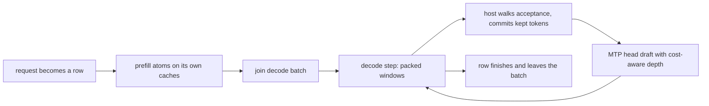

The round driver (`python/yunshu_engine/round_driver/`) is an **experimental** serving path behind `YUNSHU_ROUND_DRIVER` (default off, registered as experimental in `python/yunshu_engine/settings.py`). It exists to let concurrent requests on a dense Qwen3.5-family model draft with MTP too. The default VLM batch runner drafts only while a request is alone. This page is a maintainer reference; for the default serving paths see [Architecture](/docs/developers/architecture).

## What it does

Every request is a **row**. A row prefills on its own single-row caches (a `KVCache` per attention layer, an `ArraysCache` per GatedDeltaNet layer, a `KVCache` for its MTP head). When its prompt is done it joins the decode batch (`round_driver/batch.py`, `DecodeBatch`), where all decoding rows share slot buffers:

- attention K/V in slot buffers per attention layer, the row owning one slot, with capacity that grows in 512-key steps;
- GDN state and conv window as batch arrays per layer (a join concatenates, a finish takes);
- the MTP head's KV in the same kind of slot buffers.

`RoundDriver` (`driver.py`) advances rows in **steps**, each one forward of one kind:

- **Decode step**: every decoding row's window (the pending token plus `d >= 0` drafts), right-padded to the longest window. Norms, projections and the MLP run over the packed rows; attention writes all rows' keys with one scatter and reads them with one ragged-attention launch (`kernels/ragged_attention.py`); the GDN conv and recurrence are one batched launch (`kernels/gdn_rows.py`).
- **Prefill step**: waiting prompts' fixed-size **atoms** (`YUNSHU_ROUND_PREFILL_CHUNK`, default 512 tokens, on a grid from the prompt start, cut at the prompt's checkpoints and end). One atom while rows decode; more consecutive full atoms together when no row decodes.

While rows decode and prompts wait, prefill and decode steps alternate one to one. Steps stay single-kind: packing decode rows into the prefill forward measured no better than alternating at the same chunk size on Qwen3.8-27B (2026-09-29).

One row from admission to finish; decode steps alternate with prefill steps of other rows.

### Routing

`VLMEngine._round_driver_wanted` enables the driver only when `YUNSHU_ROUND_DRIVER` is on, the language model is a dense Qwen3.5-family decoder (`round_driver.forward.supports`; MoE layers do not qualify), `YUNSHU_KV_PRECISION` is `bf16`, and the lane-arithmetic self test passes. Otherwise a warning is logged and the upstream runner serves. Inside the runner (`VLMBatchRunner._driver_takes`), a text request goes to the driver only when at least `DRIVER_MIN_CONCURRENCY` (2) requests are in flight and its uncached prompt is at most `DRIVER_MAX_UNCACHED_TOKENS` (12288) tokens. A lone request keeps the single-request speculative lane; a long cold prompt keeps the upstream prefill. Image and audio prompts stay on the upstream path.

## Why

Upstream `mlx-vlm`'s `BatchGenerator` runs one prompt batch at a time, speculative batches cannot take joins, and MTP drafter state exists for one batch. The driver is Yunshu's own loop (inspired by TensorFold's lane engine, MIT; see [Upstream tracking](/docs/developers/upstream-tracking)) so that several rows can share a forward, join at any step and still produce the tokens they would produce alone. Earlier prototype runs measured the default path behind competitors on concurrent long-reasoning load; there is no current cross-engine number for the driver, and the numbers in the source notes are not release figures. See [Benchmarks](/docs/guides/benchmarks) for the maintained comparisons.

## Guarantees

A row's arithmetic does not depend on which rows share the step, how many drafts the others verify, or whether it drafts at all.

- **Projections** (every target linear and the LM head) use a lane matmul (`kernels/tensorfold/lane_qmm.py`, MIT): per-row bits follow the weight shape, not the row count, for 1 to 128 rows; wider calls are cut into 128-row pieces (`kernels/lane_linear.py`).
- **Decode and verify attention** (`T <= 8` tokens) uses the ragged token-tile kernel: per-token bits do not depend on `T` or on other rows.
- **GDN** runs as one launch over the rows' states; a row that keeps part of its window continues from the saved intermediate state (`DecodeBatch.commit`).
- **Prefill** follows an atom plan that is a function of the prompt alone, so a repeated prompt, or a row restored from a checkpoint on the grid, prefills with the same atoms as a cold run: APC hit equals miss token for token.
- **Greedy rows**: speculation on equals speculation off, and a row alone equals the same row in any batch or join order. **Sampled rows** draw with `keyed_sampling.KeyedSampler` (seed and generation index), so the token at index `g` is a pure function of the row's logits, seed and `g`.
- Rows with logits processors (grammar or JSON, penalties), logprobs or XTC never draft.

Drafting uses the checkpoint's MTP head for every draftable row. The head's KV is kept current every step, so any row can start drafting at any step. Draft depth per row comes from `round_driver/allocate.py` (TensorFold allocation rule, MIT): per-depth acceptance is tracked as an EMA, rows receive drafts greedily by marginal expected tokens, and the step keeps the allocation that maximizes expected committed tokens per millisecond using forward cost measured online. There are no row-count thresholds.

The driver shares the `APCManager` prefix cache with the default runner (through `APCCoordinator`, checkpoint strategy). Its entries are keyed apart from the upstream runner's, so a prefix cached by one path is cold for the other.

## Knobs

| Setting | Default | Effect |
|---|---|---|
| `YUNSHU_ROUND_DRIVER` | `false` (experimental) | Serve eligible text requests with the round driver instead of the upstream shared batch plus the single-request lane |
| `YUNSHU_ROUND_PREFILL_CHUNK` | `512` (minimum 16) | Prompt tokens per prefill atom; smaller keeps decoding rows running beside a long prompt at some prefill-speed cost. Prompts prefilled with different chunk sizes are each self-consistent but not bit-identical to each other |
| `YUNSHU_KV_PRECISION` | `bf16` | Anything else keeps the upstream path |
| `YUNSHU_MTP` | `true` | Draft with the checkpoint MTP head; shared with the default runner |

## Limits

- Image and audio prompts (mRoPE), int8 KV and MoE models stay on the upstream path.
- DFlash drafting and tree drafts are not implemented in the driver.
- The flag stays experimental until it matches the default lane for single-request greedy decode and passes the validation list recorded in its `decide=` field in the registry. If it wins, it becomes the path and the flag, the upstream shared batch and the speculative lane are deleted.

## How to verify

- `tests/unit/test_round_driver.py` (greedy invariance on a random small Qwen3.5), `tests/unit/test_round_driver_apc.py` (hit equals miss) and `tests/unit/test_round_driver_routing.py`.
- `scripts/research/sweep_round_driver.py` on a real checkpoint (alone, batch, staggered and autoregressive parity), `scripts/research/probe_span_bits.py` (identical hidden states and caches across prefill span sizes) and `scripts/research/validate_round_driver.sh` for the full off-versus-on validation. These need the GPU queue; see [Verification](/docs/developers/verification).
