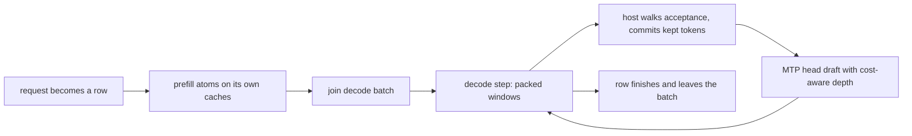

Round driver（`python/yunshu_engine/round_driver/`）是受 `YUNSHU_ROUND_DRIVER` 控制的**实验性**服务路径（默认关闭，在 `python/yunshu_engine/settings.py` 中登记为 experimental）。它的目的是让 dense Qwen3.5 系列模型上的并行请求也能用 MTP 做草稿；默认的 VLM batch runner 只在请求独自运行时才做草稿。本页是维护者参考；默认服务路径请见[架构](/docs/developers/architecture)。

## 它做什么

每个请求都是一个 **row**。row 先在自己的单 row 缓存上 prefill（每个 attention 层一个 `KVCache`、每个 GatedDeltaNet 层一个 `ArraysCache`、MTP head 一个 `KVCache`）。prompt 处理完后加入解码 batch（`round_driver/batch.py` 的 `DecodeBatch`），所有解码中的 row 共用 slot 缓冲区：

- 每个 attention 层的 K/V 放在 slot 缓冲区，每个 row 拥有一个 slot，容量以 512 个 key 为单位成长；
- GDN 状态与 conv 窗口是每层的 batch 数组（加入时串接，结束时取出）；
- MTP head 的 KV 放在同类的 slot 缓冲区。

`RoundDriver`（`driver.py`）以**步（step）**推进各 row，每一步是一种 forward：

- **解码步**：每个解码中 row 的窗口（待处理 token 加上 `d >= 0` 个草稿），右侧补齐到最长窗口。norm、投影与 MLP 在 packed 的 row 上运行；attention 用一次 scatter 写入所有 row 的 key，再用一次 ragged-attention launch 读取（`kernels/ragged_attention.py`）；GDN 的 conv 与递归各是一次 batch launch（`kernels/gdn_rows.py`）。
- **Prefill 步**：等待中 prompt 的固定大小 **atom**（`YUNSHU_ROUND_PREFILL_CHUNK`，默认 512 token，从 prompt 起点对齐网格，在 prompt 的 checkpoint 与结尾处切开）。有 row 在解码时一次一个 atom；没有 row 解码时可把连续的完整 atom 一起运行。

当有 row 在解码且有 prompt 在等待时，prefill 步与解码步一对一交替。每一步维持单一种类：在 Qwen3.8-27B 上，把解码 row 并入 prefill forward，与相同 chunk 大小下交替运行相比没有更好（2026-09-29）。

图说：一个 row 从进入到结束的流程；解码步与其他 row 的 prefill 步交替进行。

### 路由

只有在 `YUNSHU_ROUND_DRIVER` 打开、语言模型是 dense Qwen3.5 系列解码器（`round_driver.forward.supports`；含 MoE 层的不符合）、`YUNSHU_KV_PRECISION` 为 `bf16`，且 lane 运算自我测试通过时，`VLMEngine._round_driver_wanted` 才会激活 driver；否则记录警告并由 upstream runner 服务。在 runner 内（`VLMBatchRunner._driver_takes`），文本请求只有在至少 `DRIVER_MIN_CONCURRENCY`（2）个请求进行中、且未缓存的 prompt 不超过 `DRIVER_MAX_UNCACHED_TOKENS`（12288）token 时才进入 driver。单独的请求维持单请求推测 lane；很长的冷 prompt 维持 upstream 的 prefill。图像与音频 prompt 留在 upstream 路径。

## 为什么

Upstream `mlx-vlm` 的 `BatchGenerator` 一次只跑一个 prompt batch，推测 batch 不能接受新加入的 row，且 MTP drafter 状态只对应一个 batch。Driver 是 Yunshu 自己的循环（受 TensorFold 的 lane engine 启发，MIT；见[上游追踪](/docs/developers/upstream-tracking)），让多个 row 能共用一次 forward、在任何一步加入，并仍产生与单独运行时相同的 token。早期原型量测显示，默认路径在并行长推理负载下落后竞争对手；driver 目前没有最新的跨引擎数字，原始笔记中的数字也不是发行版数据。维护中的比较请见[性能基准](/docs/guides/benchmarks)。

## 保证

row 的运算不取决于哪些 row 共用该步、其他 row 验证多少草稿，或它自己是否做草稿。

- **投影**（所有目标线性层与 LM head）使用 lane matmul（`kernels/tensorfold/lane_qmm.py`，MIT）：1 到 128 个 row 时，每个 row 的比特只取决于权重形状而非 row 数；更宽的调用会切成 128-row 的片段（`kernels/lane_linear.py`）。
- **解码与验证 attention**（`T <= 8` 个 token）使用 ragged token-tile kernel：每个 token 的比特不取决于 `T` 或其他 row。
- **GDN** 以一次 launch 处理所有 row 的状态；只保留窗口一部分的 row 会从保存的中间状态继续（`DecodeBatch.commit`）。
- **Prefill** 遵循只由 prompt 决定的 atom 计划，因此重复的 prompt，或从网格上 checkpoint 还原的 row，会用与冷运行相同的 atom 做 prefill：APC 命中与未命中逐 token 相同。
- **贪婪 row**：打开推测等于关闭推测，且单独运行的 row 等于在任何 batch 或加入顺序下的同一个 row。**采样 row** 使用 `keyed_sampling.KeyedSampler`（种子与生成索引），所以索引 `g` 的 token 是该 row 的 logits、种子与 `g` 的纯函数。
- 带有 logits processor（grammar 或 JSON、penalty）、logprobs 或 XTC 的 row 不做草稿。

草稿使用 checkpoint 的 MTP head，对每个可做草稿的 row 都适用。head 的 KV 每一步都会更新，所以任何 row 在任何一步都能开始做草稿。每个 row 的草稿深度来自 `round_driver/allocate.py`（TensorFold 的分配规则，MIT）：以 EMA 追踪每个深度的接受率，依边际期望 token 数贪婪地分配草稿，并选择每毫秒期望提交 token 数最大的分配，forward 成本在在线量测。没有以 row 数为准的门槛。

Driver 与默认 runner 共用 `APCManager` 前缀缓存（通过 `APCCoordinator`，checkpoint 策略）。它的项目与 upstream runner 的项目键值分开，所以一条路径缓存的前缀对另一条路径是冷的。

## 调整项目

| 配置 | 默认 | 作用 |
|---|---|---|
| `YUNSHU_ROUND_DRIVER` | `false`（experimental） | 以 round driver 取代 upstream 共用 batch 加单请求 lane，服务符合条件的文本请求 |
| `YUNSHU_ROUND_PREFILL_CHUNK` | `512`（最小 16） | 每个 prefill atom 的 prompt token 数；较小的值让长 prompt 旁的解码 row 持续运行，但 prefill 速度会下降。以不同 chunk 大小 prefill 的 prompt 各自一致，但彼此不保证比特相同 |
| `YUNSHU_KV_PRECISION` | `bf16` | 其他值会维持 upstream 路径 |
| `YUNSHU_MTP` | `true` | 使用 checkpoint 的 MTP head 做草稿；与默认 runner 共用 |

## 限制

- 图像与音频 prompt（mRoPE）、int8 KV 与 MoE 模型留在 upstream 路径。
- Driver 尚未实现 DFlash 草稿与树状草稿。
- 在单请求贪婪解码追上默认 lane、并通过登记表 `decide=` 字段记录的验证清单之前，此旗标维持 experimental。若胜出，它会成为正式路径，旗标、upstream 共用 batch 与推测 lane 会被删除。

## 如何验证

- `tests/unit/test_round_driver.py`（随机小型 Qwen3.5 上的贪婪不变性）、`tests/unit/test_round_driver_apc.py`（命中等于未命中）与 `tests/unit/test_round_driver_routing.py`。
- `scripts/research/sweep_round_driver.py` 在真实 checkpoint 上（单独、batch、错开加入与自回归的一致性）、`scripts/research/probe_span_bits.py`（不同 prefill 区段大小下隐藏状态与缓存相同），以及完整开关比较用的 `scripts/research/validate_round_driver.sh`。这些需要 GPU 队列；见[验证](/docs/developers/verification)。
