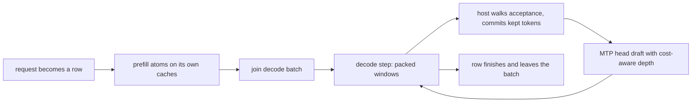

Round driver（`python/yunshu_engine/round_driver/`）是所有经由 `mlx-vlm` 载入的模型的服务路径。每个请求都是一个 row，driver 通过三种模型层服务这些 row：packed Qwen3.5 层（dense 与 MoE 的 Qwen3.5 系列模型）、packed Flash-Next 层（Qwen4），以及 generic 层（每个 row 直接使用模型自己的 upstream forward，默认不做草稿），供其他所有模型家族与 Apple Paravirtual Metal 使用。推测解码跑在 packed 层上：并行请求也能做草稿（MTP 链，或共享公平 32 节点验证预算的 DFlash2 草稿）。设置 `YUNSHU_VLM_DRAFT=off` 时，driver 仍服务所有请求，只是不做草稿；推测开启与关闭的输出逐 token 相同。本页是维护者参考；其他服务路径请见[架构](/docs/developers/architecture)。

## 它做什么

每个请求都是一个 **row**。row 先在自己的单 row 缓存上 prefill（每个 attention 层一个 `KVCache`、每个 GatedDeltaNet 层一个 `ArraysCache`、MTP head 一个 `KVCache`）。prompt 处理完后加入解码 batch（`round_driver/batch.py` 的 `DecodeBatch`），所有解码中的 row 共用 slot 缓冲区：

- 每个 attention 层的 K/V 放在 slot 缓冲区，每个 row 拥有一个 slot，容量以 512 个 key 为单位增长；
- GDN 状态与 conv 窗口是每层的 batch 数组（加入时拼接，结束时取出）；
- MTP head 的 KV 放在同类的 slot 缓冲区。

`RoundDriver`（`driver.py`）以**步（step）**推进各 row，每一步是一种 forward：

- **解码步**：每个解码中 row 的窗口（待处理 token 加上 `d >= 0` 个草稿），右侧补齐到最长窗口。norm、投影与 MLP 在 packed 的 row 上运行；attention 用一次 scatter 写入所有 row 的 key，再用一次 ragged-attention launch 读取（`kernels/ragged_attention.py`）；GDN 的 conv 与递归各是一次 batch launch（`kernels/gdn_rows.py`）。
- **Prefill 步**：等待中 prompt 的固定大小 **atom**（`vlm_engine.py` 中的 `ROUND_PREFILL_CHUNK`，512 token；Flash-Next 为 2048），从 prompt 起点对齐网格，在 prompt 的 checkpoint 与结尾处切开。有 row 在解码时一次一个 atom；没有 row 解码时可把连续的完整 atom 一起运行。

当有 row 在解码且有 prompt 在等待时，prefill 步与解码步一对一交替。每一步只做一种工作：在 Qwen3.8-27B 上，把解码 row 并入 prefill forward，并不比相同 chunk 大小下的交替运行更好（2026-09-29）。

图说：一个 row 从进入到结束的流程；解码步与其他 row 的 prefill 步交替进行。

### 路由

`VLMEngine._build_batch_runner` 在模型载入时选择模型层：

- **Apple Paravirtual Metal**：generic 层，不使用 APC，也不做推测。
- **Qwen3.5 系列或 Qwen4 模型**（`_SPEC_MODEL_TYPES`），且 packed 层支持其语言模型（`_round_driver_wanted`）：使用 packed Qwen3.5 层，Qwen4 则使用 Flash-Next 层。量化的 Qwen3.5 checkpoint 若 lane 运算自我测试失败，则改用 generic 层。
- **其他所有模型**：generic 层，每个 row 一次 upstream 调用，一般解码。只有请求带 `spec_decode: true`，或设置 `YUNSHU_NGRAM_DEFAULT=1` 开启 n-gram，generic row 才会做草稿。设置了草稿 LM（`YUNSHU_DRAFT_MODEL`）或 Gemma-4 assistant（`YUNSHU_GEMMA4_ASSISTANT`）时使用它们，否则使用 n-gram。

草稿另外选择（`spec_select.choose`）。`YUNSHU_VLM_DRAFT=off` 不做草稿；指定 DFlash 草稿模型目录或 `mtp` 则选用该路径；未设置时，若找到相符的 DFlash2 草稿模型就使用它，否则使用 checkpoint 的 MTP head。`YUNSHU_MTP=0` 会关闭 MTP head。

所有请求（文本或多媒体）都是同一个 driver 的 row。多媒体 prompt 携带自己的 prompt features（packed 层为 `VLMBatchRunner._media_request`，generic 层为 `_generic_request`）。row 只有在其 processor 允许时才会做草稿（见下文）。

## 为什么

Upstream `mlx-vlm` 的 `BatchGenerator` 一次只跑一个 prompt batch，推测 batch 不能接受新加入的 row，且 MTP drafter 状态只对应一个 batch。在 27B（M5 Max）上的测量：

- MMLU-Pro 300 b8（长推理，8 个并行）：Yunshu 139 tok/s（只在请求独自运行时做草稿）、TensorFold MTP parallel-8 159、Splash 223。
- 8 个并行 1K prompt：最后一个的 TTFT 约 10 秒（prefill 一次只处理一个请求）。

这些数字来自先前的原始共享 batch 路径，保留作为 driver 的设计动机。

Driver 是 Yunshu 自己的循环（参考 TensorFold 的 lane engine，MIT；见[上游追踪](/docs/developers/upstream-tracking)），让多个 row 能共用一次 forward、在任何一步加入，并仍产生与单独运行时相同的 token。早期原型测量显示，先前的原始路径在并行长推理负载下落后竞争对手；这个 driver 的最新跨引擎比较（Yunshu 0.1.7.dev0，2026-11-04 至 2026-11-08）见[性能基准](/docs/guides/benchmarks)，上文数字来自先前的原始路径。

## 保证

row 的运算不取决于哪些 row 共用该步、其他 row 验证多少草稿，或它自己是否做草稿。

- **投影**（所有目标线性层与 LM head）使用 lane matmul（`kernels/tensorfold/lane_qmm.py`，MIT）：1 到 128 个 row 时，每个 row 的位元只取决于权重形状而非 row 数；更宽的调用会切成 128-row 的片段（`kernels/lane_linear.py`）。
- **解码与验证 attention**（`T <= 8` 个 token）使用 ragged token-tile kernel：每个 token 的位元不取决于 `T` 或其他 row。
- **GDN** 以一次 launch 处理所有 row 的状态；只保留窗口一部分的 row 会从保存的中间状态继续（`DecodeBatch.commit`）。
- **Prefill** 遵循只由 prompt 决定的 atom 计划，因此重复的 prompt，或从网格上 checkpoint 还原的 row，会用与冷运行相同的 atom 做 prefill：APC 命中与未命中逐 token 相同。
- **贪婪 row**：打开与关闭推测的结果相同，单独运行的 row 与在任何 batch 或加入顺序下的同一个 row 结果也相同。**采样 row** 使用 `keyed_sampling.KeyedSampler`（种子与生成索引），所以索引 `g` 的 token 是该 row 的 logits、种子与 `g` 的纯函数。
- **generic 层**：每个解码中的 row 每轮对 upstream 做一次自己的调用，使用自己的缓存，所以一个 row 的输出不取决于其他 row：单独运行与并行运行相同，贪婪与 seeded 皆然。

在 packed 层上，草稿使用 checkpoint 的 MTP head（或选定时的 DFlash2 草稿模型），对每个可做草稿的 row 都适用。head 的 KV 每一步都会更新，所以任何 row 在任何一步都能开始做草稿。每个 row 的草稿深度来自 `round_driver/allocate.py`（TensorFold 的分配规则，MIT）：以 EMA 追踪每个深度的接受率，依边际期望 token 数贪婪地分配草稿，并选择每毫秒期望提交 token 数最大的分配，forward 成本是在运行中在线测量的。不使用以 row 数为准的门槛。

每个模型都使用 `APCManager` 前缀缓存，通过 `APCCoordinator`（checkpoint 策略），适用于所有没有 sliding-window 缓存的模型家族，以及 Gemma 4（其精确窗口快照）。条目以模型与 processor 的身份做盐值（`VLMBatchRunner._driver_extra_hash`），因此在一种身份下缓存的前缀，对另一种身份来说是冷的。

## 设置

| 设置 | 默认 | 效果 |
|---|---|---|
| `YUNSHU_KV_PRECISION` | `bf16` | `int8` 作用于 packed Qwen3.5 层的 row；Flash-Next 与 generic 层维持 bf16 |
| `YUNSHU_MTP` | `true` | 使用 checkpoint 的 MTP head 做草稿；`false` 会关闭该草稿 |
| `YUNSHU_VLM_DRAFT` | 未设置 | `off` 关闭草稿；指定草稿模型目录或 `mtp` 则选用该草稿（见路由） |

## 限制

- XTC 采样的 row 从不做草稿。含有可窗口化集合之外的 logits processor 的 row（纯 token mask 与 logit bias、repetition penalty、至多一个 frequency 或 presence penalty）每轮只解码一个 token。logprobs 的 row，以及受 invariant 工具调用或 response-format guide 约束的 row 会做草稿；其他约束的 row 每轮只解码一个 token，且从不做草稿。
- packed 层无法携带的 prompt feature 会在加入时抛出错误（`VLMBatchRunner._media_request`）。
- 待办：每个 row 每轮约 25 ms 的成本（草稿、验证、抽样）使四 row 的 seeded 解码仅与先前的共享 batch 持平。

## 如何验证

- `tests/unit/test_round_driver.py`（随机小型 Qwen3.5 上的贪婪不变性）、`tests/unit/test_round_driver_apc.py`（命中等于未命中）、`tests/unit/test_round_driver_routing.py`（模型层与草稿路由），以及 `tests/unit/test_round_driver_generic.py`（generic 层）。
- `scripts/research/sweep_round_driver.py` 在真实 checkpoint 上（单独、batch、错开加入与自回归的一致性），以及 `scripts/research/probe_span_bits.py`（不同 prefill 区段大小下隐藏状态与缓存相同）。这些需要 GPU 队列；见[验证](/docs/developers/verification)。
