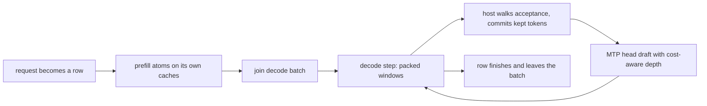

Round driver（`python/yunshu_engine/round_driver/`）是受 `YUNSHU_ROUND_DRIVER` 控制的**實驗性**服務路徑（預設關閉，在 `python/yunshu_engine/settings.py` 中登記為 experimental）。它的目的是讓 dense Qwen3.5 系列模型上的並行請求也能用 MTP 做草稿；預設的 VLM batch runner 只在請求獨自執行時才做草稿。本頁是維護者參考；預設服務路徑請見[架構](/docs/developers/architecture)。

## 它做什麼

每個請求都是一個 **row**。row 先在自己的單 row 快取上 prefill（每個 attention 層一個 `KVCache`、每個 GatedDeltaNet 層一個 `ArraysCache`、MTP head 一個 `KVCache`）。prompt 處理完後加入解碼 batch（`round_driver/batch.py` 的 `DecodeBatch`），所有解碼中的 row 共用 slot 緩衝區：

- 每個 attention 層的 K/V 放在 slot 緩衝區，每個 row 擁有一個 slot，容量以 512 個 key 為單位成長；
- GDN 狀態與 conv 視窗是每層的 batch 陣列（加入時串接，結束時取出）；
- MTP head 的 KV 放在同類的 slot 緩衝區。

`RoundDriver`（`driver.py`）以**步（step）**推進各 row，每一步是一種 forward：

- **解碼步**：每個解碼中 row 的視窗（待處理 token 加上 `d >= 0` 個草稿），右側補齊到最長視窗。norm、投影與 MLP 在 packed 的 row 上執行；attention 用一次 scatter 寫入所有 row 的 key，再用一次 ragged-attention launch 讀取（`kernels/ragged_attention.py`）；GDN 的 conv 與遞迴各是一次 batch launch（`kernels/gdn_rows.py`）。
- **Prefill 步**：等待中 prompt 的固定大小 **atom**（`YUNSHU_ROUND_PREFILL_CHUNK`，預設 512 token，從 prompt 起點對齊網格，在 prompt 的 checkpoint 與結尾處切開）。有 row 在解碼時一次一個 atom；沒有 row 解碼時可把連續的完整 atom 一起執行。

當有 row 在解碼且有 prompt 在等待時，prefill 步與解碼步一對一交替。每一步維持單一種類：在 Qwen3.8-27B 上，把解碼 row 併入 prefill forward，與相同 chunk 大小下交替執行相比沒有更好（2026-09-29）。

圖說：一個 row 從進入到結束的流程；解碼步與其他 row 的 prefill 步交替進行。

### 路由

只有在 `YUNSHU_ROUND_DRIVER` 開啟、語言模型是 dense Qwen3.5 系列解碼器（`round_driver.forward.supports`；含 MoE 層的不符合）、`YUNSHU_KV_PRECISION` 為 `bf16`，且 lane 運算自我測試通過時，`VLMEngine._round_driver_wanted` 才會啟用 driver；否則記錄警告並由 upstream runner 服務。在 runner 內（`VLMBatchRunner._driver_takes`），文字請求只有在至少 `DRIVER_MIN_CONCURRENCY`（2）個請求進行中、且未快取的 prompt 不超過 `DRIVER_MAX_UNCACHED_TOKENS`（12288）token 時才進入 driver。單獨的請求維持單請求推測 lane；很長的冷 prompt 維持 upstream 的 prefill。影像與音訊 prompt 留在 upstream 路徑。

## 為什麼

Upstream `mlx-vlm` 的 `BatchGenerator` 一次只跑一個 prompt batch，推測 batch 不能接受新加入的 row，且 MTP drafter 狀態只對應一個 batch。Driver 是 Yunshu 自己的迴圈（受 TensorFold 的 lane engine 啟發，MIT；見[上游追蹤](/docs/developers/upstream-tracking)），讓多個 row 能共用一次 forward、在任何一步加入，並仍產生與單獨執行時相同的 token。早期原型量測顯示，預設路徑在並行長推理負載下落後競爭對手；driver 目前沒有最新的跨引擎數字，原始筆記中的數字也不是發行版數據。維護中的比較請見[效能基準](/docs/guides/benchmarks)。

## 保證

row 的運算不取決於哪些 row 共用該步、其他 row 驗證多少草稿，或它自己是否做草稿。

- **投影**（所有目標線性層與 LM head）使用 lane matmul（`kernels/tensorfold/lane_qmm.py`，MIT）：1 到 128 個 row 時，每個 row 的位元只取決於權重形狀而非 row 數；更寬的呼叫會切成 128-row 的片段（`kernels/lane_linear.py`）。
- **解碼與驗證 attention**（`T <= 8` 個 token）使用 ragged token-tile kernel：每個 token 的位元不取決於 `T` 或其他 row。
- **GDN** 以一次 launch 處理所有 row 的狀態；只保留視窗一部分的 row 會從保存的中間狀態繼續（`DecodeBatch.commit`）。
- **Prefill** 遵循只由 prompt 決定的 atom 計畫，因此重複的 prompt，或從網格上 checkpoint 還原的 row，會用與冷執行相同的 atom 做 prefill：APC 命中與未命中逐 token 相同。
- **貪婪 row**：開啟推測等於關閉推測，且單獨執行的 row 等於在任何 batch 或加入順序下的同一個 row。**取樣 row** 使用 `keyed_sampling.KeyedSampler`（種子與生成索引），所以索引 `g` 的 token 是該 row 的 logits、種子與 `g` 的純函式。
- 帶有 logits processor（grammar 或 JSON、penalty）、logprobs 或 XTC 的 row 不做草稿。

草稿使用 checkpoint 的 MTP head，對每個可做草稿的 row 都適用。head 的 KV 每一步都會更新，所以任何 row 在任何一步都能開始做草稿。每個 row 的草稿深度來自 `round_driver/allocate.py`（TensorFold 的分配規則，MIT）：以 EMA 追蹤每個深度的接受率，依邊際期望 token 數貪婪地分配草稿，並選擇每毫秒期望提交 token 數最大的分配，forward 成本在線上量測。沒有以 row 數為準的門檻。

Driver 與預設 runner 共用 `APCManager` 前綴快取（透過 `APCCoordinator`，checkpoint 策略）。它的項目與 upstream runner 的項目鍵值分開，所以一條路徑快取的前綴對另一條路徑是冷的。

## 調整項目

| 設定 | 預設 | 作用 |
|---|---|---|
| `YUNSHU_ROUND_DRIVER` | `false`（experimental） | 以 round driver 取代 upstream 共用 batch 加單請求 lane，服務符合條件的文字請求 |
| `YUNSHU_ROUND_PREFILL_CHUNK` | `512`（最小 16） | 每個 prefill atom 的 prompt token 數；較小的值讓長 prompt 旁的解碼 row 持續執行，但 prefill 速度會下降。以不同 chunk 大小 prefill 的 prompt 各自一致，但彼此不保證位元相同 |
| `YUNSHU_KV_PRECISION` | `bf16` | 其他值會維持 upstream 路徑 |
| `YUNSHU_MTP` | `true` | 使用 checkpoint 的 MTP head 做草稿；與預設 runner 共用 |

## 限制

- 影像與音訊 prompt（mRoPE）、int8 KV 與 MoE 模型留在 upstream 路徑。
- Driver 尚未實作 DFlash 草稿與樹狀草稿。
- 在單請求貪婪解碼追上預設 lane、並通過登記表 `decide=` 欄位記錄的驗證清單之前，此旗標維持 experimental。若勝出，它會成為正式路徑，旗標、upstream 共用 batch 與推測 lane 會被刪除。

## 如何驗證

- `tests/unit/test_round_driver.py`（隨機小型 Qwen3.5 上的貪婪不變性）、`tests/unit/test_round_driver_apc.py`（命中等於未命中）與 `tests/unit/test_round_driver_routing.py`。
- `scripts/research/sweep_round_driver.py` 在真實 checkpoint 上（單獨、batch、錯開加入與自迴歸的一致性）、`scripts/research/probe_span_bits.py`（不同 prefill 區段大小下隱藏狀態與快取相同），以及完整開關比較用的 `scripts/research/validate_round_driver.sh`。這些需要 GPU 佇列；見[驗證](/docs/developers/verification)。
