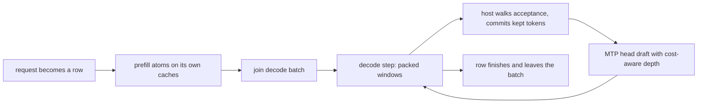

Round driver（`python/yunshu_engine/round_driver/`）是所有經由 `mlx-vlm` 載入的模型的服務路徑。每個請求都是一個 row，driver 透過三種模型層服務這些 row：packed Qwen3.5 層（dense 與 MoE 的 Qwen3.5 系列模型）、packed Flash-Next 層（Qwen4），以及 generic 層（每個 row 直接使用模型自己的 upstream forward，預設不做草稿），供其他所有模型家族與 Apple Paravirtual Metal 使用。推測解碼跑在 packed 層上：並行請求也能做草稿（MTP 鏈，或共用公平 32 節點驗證預算的 DFlash2 草稿）。設定 `YUNSHU_VLM_DRAFT=off` 時，driver 仍服務所有請求，只是不做草稿；推測開啟與關閉的輸出逐 token 相同。本頁是維護者參考；其他服務路徑請見[架構](/docs/developers/architecture)。

## 它做什麼

每個請求都是一個 **row**。row 先在自己的單 row 快取上 prefill（每個 attention 層一個 `KVCache`、每個 GatedDeltaNet 層一個 `ArraysCache`、MTP head 一個 `KVCache`）。prompt 處理完後加入解碼 batch（`round_driver/batch.py` 的 `DecodeBatch`），所有解碼中的 row 共用 slot 緩衝區：

- 每個 attention 層的 K/V 放在 slot 緩衝區，每個 row 擁有一個 slot，容量以 512 個 key 為單位增長；
- GDN 狀態與 conv 視窗是每層的 batch 陣列（加入時串接，結束時取出）；
- MTP head 的 KV 放在同類的 slot 緩衝區。

`RoundDriver`（`driver.py`）以**步（step）**推進各 row，每一步是一種 forward：

- **解碼步**：每個解碼中 row 的視窗（待處理 token 加上 `d >= 0` 個草稿），右側補齊到最長視窗。norm、投影與 MLP 在 packed 的 row 上執行；attention 用一次 scatter 寫入所有 row 的 key，再用一次 ragged-attention launch 讀取（`kernels/ragged_attention.py`）；GDN 的 conv 與遞迴各是一次 batch launch（`kernels/gdn_rows.py`）。
- **Prefill 步**：等待中 prompt 的固定大小 **atom**（`vlm_engine.py` 中的 `ROUND_PREFILL_CHUNK`，512 token；Flash-Next 為 2048），從 prompt 起點對齊網格，在 prompt 的 checkpoint 與結尾處切開。有 row 在解碼時一次一個 atom；沒有 row 解碼時可把連續的完整 atom 一起執行。

當有 row 在解碼且有 prompt 在等待時，prefill 步與解碼步一對一交替。每一步只做一種工作：在 Qwen3.8-27B 上，把解碼 row 併入 prefill forward，並不比相同 chunk 大小下的交替執行更好（2026-09-29）。

圖說：一個 row 從進入到結束的流程；解碼步與其他 row 的 prefill 步交替進行。

### 路由

`VLMEngine._build_batch_runner` 在模型載入時選擇模型層：

- **Apple Paravirtual Metal**：generic 層，不使用 APC，也不做推測。
- **Qwen3.5 系列或 Qwen4 模型**（`_SPEC_MODEL_TYPES`），且 packed 層支援其語言模型（`_round_driver_wanted`）：使用 packed Qwen3.5 層，Qwen4 則使用 Flash-Next 層。量化的 Qwen3.5 checkpoint 若 lane 運算自我測試失敗，則改用 generic 層。
- **其他所有模型**：generic 層，每個 row 一次 upstream 呼叫，一般解碼。只有請求帶 `spec_decode: true`，或設定 `YUNSHU_NGRAM_DEFAULT=1` 開啟 n-gram，generic row 才會做草稿。設定了草稿 LM（`YUNSHU_DRAFT_MODEL`）或 Gemma-4 assistant（`YUNSHU_GEMMA4_ASSISTANT`）時使用它們，否則使用 n-gram。

草稿另外選擇（`spec_select.choose`）。`YUNSHU_VLM_DRAFT=off` 不做草稿；指定 DFlash 草稿模型目錄或 `mtp` 則選用該路徑；未設定時，若找到相符的 DFlash2 草稿模型就使用它，否則使用 checkpoint 的 MTP head。`YUNSHU_MTP=0` 會關閉 MTP head。

所有請求（文字或多媒體）都是同一個 driver 的 row。多媒體 prompt 攜帶自己的 prompt features（packed 層為 `VLMBatchRunner._media_request`，generic 層為 `_generic_request`）。row 只有在其 processor 允許時才會做草稿（見下文）。

## 為什麼

Upstream `mlx-vlm` 的 `BatchGenerator` 一次只跑一個 prompt batch，推測 batch 不能接受新加入的 row，且 MTP drafter 狀態只對應一個 batch。在 27B（M5 Max）上的量測：

- MMLU-Pro 300 b8（長推理，8 個並行）：Yunshu 139 tok/s（只在請求獨自執行時做草稿）、TensorFold MTP parallel-8 159、Splash 223。
- 8 個並行 1K prompt：最後一個的 TTFT 約 10 秒（prefill 一次只處理一個請求）。

這些數字來自先前的原始共用 batch 路徑，保留作為 driver 的設計動機。

Driver 是 Yunshu 自己的迴圈（參考 TensorFold 的 lane engine，MIT；見[上游追蹤](/docs/developers/upstream-tracking)），讓多個 row 能共用一次 forward、在任何一步加入，並仍產生與單獨執行時相同的 token。早期原型量測顯示，先前的原始路徑在並行長推理負載下落後競爭對手；這個 driver 的最新跨引擎比較（Yunshu 0.1.7.dev0，2026-11-04 至 2026-11-08）見[效能基準](/docs/guides/benchmarks)，上文數字來自先前的原始路徑。

## 保證

row 的運算不取決於哪些 row 共用該步、其他 row 驗證多少草稿，或它自己是否做草稿。

- **投影**（所有目標線性層與 LM head）使用 lane matmul（`kernels/tensorfold/lane_qmm.py`，MIT）：1 到 128 個 row 時，每個 row 的位元只取決於權重形狀而非 row 數；更寬的呼叫會切成 128-row 的片段（`kernels/lane_linear.py`）。
- **解碼與驗證 attention**（`T <= 8` 個 token）使用 ragged token-tile kernel：每個 token 的位元不取決於 `T` 或其他 row。
- **GDN** 以一次 launch 處理所有 row 的狀態；只保留視窗一部分的 row 會從保存的中間狀態繼續（`DecodeBatch.commit`）。
- **Prefill** 遵循只由 prompt 決定的 atom 計畫，因此重複的 prompt，或從網格上 checkpoint 還原的 row，會用與冷執行相同的 atom 做 prefill：APC 命中與未命中逐 token 相同。
- **貪婪 row**：開啟與關閉推測的結果相同，單獨執行的 row 與在任何 batch 或加入順序下的同一個 row 結果也相同。**取樣 row** 使用 `keyed_sampling.KeyedSampler`（種子與生成索引），所以索引 `g` 的 token 是該 row 的 logits、種子與 `g` 的純函式。
- **generic 層**：每個解碼中的 row 每輪對 upstream 做一次自己的呼叫，使用自己的快取，所以一個 row 的輸出不取決於其他 row：單獨執行與並行執行相同，貪婪與 seeded 皆然。

在 packed 層上，草稿使用 checkpoint 的 MTP head（或選定時的 DFlash2 草稿模型），對每個可做草稿的 row 都適用。head 的 KV 每一步都會更新，所以任何 row 在任何一步都能開始做草稿。每個 row 的草稿深度來自 `round_driver/allocate.py`（TensorFold 的分配規則，MIT）：以 EMA 追蹤每個深度的接受率，依邊際期望 token 數貪婪地分配草稿，並選擇每毫秒期望提交 token 數最大的分配，forward 成本是在執行中線上量測的。不使用以 row 數為準的門檻。

每個模型都使用 `APCManager` 前綴快取，透過 `APCCoordinator`（checkpoint 策略），適用於所有沒有 sliding-window 快取的模型家族。項目以模型與 processor 的身分做鹽值（`VLMBatchRunner._driver_extra_hash`），因此在一種身分下快取的前綴，對另一種身分來說是冷的。

## 設定

| 設定 | 預設 | 效果 |
|---|---|---|
| `YUNSHU_KV_PRECISION` | `bf16` | `int8` 作用於 packed Qwen3.5 層的 row；Flash-Next 與 generic 層維持 bf16 |
| `YUNSHU_MTP` | `true` | 使用 checkpoint 的 MTP head 做草稿；`false` 會關閉該草稿 |
| `YUNSHU_VLM_DRAFT` | 未設定 | `off` 關閉草稿；指定草稿模型目錄或 `mtp` 則選用該草稿（見路由） |

## 限制

- XTC 取樣的 row 從不做草稿。含有可視窗化集合之外的 logits processor 的 row（純 token mask 與 logit bias、repetition penalty、至多一個 frequency 或 presence penalty）每輪只解碼一個 token。logprobs 的 row，以及受 invariant 工具呼叫或 response-format guide 約束的 row 會做草稿；其他約束的 row 每輪只解碼一個 token，且從不做草稿。
- packed 層無法攜帶的 prompt feature 會在加入時拋出錯誤（`VLMBatchRunner._media_request`）。
- 待辦：每個 row 每輪約 25 ms 的成本（草稿、驗證、抽樣）使四 row 的 seeded 解碼僅與先前的共用 batch 持平。

## 如何驗證

- `tests/unit/test_round_driver.py`（隨機小型 Qwen3.5 上的貪婪不變性）、`tests/unit/test_round_driver_apc.py`（命中等於未命中）、`tests/unit/test_round_driver_routing.py`（模型層與草稿路由），以及 `tests/unit/test_round_driver_generic.py`（generic 層）。
- `scripts/research/sweep_round_driver.py` 在真實 checkpoint 上（單獨、batch、錯開加入與自迴歸的一致性），以及 `scripts/research/probe_span_bits.py`（不同 prefill 區段大小下隱藏狀態與快取相同）。這些需要 GPU 佇列；見[驗證](/docs/developers/verification)。
