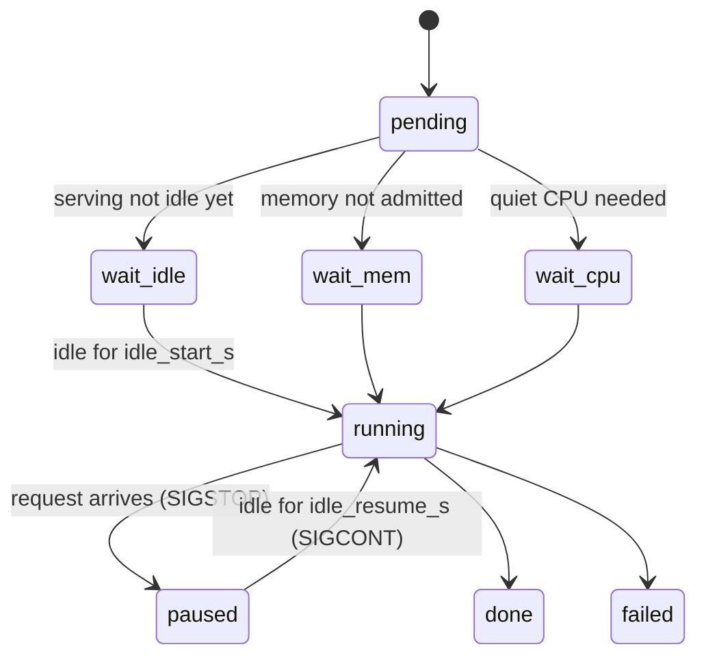

The GPU queue (`scripts/dev/gpuq`) supports running a production Yunshu server for real users while development GPU jobs (benchmarks, evals) use the same machine. The queue is aware of the production server: development jobs run only while it is idle and are frozen the instant user traffic arrives. This page is for maintainers; it describes the queue and the engine-side hooks it relies on.

## What it does

Jobs are separate processes submitted to a queue daemon. Each job moves through states the daemon reports in `gpuq status`:

Caption: the life of a gated job, from waiting for an idle server to finishing, with the pause path taken when user traffic arrives.



| Piece | Behavior |
|---|---|
| Poller | The daemon GETs `/v1/yunshu/status` of each configured server every `poll_s` and reads only `requests.active` and `requests.queued`. No prompts, no request items |
| Start gate | A job starts only after every server has been idle (no active, no queued) for `idle_start_s` |
| Preemption | When a request appears, `SIGSTOP` goes to the job's own process group (the queue starts each job in its own session; nothing else is ever signalled, never the server) |
| Resume | `SIGCONT` after the servers have been idle for `idle_resume_s` |
| Pause record | Each interval is stored in the job JSON (`pauses: [[t0, t1], ...]`, wall clock) and in the file named by `$GPUQ_PAUSE_FILE` |
| Timeouts | `--timeout` and `--stall` count active time only; paused time is excluded |
| Memory admission | A job declares `--mem-gb` (0 with `--serving-ok`). It starts only if free memory minus `mem_gb` leaves `reserve_gb` |
| Bypass | `--serving-ok` skips the idle gate and serving pauses (CPU-only jobs). Priority preemption still applies |
| Priority preemption | Pending priority 0 or higher work can `SIGSTOP` a running priority -1 or lower job when memory admits both resident jobs; no job is killed to reclaim memory |
| Status | `gpuq status` shows `wait-idle`, `wait-mem`, `wait-cpu`, `paused` and a `pauses=N` count; an `idle:` line explains why pending jobs have no active runner |

## Why (design decision)

- A production server must never be slowed by a benchmark, and a benchmark must never silently measure user traffic. The queue therefore pauses the job, not the server, and records the pause.
- The poll reads counters only, so no user content ever reaches the queue.
- It fails closed: an unreachable server (connection refused) counts as idle, but a timeout, a 5xx or an unparsable answer counts as busy.

## Guarantees

- Without configured server URLs or an explicit reserve there is no serving gate, serial memory admission and no serving pause.
- Priority preemption still checks memory: measured available memory minus the new job's `mem_gb` must leave `reserve_gb`. Unknown memory prevents preemption, and a blocked high-priority job is shown as `wait-mem`.
- An active label (pending, running or paused) is exclusive; the same label cannot be submitted twice concurrently. Submission never deletes earlier logs, pause records, return codes or output files.

### Measurement integrity

A benchmark number that includes paused time measures the user's traffic, not the engine, so harnesses must never report such a sample.

- `scripts/dev/gpuq_pause.py` (standard library only) provides `was_paused(t0, t1)`, `timed(fn)` and `pause_intervals()`. `timed` discards and re-runs a sample that overlapped a pause and raises `PausedSampleError` after repeated overlaps. It fails closed: an unreadable `$GPUQ_PAUSE_FILE` means paused; outside gpuq the variable is unset and nothing is ever paused.
- It is wired into `scripts/research/agentic/replay_traffic.py`, `scripts/research/bench_engine_matrix.py` and the release gate's `cancel_then_next` wall-time check. New benchmark scripts must wrap each timed sample in `timed(...)`. Accuracy evals need nothing: a pause only makes them slower.
- Preemption lands within one poll interval of the first request, so a sample can briefly share the GPU before the stop. Keep `poll_s` small. For the handshake that closes this window, see below.

### Foreign-CPU and memory contamination

Every started job records `cpu_samples` (`load_1m`, `load_5m`, `foreign_cpu_pct` and the largest foreign processes) at start, periodically and at the end. Foreign CPU includes all processes except the job's own tree and background processes with `nice` of 10 or more. A job is latched `contended` when the threshold is reached or sampling fails.

- Jobs submitted with `--quiet` wait for a quiet CPU before starting (`--quiet-window`, `--quiet-max-wait`; environment defaults `GPUQ_CPU_THRESHOLD`, `GPUQ_QUIET_WINDOW_S`, `GPUQ_QUIET_MAX_WAIT_S`, `GPUQ_CPU_SAMPLE_S`). The hold is bounded by the smaller of the job's max wait and `GPUQ_QUIET_HOLD_MAX_S` (daemon environment, default 300 seconds); on expiry the job starts flagged `quiet_timeout` and `contended`. Serving and memory admission still apply, and `--serving-ok` does not bypass the CPU gate.
- A memory contention rule rejects a job when its process tree has too much compressed or swapped memory (`GPUQ_SWAP_MB`), host swap-ins during the job are too large (`GPUQ_HOST_SWAP_MB`), or host free plus inactive memory falls below a floor (`GPUQ_MEMORY_FLOOR_MB`). Unreadable evidence fails closed. The job JSON records `host_swap_mb`, `job_swap_mb`, `available_min_mb`, `memory_processes` and `memory_policy_version`.
- `gpuq wait` returns 3 for an otherwise successful contended perf or quiet job. `scripts/dev/gpuq_contention.py:was_contended()` lets harnesses read the flag; the release gate retries a contended server-path comparison once after a bounded quiet wait, and two contended attempts are reported as contended (gate exit 3) while text or speculative-decoding mismatches stay failures.
- CPU-only test suites and builds run under `nice -n 15` so they are excluded from foreign-CPU monitoring. Do not add `taskpolicy -b` to unit tests: efficiency-core scheduling can break timing-sensitive checks.

## Knobs

Serving gate configuration lives either in daemon environment variables or in `$GPUQ_DIR/serving.json`, which is re-read every loop so it can be edited live:

```json
{"urls": ["http://127.0.0.1:8000"], "idle_start_s": 120, "idle_resume_s": 30,
 "poll_s": 1, "reserve_gb": 16, "api_key": "optional bearer if the server needs one"}
```

| Setting | Default | Effect |
|---|---|---|
| `GPUQ_SERVING_URLS` (`urls`) | none | Comma-separated servers to poll; none means no serving gate |
| `GPUQ_IDLE_START_S` (`idle_start_s`) | 120 | Idle time before a job may start |
| `GPUQ_IDLE_RESUME_S` (`idle_resume_s`) | 30 | Idle time before a paused job resumes |
| `GPUQ_SERVING_POLL_S` (`poll_s`) | 1 | Poll interval in seconds |
| `GPUQ_RESERVE_GB` (`reserve_gb`) | 16 | Memory kept free after admitting a job |
| `GPUQ_SERVING_KEY` (`api_key`) | none | Bearer token if the server needs one |
| `GPUQ_SHORT_MIN`, `GPUQ_SHORT_WAIT_S`, `GPUQ_SHORT_SHARE` | 10 min, 5 min, 0.15 | Short-job lane limits |
| `GPUQ_FILLER_WAIT_S`, `GPUQ_FILLER_MAX_MIN` | 30 s, 30 min | Filler-job limits for a CPU-quiet-blocked head |
| `YUNSHU_SERVE_LOG` | off | Numbers-only event log (timings, token counts, cache tier, speculative acceptance, concurrency, arm, build); never prompts, outputs or token ids. `YUNSHU_SERVE_LOG_DIR`, `YUNSHU_SERVE_LOG_MAX_MB` and `YUNSHU_SERVE_LOG_KEEP` control location and rotation |
| `YUNSHU_RESEARCH_ACTIVITY_FILE` | unset | Local pause handshake file; also configure it as `activity_files` in `serving.json` |
| `YUNSHU_RESEARCH_PAUSE_TIMEOUT_S` | 2.0 | Longest pre-admission wait for gpuq's acknowledgement; a timeout returns 503 |
| `YUNSHU_ARM` | unset | Labels a manually chosen configuration in the log without changing behavior |

The server reports cumulative GPU-busy seconds in `/v1/yunshu/status` and `yunshu_gpu_busy_seconds_total` in `/metrics`. These are busy-time counters, not hardware utilization samples.

### Co-serving handshake

With `YUNSHU_RESEARCH_ACTIVITY_FILE` set, the server writes a numbers-only activity file and, before inference, waits up to `YUNSHU_RESEARCH_PAUSE_TIMEOUT_S` for gpuq's fresh acknowledgement that every research process is observed stopped. This closes the poll-interval window in which the first request could share the GPU with a timing sample.

### Submitting jobs

```bash
scripts/dev/gpuq submit --label eval --mem-gb 30 -- python bench.py      # gated, preemptible
scripts/dev/gpuq submit --label lint --serving-ok -- python cpu_job.py   # bypasses the gate
scripts/dev/gpuq submit --label x-smoke --timeout 5 -- python smoke.py   # short lane
scripts/dev/gpuq submit --quiet --priority -1 --quiet-window 20 \
  --quiet-max-wait 300 --label cpu-quiet-unique -- python bench.py
scripts/dev/gpuq submit --label eval-unique --out results/a.jsonl --expect-complete -- python sweep.py
scripts/dev/gpuq wait --max-seconds 45 JOB_ID OTHER_JOB_ID
scripts/dev/gpuq digest --label-prefix eval- --since 6h
```

- Queue-level `--out` arguments go before the `--` separator. `--expect-complete` requires every output to be a nonempty file containing a line with the literal `complete`.
- `wait` uses one deadline for the whole id list and prints one line per job. Exit 0: every job is done with rc 0 and verified outputs. Exit 1: a job failed, was cancelled, is missing or has invalid outputs. Exit 2: some jobs are still pending or running at the deadline (takes precedence over failures in finished peers). Exit 3: a successful but contended perf or quiet job.
- `gpuq digest` (`scripts/dev/gpuq_digest.py`) lists jobs finished since the last digest, grouped by label family, and exits 1 on any job that ended `failed`, `lost`, `stalled`, `timeout` or `cancelled`, has an absent or nonzero rc, or has missing or empty outputs. `--peek` leaves the marker (`$GPUQ_DIR/.digest_marker`) untouched, `--since` never moves it, and a label-filtered digest never moves the global marker. The coordinator runs it at every check-in and acts on every flagged line.
- Short-job lane: a job with `--timeout` of at most 10 minutes, or submitted with `--short`, may run ahead of a long job after waiting 5 minutes, within a rolling share of long-job time and never twice in a row. A short job that exceeds its timeout is killed and marked `timeout`.
- Priorities are non-positive for dev work; `--gate` admits a gate ahead of the same priority's backlog. Timing cells require quiet admission; correctness cells do not.

### Reloading the daemon

The daemon keeps its Python code loaded at startup. After a queue change merges, hold new submissions and restart the daemon at a job boundary; running and paused jobs are adopted on restart. Terminate only the process holding `daemon.lock` (by PID, never a process group) and start the replacement with `/usr/bin/python3`:

```bash
export GPUQ_DIR=/Volumes/P5Plus/yunshu-gpuq
scripts/dev/gpuq status
GPUQ_DAEMON_PID="$(lsof -t "$GPUQ_DIR/daemon.lock")"
ps -p "$GPUQ_DAEMON_PID" -o pid=,command=   # must be gpuq.py _daemon
kill -TERM "$GPUQ_DAEMON_PID"
while kill -0 "$GPUQ_DAEMON_PID" 2>/dev/null; do sleep 1; done
nohup /usr/bin/python3 scripts/dev/gpuq.py _daemon >> "$GPUQ_DIR/daemon.log" 2>&1 < /dev/null &
scripts/dev/gpuq status
```

Only the queue owner does this; workers never restart the live daemon during a measurement.

### Optional M3 correctness lane

`gpuq submit --device m5|m3|any` keeps `m5` as the default. One daemon runs a local M5 slot and a remote M3 slot concurrently; `any` is reserved once by whichever slot admits it first. Local serving, quiet admission and priority preemption apply to the M5 slot, and `--quiet` is rejected with `m3` and `any`, because timing belongs on the M5. Configure `M3_HOST`, `M3_KEY` and `M3_REPO` as for `scripts/dev/m3run`; all worktrees, outputs, models, caches and temporary files stay inside that checkout, because the M3 is a personal laptop. The laptop admits declared memory up to a fixed limit that reserves capacity for its user, so declare a realistic peak.

The remote snapshot is HEAD plus tracked edits in a detached worktree. Declared outputs return to their original paths even when the command fails. SSH or transfer failure is a failed job, never a successful receipt; if remote cleanup cannot be confirmed, `m3-quarantine.json` blocks further M3 dispatch until a person inspects it. M3 digest entries are labelled portability evidence (not M5), and mixed-device accuracy or parity arms and M3 performance verdicts are refused by the research analysis helpers. An M3 failure needs M5 reproduction before it rejects an M5 optimization; an M3 pass never approves an M5 hot-path default.

## Limits

The engine-side pieces described above are implemented. The offline scripts in `scripts/servedev/` are `replay.py` (shape-only replay A/B, token-identical or fail), `bandit.py` (a UCB1 bandit over registered lossless knobs with a reversible ledger) and `loop.py` (a gated candidate loop); none of them selects an arm on live traffic. Offline switchback, CUPED and mSPRT helpers and run-history variance profiling exist; no online arm selection is enabled.

Planned and not implemented:

- online lossless A/B on live traffic, recording metrics only (no prompts);
- bandit auto-tuning of lossless knobs against those metrics;
- a gated autonomous improvement loop that proposes, measures and lands changes only through the existing gates.

Always-on 27B serving next to development remains gated on long-context parity across cold, warm and follow-up TTFT, decode, concurrency and memory. The queue mechanisms are implemented; that does not claim the performance gate has passed. Point sampling cannot observe every short-lived process between polls, and no tokens-per-second or TTFT improvement is implied by the queue.

## How to verify

```bash
scripts/dev/gpuq status          # states, pauses, idle explanation
scripts/dev/gpuq digest --peek   # finished jobs, flagged failures
```

Queue behavior is covered by the gpuq tests under `tests/unit`; test queue changes across priorities in an isolated queue before the live daemon restarts. A benchmark script is correct only if it wraps each timed sample in `timed(...)` from `scripts/dev/gpuq_pause.py`. See also [Verification](/docs/developers/verification), [Release readiness](/docs/developers/release-readiness) and [Agentic coding benchmark](/docs/developers/agentic-bench).

## Related

- [Verification](/docs/developers/verification)
- [Hardware validation](/docs/developers/hardware-validation)
- [Telemetry](/docs/guides/telemetry)
