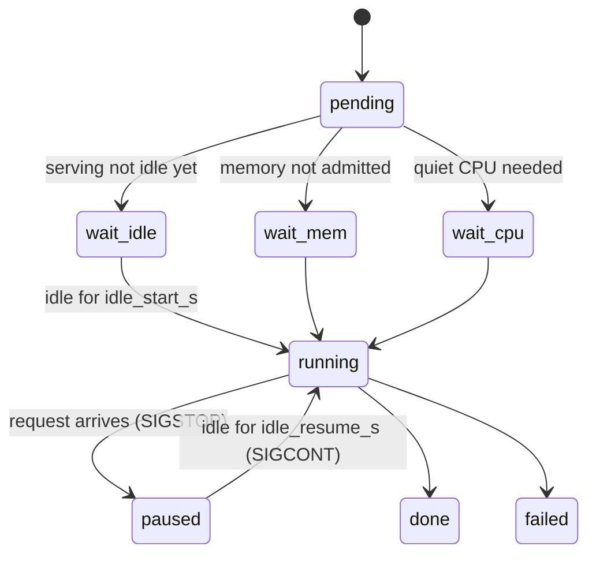

GPU 队列（`scripts/dev/gpuq`）支持在同一台机器上，一边为真实用户运行正式的 Yunshu 服务器，一边让开发用的 GPU 作业（基准测试、评测）使用它。队列能感知正式服务器：开发作业只在服务器空闲时运行，用户流量一到就立刻冻结。本页写给维护者；它说明队列，以及队列所依赖的引擎端钩子。

## 它做什么

作业是提交给队列守护进程的独立进程。每个作业会经过守护进程在 `gpuq status` 中报告的各个状态：

说明：一个受门控的作业从等待服务器空闲到完成的过程，以及用户流量到达时走的暂停路径。



| 组件 | 行为 |
|---|---|
| 轮询器 | 守护进程每隔 `poll_s` 对每个已配置服务器的 `/v1/yunshu/status` 发出 GET，只读取 `requests.active` 与 `requests.queued`。不含提示词，也不含请求条目 |
| 启动门控 | 只有在每个服务器都已空闲（没有运行中、没有排队）达 `idle_start_s` 之后，作业才会启动 |
| 抢占 | 请求出现时，`SIGSTOP` 发给该作业自己的进程组（队列让每个作业在自己的 session 中启动；绝不对其他东西发送信号，更不会发给服务器） |
| 恢复 | 服务器空闲达 `idle_resume_s` 之后发出 `SIGCONT` |
| 暂停记录 | 每段区间都存在作业 JSON 中（`pauses: [[t0, t1], ...]`，墙上时钟），也写入 `$GPUQ_PAUSE_FILE` 指定的文件 |
| 超时 | `--timeout` 与 `--stall` 只计算活动时间；暂停的时间不算 |
| 内存准入 | 作业声明 `--mem-gb`（搭配 `--serving-ok` 时为 0）。只有可用内存减去 `mem_gb` 后仍保留 `reserve_gb`，才会启动 |
| 绕过 | `--serving-ok` 跳过空闲门控与服务暂停（用于仅 CPU 的作业）。优先级抢占仍然适用 |
| 优先级抢占 | 优先级 0 或更高的待处理作业，在内存容得下两个常驻作业时，可以对运行中、优先级 -1 或更低的作业发出 `SIGSTOP`；不会为了回收内存而杀掉任何作业 |
| 状态 | `gpuq status` 显示 `wait-idle`、`wait-mem`、`wait-cpu`、`paused` 与 `pauses=N` 计数；`idle:` 一行说明为什么待处理作业没有任何运行中的作业 |

## 为什么这样设计

- 正式服务器绝不能被基准测试拖慢，基准测试也绝不能悄悄地测到用户流量。因此队列暂停的是作业而不是服务器，并记录这次暂停。
- 轮询只读计数器，所以任何用户内容都不会到达队列。
- 它以失败关闭为原则：无法连接的服务器（连接被拒）视为空闲，但超时、5xx 或无法解析的响应视为忙碌。

## 保证

- 没有配置服务器 URL 或明确的保留量时，就没有服务门控，内存准入为串行，也没有服务暂停。
- 优先级抢占仍会检查内存：实测可用内存减去新作业的 `mem_gb` 后，必须保留 `reserve_gb`。内存未知就不能抢占，被挡住的高优先级作业会显示为 `wait-mem`。
- 活动中的标签（待处理、运行中或已暂停）是独占的；同一个标签不能同时提交两次。提交绝不会删除先前的日志、暂停记录、返回码或输出文件。

### 测量完整性

包含暂停时间的基准测试数字，测到的是用户的流量，不是引擎，所以测试工具绝不能报告这样的样本。

- `scripts/dev/gpuq_pause.py`（仅用标准库）提供 `was_paused(t0, t1)`、`timed(fn)` 与 `pause_intervals()`。`timed` 会丢弃并重跑与暂停重叠的样本，重复重叠后抛出 `PausedSampleError`。它以失败关闭为原则：无法读取的 `$GPUQ_PAUSE_FILE` 视为已暂停；在 gpuq 之外，该变量未设置，也绝不会暂停。
- 已接入 `scripts/research/agentic/replay_traffic.py`、`scripts/research/bench_engine_matrix.py`，以及发布关卡的 `cancel_then_next` 墙钟时间检查。新的基准测试脚本必须把每个计时样本包在 `timed(...)` 中。准确度评测不需要：暂停只会让它们变慢。
- 抢占会在第一个请求之后的一个轮询间隔内生效，所以样本可能在停止之前短暂与请求共用 GPU。请让 `poll_s` 保持很小。关闭这个空窗的握手机制见下文。

### 外部 CPU 与内存污染

每个已启动的作业都会在开始时、定期，以及结束时记录 `cpu_samples`（`load_1m`、`load_5m`、`foreign_cpu_pct` 与最大的外部进程）。外部 CPU 包含除了该作业自己的进程树，以及 `nice` 为 10 或以上的后台进程之外的所有进程。达到阈值或采样失败时，作业会被标记为 `contended`。

- 以 `--quiet` 提交的作业会在启动前等待 CPU 安静（`--quiet-window`、`--quiet-max-wait`；环境变量默认值 `GPUQ_CPU_THRESHOLD`、`GPUQ_QUIET_WINDOW_S`、`GPUQ_QUIET_MAX_WAIT_S`、`GPUQ_CPU_SAMPLE_S`）。等待时间以该作业的最长等待与 `GPUQ_QUIET_HOLD_MAX_S`（守护进程环境变量，默认 300 秒）中较小者为限；到期时作业会启动并标记为 `quiet_timeout` 与 `contended`。服务与内存准入仍然适用，`--serving-ok` 不会绕过 CPU 门控。
- 内存污染规则会在以下情况拒绝作业：其进程树的压缩或交换内存太多（`GPUQ_SWAP_MB`）、作业期间主机的 swap-in 太大（`GPUQ_HOST_SWAP_MB`），或主机的空闲加非活跃内存低于下限（`GPUQ_MEMORY_FLOOR_MB`）。无法读取的证据以失败关闭处理。作业 JSON 会记录 `host_swap_mb`、`job_swap_mb`、`available_min_mb`、`memory_processes` 与 `memory_policy_version`。
- 对于其他方面成功、但受污染的性能或安静作业，`gpuq wait` 返回 3。`scripts/dev/gpuq_contention.py:was_contended()` 让测试工具读取该标志；发布关卡在有限的安静等待之后，会把受污染的服务器路径比较重试一次，两次都受污染就报告为 contended（关卡退出码 3），而文本或推测解码的输出不一致仍然算失败。
- 仅 CPU 的测试套件与构建在 `nice -n 15` 下运行，所以不计入外部 CPU 监控。请不要在单元测试中加入 `taskpolicy -b`：能效核心调度可能破坏对时间敏感的检查。

## 设置

服务门控的配置存在于守护进程环境变量，或 `$GPUQ_DIR/serving.json`；后者每个循环都会重新读取，所以可以实时编辑：

```json
{"urls": ["http://127.0.0.1:8000"], "idle_start_s": 120, "idle_resume_s": 30,
 "poll_s": 1, "reserve_gb": 16, "api_key": "optional bearer if the server needs one"}
```

| 设置 | 默认值 | 效果 |
|---|---|---|
| `GPUQ_SERVING_URLS`（`urls`） | none | 要轮询的服务器，以逗号分隔；没有设置表示没有服务门控 |
| `GPUQ_IDLE_START_S`（`idle_start_s`） | 120 | 作业可以启动之前所需的空闲时间 |
| `GPUQ_IDLE_RESUME_S`（`idle_resume_s`） | 30 | 已暂停的作业恢复之前所需的空闲时间 |
| `GPUQ_SERVING_POLL_S`（`poll_s`） | 1 | 轮询间隔（秒） |
| `GPUQ_RESERVE_GB`（`reserve_gb`） | 16 | 准入作业后保持空闲的内存 |
| `GPUQ_SERVING_KEY`（`api_key`） | none | 服务器需要时使用的 Bearer token |
| `GPUQ_SHORT_MIN`、`GPUQ_SHORT_WAIT_S`、`GPUQ_SHORT_SHARE` | 10 min、5 min、0.15 | 短作业通道的限制 |
| `GPUQ_FILLER_WAIT_S`、`GPUQ_FILLER_MAX_MIN` | 30 s、30 min | 队列头部被 CPU 安静条件挡住时，填补作业的限制 |
| `YUNSHU_SERVE_LOG` | off | 仅含数字的事件日志（耗时、token 数、缓存层、推测解码接受率、并发度、arm、build）；绝不含提示词、输出或 token id。`YUNSHU_SERVE_LOG_DIR`、`YUNSHU_SERVE_LOG_MAX_MB` 与 `YUNSHU_SERVE_LOG_KEEP` 控制位置与轮转 |
| `YUNSHU_RESEARCH_ACTIVITY_FILE` | unset | 本机暂停握手文件；也要在 `serving.json` 中将它设为 `activity_files` |
| `YUNSHU_RESEARCH_PAUSE_TIMEOUT_S` | 2.0 | 准入前等待 gpuq 确认的最长时间；超时返回 503 |
| `YUNSHU_ARM` | unset | 在日志中标记手动选择的配置，不改变行为 |

服务器在 `/v1/yunshu/status` 中报告累计的 GPU 忙碌秒数，在 `/metrics` 中报告 `yunshu_gpu_busy_seconds_total`。这些是忙碌时间计数器，不是硬件利用率的采样。

### 共同服务握手

设置 `YUNSHU_RESEARCH_ACTIVITY_FILE` 后，服务器会写出一个仅含数字的活动文件，并在推理之前，最多等待 `YUNSHU_RESEARCH_PAUSE_TIMEOUT_S`，等 gpuq 给出新的确认，表示每个研究进程都已被观察到停止。这关闭了轮询间隔造成的空窗，否则第一个请求可能与计时样本共用 GPU。

### 提交作业

```bash
scripts/dev/gpuq submit --label eval --mem-gb 30 -- python bench.py      # gated, preemptible
scripts/dev/gpuq submit --label lint --serving-ok -- python cpu_job.py   # bypasses the gate
scripts/dev/gpuq submit --label x-smoke --timeout 5 -- python smoke.py   # short lane
scripts/dev/gpuq submit --quiet --priority -1 --quiet-window 20 \
  --quiet-max-wait 300 --label cpu-quiet-unique -- python bench.py
scripts/dev/gpuq submit --label eval-unique --out results/a.jsonl --expect-complete -- python sweep.py
scripts/dev/gpuq wait --max-seconds 45 JOB_ID OTHER_JOB_ID
scripts/dev/gpuq digest --label-prefix eval- --since 6h
```

- 队列级别的 `--out` 参数放在 `--` 分隔符之前。`--expect-complete` 要求每个输出都是非空文件，且其中有一行是字面值 `complete`。
- `wait` 对整个 id 列表使用同一个期限，并且每个作业打印一行。退出码 0：每个作业都已完成且 rc 为 0，输出经过验证。退出码 1：有作业失败、被取消、不存在，或输出无效。退出码 2：期限到时仍有作业处于待处理或运行中（优先于已结束同伴的失败）。退出码 3：成功但受污染的性能或安静作业。
- `gpuq digest`（`scripts/dev/gpuq_digest.py`）列出自上次摘要以来结束的作业，按标签家族分组；只要有任何作业以 `failed`、`lost`、`stalled`、`timeout` 或 `cancelled` 结束、rc 缺失或不为零，或输出缺失或为空，就以 1 退出。`--peek` 不动标记（`$GPUQ_DIR/.digest_marker`），`--since` 绝不移动它，带标签过滤的摘要也绝不移动全局标记。协调者在每次检查时运行它，并处理每一行被标示的项目。
- 短作业通道：`--timeout` 不超过 10 分钟，或以 `--short` 提交的作业，在等待 5 分钟之后，可以排在长作业之前运行，但受长作业时间滚动占比的限制，且不会连续两次。超过超时的短作业会被杀掉并标记为 `timeout`。
- 开发作业的优先级为非正数；`--gate` 让一个关卡排在同优先级待办事项之前。计时格需要安静准入；正确性格不需要。

### 重新加载守护进程

守护进程在启动时加载它的 Python 代码。队列变更合并之后，请暂停接受新的提交，并在作业边界重新启动守护进程；运行中与已暂停的作业会在重启时被接管。只终止持有 `daemon.lock` 的进程（以 PID，绝不用进程组），并用 `/usr/bin/python3` 启动替代者：

```bash
export GPUQ_DIR=/Volumes/P5Plus/yunshu-gpuq
scripts/dev/gpuq status
GPUQ_DAEMON_PID="$(lsof -t "$GPUQ_DIR/daemon.lock")"
ps -p "$GPUQ_DAEMON_PID" -o pid=,command=   # must be gpuq.py _daemon
kill -TERM "$GPUQ_DAEMON_PID"
while kill -0 "$GPUQ_DAEMON_PID" 2>/dev/null; do sleep 1; done
nohup /usr/bin/python3 scripts/dev/gpuq.py _daemon >> "$GPUQ_DIR/daemon.log" 2>&1 < /dev/null &
scripts/dev/gpuq status
```

只有队列所有者做这件事；worker 绝不在测量期间重新启动正在运行的守护进程。

### 可选的 M3 正确性通道

`gpuq submit --device m5|m3|any` 默认为 `m5`。一个守护进程同时运行本机 M5 槽位与远程 M3 槽位；`any` 由先准入它的槽位保留一次。本机服务、安静准入与优先级抢占都适用于 M5 槽位，而 `--quiet` 与 `m3`、`any` 并用时会被拒绝，因为计时属于 M5。`M3_HOST`、`M3_KEY` 与 `M3_REPO` 的配置方式与 `scripts/dev/m3run` 相同；所有 worktree、输出、模型、缓存与临时文件都留在那个 checkout 内，因为 M3 是一台个人笔记本。笔记本只会在固定上限内准入声明的内存，该上限为用户保留了容量，所以请声明实际的峰值。

远程快照是 HEAD 加上已跟踪的修改，位于一个 detached worktree。即使命令失败，声明的输出也会回到原本的路径。SSH 或传输失败就是失败的作业，绝不是成功的收据；如果无法确认远程清理，`m3-quarantine.json` 会阻挡后续的 M3 派发，直到有人检查。M3 摘要条目标示为可移植性证据（不是 M5），混合设备的准确度或一致性 arm 与 M3 性能结论，会被研究分析辅助工具拒绝。M3 上的失败必须在 M5 复现后，才能否决 M5 的优化；M3 通过绝不会批准 M5 热路径的默认值。

## 限制

上述的引擎端组件都已实现。`scripts/servedev/` 中的离线脚本有 `replay.py`（仅形状的重放 A/B，token 相同否则失败）、`bandit.py`（对已注册的无损可调参数进行 UCB1 bandit，带有可逆的账本）以及 `loop.py`（有门控的候选循环）；没有任何一个会根据实时流量选择 arm。离线的 switchback、CUPED 与 mSPRT 辅助工具，以及运行历史的方差剖析都已存在；没有启用任何在线 arm 选择。

已规划但尚未实现：

- 在实时流量上进行在线无损 A/B，只记录指标（不含提示词）；
- 依据这些指标，对无损可调参数进行 bandit 自动调优；
- 有门控的自主改进循环，只通过现有的关卡来提出、测量并落地变更。

要在开发的同时常驻提供 27B 服务，仍须先在长上下文上追平：冷、暖与后续 TTFT、解码、并发与内存都要达标。队列机制已经实现；这并不表示性能关卡已通过。定时采样无法观察到两次轮询之间所有短命的进程，队列也不暗示任何每秒 token 数或 TTFT 的提升。

## 如何验证

```bash
scripts/dev/gpuq status          # states, pauses, idle explanation
scripts/dev/gpuq digest --peek   # finished jobs, flagged failures
```

队列行为由 `tests/unit` 下的 gpuq 测试覆盖；在正式守护进程重新启动之前，请先在隔离的队列中跨优先级测试队列变更。基准测试脚本只有在把每个计时样本包进 `scripts/dev/gpuq_pause.py` 的 `timed(...)` 时才正确。另见[验证](/docs/developers/verification)、[发布就绪](/docs/developers/release-readiness)与[Agentic 编程基准](/docs/developers/agentic-bench)。

## 相关页面

- [验证](/docs/developers/verification)
- [硬件验证](/docs/developers/hardware-validation)
- [遥测](/docs/guides/telemetry)
