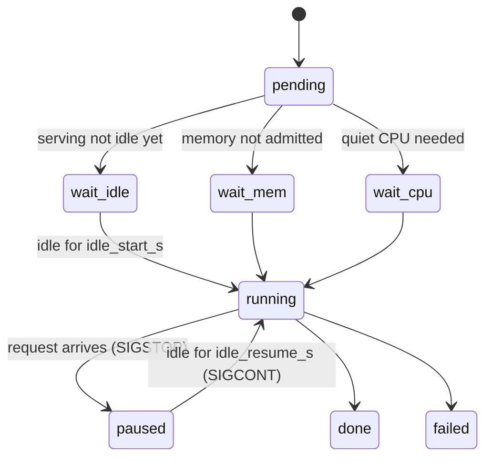

GPU 佇列（`scripts/dev/gpuq`）支援在同一台機器上，一邊為真實使用者運行正式的 Yunshu 伺服器，一邊讓開發用的 GPU 工作（基準測試、評測）使用它。佇列能感知正式伺服器：開發工作只在伺服器閒置時執行，使用者流量一到就立刻凍結。本頁寫給維護者；它說明佇列，以及佇列所依賴的引擎端掛鉤。

## 做了什麼

工作是提交給佇列常駐程式的獨立行程。每個工作會經過常駐程式在 `gpuq status` 中回報的各個狀態：

說明：一個受閘門控制的工作從等待伺服器閒置到完成的過程，以及使用者流量到達時走的暫停路徑。



| 元件 | 行為 |
|---|---|
| 輪詢器 | 常駐程式每隔 `poll_s` 對每個已設定伺服器的 `/v1/yunshu/status` 發出 GET，只讀取 `requests.active` 與 `requests.queued`。不含提示詞，也不含請求項目 |
| 啟動閘門 | 只有在每個伺服器都已閒置（沒有執行中、沒有排隊）達 `idle_start_s` 之後，工作才會啟動 |
| 搶佔 | 請求出現時，`SIGSTOP` 送給該工作自己的行程群組（佇列讓每個工作在自己的 session 中啟動；絕不對其他東西發送訊號，更不會對伺服器發送） |
| 恢復 | 伺服器閒置達 `idle_resume_s` 之後送出 `SIGCONT` |
| 暫停紀錄 | 每段區間都存在工作 JSON 中（`pauses: [[t0, t1], ...]`，牆上時鐘），也寫入 `$GPUQ_PAUSE_FILE` 指定的檔案 |
| 逾時 | `--timeout` 與 `--stall` 只計算活動時間；暫停的時間不算 |
| 記憶體准入 | 工作宣告 `--mem-gb`（搭配 `--serving-ok` 時為 0）。只有可用記憶體減去 `mem_gb` 後仍保留 `reserve_gb`，才會啟動 |
| 繞過 | `--serving-ok` 略過閒置閘門與服務暫停（用於僅 CPU 的工作）。優先權搶佔仍然適用 |
| 優先權搶佔 | 優先權 0 或更高的待處理工作，在記憶體容得下兩個常駐工作時，可以對執行中、優先權 -1 或更低的工作送出 `SIGSTOP`；不會為了回收記憶體而殺掉任何工作 |
| 狀態 | `gpuq status` 顯示 `wait-idle`、`wait-mem`、`wait-cpu`、`paused` 與 `pauses=N` 計數；`idle:` 一行說明為什麼待處理工作沒有執行者 |

## 為什麼（設計決策）

- 正式伺服器絕不能被基準測試拖慢，基準測試也絕不能默默地量到使用者流量。因此佇列暫停的是工作而不是伺服器，並記錄這次暫停。
- 輪詢只讀計數器，所以任何使用者內容都不會到達佇列。
- 它以失敗關閉為原則：無法連線的伺服器（連線被拒）視為閒置，但逾時、5xx 或無法解析的回應視為忙碌。

## 保證

- 沒有設定伺服器 URL 或明確的保留量時，就沒有服務閘門，記憶體准入為循序，也沒有服務暫停。
- 優先權搶佔仍會檢查記憶體：實測可用記憶體減去新工作的 `mem_gb` 後，必須保留 `reserve_gb`。記憶體未知就不能搶佔，被擋住的高優先權工作會顯示為 `wait-mem`。
- 作用中的標籤（待處理、執行中或已暫停）是獨占的；同一個標籤不能同時提交兩次。提交絕不會刪除先前的日誌、暫停紀錄、回傳碼或輸出檔案。

### 量測完整性

包含暫停時間的基準測試數字，量到的是使用者的流量，不是引擎，所以測試工具絕不能回報這樣的樣本。

- `scripts/dev/gpuq_pause.py`（僅用標準函式庫）提供 `was_paused(t0, t1)`、`timed(fn)` 與 `pause_intervals()`。`timed` 會丟棄並重跑與暫停重疊的樣本，重複重疊後拋出 `PausedSampleError`。它以失敗關閉為原則：無法讀取的 `$GPUQ_PAUSE_FILE` 視為已暫停；在 gpuq 之外，該變數未設定，也絕不會暫停。
- 它已接入 `scripts/research/agentic/replay_traffic.py`、`scripts/research/bench_engine_matrix.py`，以及發版關卡的 `cancel_then_next` 牆鐘時間檢查。新的基準測試腳本必須把每個計時樣本包在 `timed(...)` 中。準確度評測不需要：暫停只會讓它們變慢。
- 搶佔會在第一個請求之後的一個輪詢間隔內生效，所以樣本可能在停止之前短暫與請求共用 GPU。請讓 `poll_s` 保持很小。關閉這個空窗的握手機制見下文。

### 外部 CPU 與記憶體污染

每個已啟動的工作都會在開始時、定期，以及結束時記錄 `cpu_samples`（`load_1m`、`load_5m`、`foreign_cpu_pct` 與最大的外部行程）。外部 CPU 包含除了該工作自己的行程樹，以及 `nice` 為 10 或以上的背景行程之外的所有行程。達到門檻或取樣失敗時，工作會被標記為 `contended`。

- 以 `--quiet` 提交的工作會在啟動前等待 CPU 安靜（`--quiet-window`、`--quiet-max-wait`；環境變數預設值 `GPUQ_CPU_THRESHOLD`、`GPUQ_QUIET_WINDOW_S`、`GPUQ_QUIET_MAX_WAIT_S`、`GPUQ_CPU_SAMPLE_S`）。等待時間以該工作的最長等待與 `GPUQ_QUIET_HOLD_MAX_S`（常駐程式環境變數，預設 300 秒）中較小者為限；到期時工作會啟動並標記為 `quiet_timeout` 與 `contended`。服務與記憶體准入仍然適用，`--serving-ok` 不會繞過 CPU 閘門。
- 記憶體污染規則會在以下情況拒絕工作：其行程樹的壓縮或交換記憶體太多（`GPUQ_SWAP_MB`）、工作期間主機的 swap-in 太大（`GPUQ_HOST_SWAP_MB`），或主機的空閒加非活躍記憶體低於下限（`GPUQ_MEMORY_FLOOR_MB`）。無法讀取的證據以失敗關閉處理。工作 JSON 會記錄 `host_swap_mb`、`job_swap_mb`、`available_min_mb`、`memory_processes` 與 `memory_policy_version`。
- 對於其他方面成功、但受污染的效能或安靜工作，`gpuq wait` 回傳 3。`scripts/dev/gpuq_contention.py:was_contended()` 讓測試工具讀取該旗標；發版關卡在有限的安靜等待之後，會把受污染的伺服器路徑比較重試一次，兩次都受污染就回報為 contended（關卡結束碼 3），而文字或推測式解碼不一致仍然是失敗。
- 僅 CPU 的測試套件與建置在 `nice -n 15` 下執行，所以不計入外部 CPU 監控。請不要在單元測試加入 `taskpolicy -b`：效率核心排程可能破壞對時間敏感的檢查。

## 旋鈕

服務閘門的設定存在於常駐程式環境變數，或 `$GPUQ_DIR/serving.json`；後者每個迴圈都會重新讀取，所以可以即時編輯：

```json
{"urls": ["http://127.0.0.1:8000"], "idle_start_s": 120, "idle_resume_s": 30,
 "poll_s": 1, "reserve_gb": 16, "api_key": "optional bearer if the server needs one"}
```

| 設定 | 預設值 | 效果 |
|---|---|---|
| `GPUQ_SERVING_URLS`（`urls`） | none | 要輪詢的伺服器，以逗號分隔；沒有設定表示沒有服務閘門 |
| `GPUQ_IDLE_START_S`（`idle_start_s`） | 120 | 工作可以啟動之前所需的閒置時間 |
| `GPUQ_IDLE_RESUME_S`（`idle_resume_s`） | 30 | 已暫停的工作恢復之前所需的閒置時間 |
| `GPUQ_SERVING_POLL_S`（`poll_s`） | 1 | 輪詢間隔（秒） |
| `GPUQ_RESERVE_GB`（`reserve_gb`） | 16 | 准入工作後保持空閒的記憶體 |
| `GPUQ_SERVING_KEY`（`api_key`） | none | 伺服器需要時使用的 Bearer token |
| `GPUQ_SHORT_MIN`、`GPUQ_SHORT_WAIT_S`、`GPUQ_SHORT_SHARE` | 10 min、5 min、0.15 | 短工作通道的限制 |
| `GPUQ_FILLER_WAIT_S`、`GPUQ_FILLER_MAX_MIN` | 30 s、30 min | 佇列頭部被 CPU 安靜條件擋住時，填補工作的限制 |
| `YUNSHU_SERVE_LOG` | off | 僅含數字的事件日誌（時間、token 數、快取層、推測式接受率、並行度、arm、build）；絕不含提示詞、輸出或 token id。`YUNSHU_SERVE_LOG_DIR`、`YUNSHU_SERVE_LOG_MAX_MB` 與 `YUNSHU_SERVE_LOG_KEEP` 控制位置與輪替 |
| `YUNSHU_RESEARCH_ACTIVITY_FILE` | unset | 本機暫停握手檔案；也要在 `serving.json` 中將它設為 `activity_files` |
| `YUNSHU_RESEARCH_PAUSE_TIMEOUT_S` | 2.0 | 准入前等待 gpuq 確認的最長時間；逾時回傳 503 |
| `YUNSHU_ARM` | unset | 在日誌中標記手動選擇的設定，不改變行為 |

伺服器在 `/v1/yunshu/status` 中回報累計的 GPU 忙碌秒數，在 `/metrics` 中回報 `yunshu_gpu_busy_seconds_total`。這些是忙碌時間計數器，不是硬體使用率的取樣。

### 共同服務握手

設定 `YUNSHU_RESEARCH_ACTIVITY_FILE` 後，伺服器會寫出一個僅含數字的活動檔案，並在推論之前，最多等待 `YUNSHU_RESEARCH_PAUSE_TIMEOUT_S`，等 gpuq 給出新的確認，表示每個研究行程都已被觀察到停止。這關閉了輪詢間隔造成的空窗，否則第一個請求可能與計時樣本共用 GPU。

### 提交工作

```bash
scripts/dev/gpuq submit --label eval --mem-gb 30 -- python bench.py      # gated, preemptible
scripts/dev/gpuq submit --label lint --serving-ok -- python cpu_job.py   # bypasses the gate
scripts/dev/gpuq submit --label x-smoke --timeout 5 -- python smoke.py   # short lane
scripts/dev/gpuq submit --quiet --priority -1 --quiet-window 20 \
  --quiet-max-wait 300 --label cpu-quiet-unique -- python bench.py
scripts/dev/gpuq submit --label eval-unique --out results/a.jsonl --expect-complete -- python sweep.py
scripts/dev/gpuq wait --max-seconds 45 JOB_ID OTHER_JOB_ID
scripts/dev/gpuq digest --label-prefix eval- --since 6h
```

- 佇列層級的 `--out` 參數放在 `--` 分隔符之前。`--expect-complete` 要求每個輸出都是非空檔案，且其中有一行是字面值 `complete`。
- `wait` 對整個 id 清單使用同一個期限，並且每個工作印出一行。結束碼 0：每個工作都已完成且 rc 為 0，輸出經過驗證。結束碼 1：有工作失敗、被取消、不存在，或輸出無效。結束碼 2：期限到時仍有工作處於待處理或執行中（優先於已結束同伴的失敗）。結束碼 3：成功但受污染的效能或安靜工作。
- `gpuq digest`（`scripts/dev/gpuq_digest.py`）列出自上次摘要以來結束的工作，依標籤家族分組；只要有任何工作以 `failed`、`lost`、`stalled`、`timeout` 或 `cancelled` 結束、rc 缺失或不為零，或輸出缺失或為空，就以 1 結束。`--peek` 不動標記（`$GPUQ_DIR/.digest_marker`），`--since` 絕不移動它，帶標籤篩選的摘要也絕不移動全域標記。協調者在每次檢查時執行它，並處理每一行被標示的項目。
- 短工作通道：`--timeout` 不超過 10 分鐘，或以 `--short` 提交的工作，在等待 5 分鐘之後，可以排在長工作之前執行，但受長工作時間滾動占比的限制，且不會連續兩次。超過逾時的短工作會被殺掉並標記為 `timeout`。
- 開發工作的優先權為非正數；`--gate` 讓一個關卡排在同優先權待辦事項之前。計時格需要安靜准入；正確性格不需要。

### 重新載入常駐程式

常駐程式在啟動時載入它的 Python 程式碼。佇列變更合併之後，請暫停接受新的提交，並在工作邊界重新啟動常駐程式；執行中與已暫停的工作會在重啟時被接管。只終止持有 `daemon.lock` 的行程（以 PID，絕不用行程群組），並用 `/usr/bin/python3` 啟動替代者：

```bash
export GPUQ_DIR=/Volumes/P5Plus/yunshu-gpuq
scripts/dev/gpuq status
GPUQ_DAEMON_PID="$(lsof -t "$GPUQ_DIR/daemon.lock")"
ps -p "$GPUQ_DAEMON_PID" -o pid=,command=   # must be gpuq.py _daemon
kill -TERM "$GPUQ_DAEMON_PID"
while kill -0 "$GPUQ_DAEMON_PID" 2>/dev/null; do sleep 1; done
nohup /usr/bin/python3 scripts/dev/gpuq.py _daemon >> "$GPUQ_DIR/daemon.log" 2>&1 < /dev/null &
scripts/dev/gpuq status
```

只有佇列擁有者做這件事；worker 絕不在量測期間重新啟動正在運作的常駐程式。

### 選用的 M3 正確性通道

`gpuq submit --device m5|m3|any` 預設為 `m5`。一個常駐程式同時執行本機 M5 槽位與遠端 M3 槽位；`any` 由先准入它的槽位保留一次。本機服務、安靜准入與優先權搶佔都適用於 M5 槽位，而 `--quiet` 與 `m3`、`any` 並用時會被拒絕，因為計時屬於 M5。`M3_HOST`、`M3_KEY` 與 `M3_REPO` 的設定方式與 `scripts/dev/m3run` 相同；所有 worktree、輸出、模型、快取與暫存檔都留在那個 checkout 內，因為 M3 是一台個人筆電。筆電只會在固定上限內准入宣告的記憶體，該上限為使用者保留了容量，所以請宣告實際的峰值。

遠端快照是 HEAD 加上已追蹤的修改，位於一個 detached worktree。即使命令失敗，宣告的輸出也會回到原本的路徑。SSH 或傳輸失敗就是失敗的工作，絕不是成功的收據；如果無法確認遠端清理，`m3-quarantine.json` 會阻擋後續的 M3 派送，直到有人檢查。M3 摘要條目標示為可攜性證據（不是 M5），混合裝置的準確度或一致性 arm 與 M3 效能結論，會被研究分析輔助工具拒絕。M3 上的失敗必須在 M5 重現後，才能否決 M5 的最佳化；M3 通過絕不會核准 M5 熱路徑的預設值。

## 限制

上述的引擎端元件都已實作。`scripts/servedev/` 中的離線腳本有 `replay.py`（僅形狀的重播 A/B，token 相同否則失敗）、`bandit.py`（對已註冊的無損旋鈕進行 UCB1 bandit，帶有可逆的帳本）以及 `loop.py`（有閘門的候選迴圈）；沒有任何一個會根據即時流量選擇 arm。離線的 switchback、CUPED 與 mSPRT 輔助工具，以及執行歷史的變異數剖析都已存在；沒有啟用任何線上 arm 選擇。

已規劃但尚未實作：

- 在即時流量上進行線上無損 A/B，只記錄指標（不含提示詞）；
- 依據這些指標，對無損旋鈕進行 bandit 自動調校；
- 有閘門的自主改進迴圈，只透過現有的關卡來提出、量測並落地變更。

在開發的同時常駐提供 27B 服務，仍受制於長上下文一致性：冷啟動、暖啟動與後續 TTFT、解碼、並行與記憶體都要達標。佇列機制已經實作；這並不表示效能關卡已通過。逐點取樣無法觀察到輪詢之間所有短命的行程，佇列也不暗示任何每秒 token 數或 TTFT 的提升。

## 如何驗證

```bash
scripts/dev/gpuq status          # states, pauses, idle explanation
scripts/dev/gpuq digest --peek   # finished jobs, flagged failures
```

佇列行為由 `tests/unit` 下的 gpuq 測試涵蓋；在正式常駐程式重新啟動之前，請先在隔離的佇列中跨優先權測試佇列變更。基準測試腳本只有在把每個計時樣本包進 `scripts/dev/gpuq_pause.py` 的 `timed(...)` 時才正確。另見[驗證](/docs/developers/verification)、[發版就緒](/docs/developers/release-readiness)與[代理編碼基準測試](/docs/developers/agentic-bench)。

## 相關

- [驗證](/docs/developers/verification)
- [硬體驗證](/docs/developers/hardware-validation)
- [遙測](/docs/guides/telemetry)
