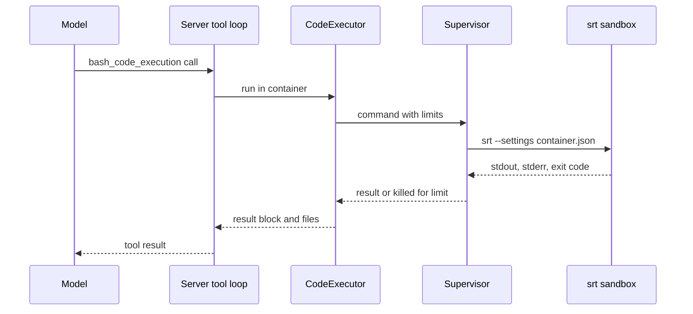

The Anthropic `code_execution` tool lets a model run commands and edit files on the machine that serves it. That is only acceptable inside a sandbox. This page explains how Yunshu builds that sandbox, what it limits, and how the tool is exposed to the API. For turning it on and using it from a client, see the [code execution guide](/docs/guides/code-execution).

## What it does

The code lives in `python/yunshu_gateway/sandbox/` and is wired in as a server tool by `server_tools/runtime.py` and `server_tools/anthropic_loop.py`.

- **`srt.py`** finds Anthropic's `sandbox-runtime` CLI (`srt`, optional, needs Node 22.12 or newer) on `PATH` or under `~/.yunshu/srt`, and builds its settings for one container. These are pure functions, testable without `srt`.
- **`supervisor.py`** runs one command with wall-clock, CPU, memory and output limits, which `srt` does not provide.
- **`containers.py`** keeps one workspace directory per container, with idle expiry and a total size cap.
- **`executor.py`** turns a tool call into a sandboxed process. `bash_code_execution` runs under `srt`; `text_editor_code_execution` (`view`, `create`, `str_replace`) runs in-process with paths confined to the container.

The model sees two sub-tools under one declared tool (`code_execution_20250825`, with the `20260120` and `20260521` types accepted and behaving the same). The server runs the tool loop and returns `server_tool_use` and result blocks like the official API.

## Why

Two layers protect the host. `srt` uses macOS `sandbox-exec` for file and network isolation. Yunshu adds what `srt` lacks, because macOS does not enforce `RLIMIT_AS` and `RLIMIT_NPROC` counts every process of the user, so neither is used: a supervisor samples the resident size of the whole process tree, kills it on overrun and sweeps the session afterwards so no daemon is left behind. The rule at the top of the package is absolute: nothing runs a command outside `srt`. If `srt` is missing or cannot run, the request fails (`SandboxUnavailableError`) instead of running unsandboxed.



## Policy: what the sandbox allows

`build_settings` produces the policy for one container directory:

| Area | Rule |
|---|---|
| Writes | The container directory only (`work/`, `home/`, `tmp/` and a per-call `out/`) |
| Reads | `/Users`, `/Volumes`, `/home` and the shared containers root are denied. Only this container and the Python interpreter's prefix are allowed back, so your home, keys, `~/.yunshu` and other containers are unreadable. System libraries elsewhere stay readable. |
| Network | None unless hosts are listed. Loopback is never reachable (`allowLocalBinding` is false), and allowed names cannot resolve into private ranges (`10/8`, `172.16/12`, `192.168/16`, `100.64/10`, `fc00::/7`). |
| Other | Unix sockets, Apple Events and `open` are off |
| Environment | The command sees only `PATH`, `HOME` (the container), `TMPDIR`, `OUTPUT_DIR` and locale variables, never the server's environment |

An allowed-domain list does not inspect traffic: allowing a broad host can still leak data, so keep the list short.

## Limits

| Limit | Value | Source |
|---|---|---|
| Wall clock per call (also the CPU-time limit) | `YUNSHU_CODE_EXECUTION_TIMEOUT`, 60 s; then `execution_time_exceeded` | settings |
| Memory | `YUNSHU_CODE_EXECUTION_MEMORY_MB`, 2048; resident size of the whole process tree, sampled every 100 ms, then killed | settings |
| stdout and stderr | 64 KiB each, cut and marked | `supervisor.py` |
| Total output (stdout plus stderr together) | More than 1 MiB in a call kills it (`output_file_too_large`) | `supervisor.py` |
| Size of any single file a command writes | 256 MiB (`RLIMIT_FSIZE`) | `supervisor.py` |
| Concurrent calls | 2 (`MAX_CONCURRENT`) | `executor.py` |
| All containers together | 2 GiB (`MAX_TOTAL_BYTES`), oldest removed first | `containers.py` |
| Container idle expiry | `YUNSHU_CODE_EXECUTION_TTL_MIN`, 20 minutes | settings |
| Files attached per call | 20 (`MAX_FILES_PER_CALL`) | `executor.py` |
| Text-editor view | 200,000 characters | `executor.py` |

Background processes die with the call: the command runs in its own session, and on timeout, memory overrun or output overflow the whole tree is killed.

## Exposure as a server tool

Off by default. With `YUNSHU_CODE_EXECUTION` off, a request that declares the tool gets a `400` naming the setting. On without `srt`, the response is `503` (`api_error`) with the install command. Containers are addressed with `container: "<id>"`; an unknown or expired id is a `400`. `container_upload` blocks copy Files API files into the working directory, and each bash call gets a fresh `$OUTPUT_DIR` whose top-level files become Files API entries.

Violations are logged as metadata only (container id, return code, byte counts). Commands, output and file contents are never logged.

## Guarantees

- No command runs outside `srt`.
- A call cannot read the user's home, `~/.yunshu` or another container, and cannot write outside its container.
- A call cannot exceed its wall-clock, memory or output limits; the whole process tree is killed and swept.
- The sandbox does not inherit the server's environment variables.

## Knobs

| Setting | Default | Effect |
|---|---|---|
| `YUNSHU_CODE_EXECUTION` | off | Serve the tool |
| `YUNSHU_CODE_EXECUTION_ROOT` | `~/.yunshu/sandbox` | Container directory, one subdirectory per container, mode 0700 |
| `YUNSHU_CODE_EXECUTION_TIMEOUT` | 60 | Seconds per call |
| `YUNSHU_CODE_EXECUTION_MEMORY_MB` | 2048 | Memory per call |
| `YUNSHU_CODE_EXECUTION_NETWORK_ALLOW` | none | Comma-separated hosts the sandbox may reach |
| `YUNSHU_CODE_EXECUTION_TTL_MIN` | 20 | Idle minutes before a container is deleted |

## Differences from Anthropic's container

- It runs on macOS, not Linux x86_64. The Python is the interpreter Yunshu runs on, with the standard library only.
- There is no REPL state between calls and no programmatic tool calling.
- OpenAI `code_interpreter` and `shell` are not served yet.
- The sandbox depends on macOS `sandbox-exec`, which Apple marks deprecated, and `srt` is a 0.0.x release (the guide records 0.0.81 as tested).

## How to verify

```bash
yunshu doctor        # the "code execution" row shows the srt version and a self-test
uv run pytest tests/unit/test_sandbox_core.py tests/unit/test_server_tools_code_execution.py -q
```

`tests/unit/test_sandbox_srt_integration.py` exercises a real `srt` when one is installed.
