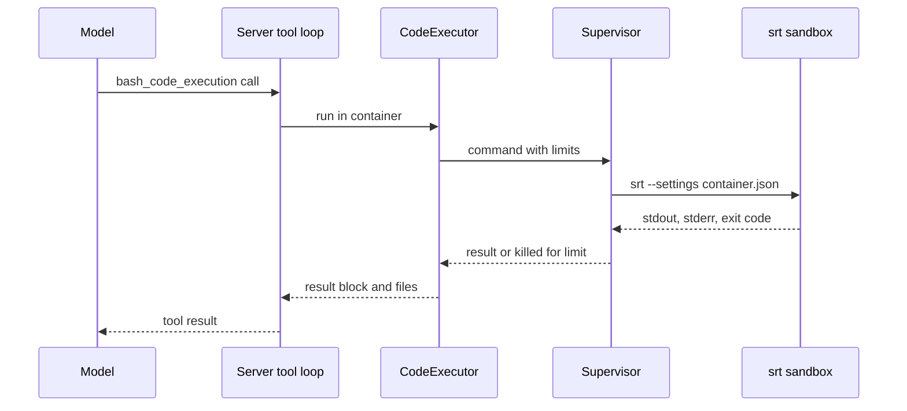

Anthropic 的 `code_execution` 工具让模型在提供服务的机器上运行命令并编辑文件。只有在沙盒内才可以接受这样做。本页说明 Yunshu 如何构建这个沙盒、它限制什么，以及该工具如何在 API 中公开。如何开启并从客户端使用，请见[代码执行指南](/docs/guides/code-execution)。

## 功能概览

代码位于 `python/yunshu_gateway/sandbox/`，并由 `server_tools/runtime.py` 与 `server_tools/anthropic_loop.py` 接入为服务器工具。

- **`srt.py`** 在 `PATH` 或 `~/.yunshu/srt` 下寻找 Anthropic 的 `sandbox-runtime` CLI（`srt`，选用，需要 Node 22.12 或更新版本），并为一个容器构建它的设置。这些都是纯函数，不需要 `srt` 也能测试。
- **`supervisor.py`** 在墙钟时间、CPU、内存与输出限制下运行一条命令，这些是 `srt` 不提供的。
- **`containers.py`** 为每个容器保留一个工作区目录，带有闲置过期与总大小上限。
- **`executor.py`** 把一次工具调用变成沙盒进程。`bash_code_execution` 在 `srt` 下运行；`text_editor_code_execution`（`view`、`create`、`str_replace`）在进程内运行，路径被限制在容器内。

模型在一个声明的工具（`code_execution_20250825`，同时接受 `20260120` 与 `20260521` 类型，行为相同）之下看到两个子工具。服务器运行工具循环，并像官方 API 一样返回 `server_tool_use` 与结果区块。

## 为什么这样设计

有两层保护主机。`srt` 使用 macOS 的 `sandbox-exec` 做文件与网络隔离。Yunshu 补上 `srt` 缺少的部分，因为 macOS 不强制 `RLIMIT_AS`，而 `RLIMIT_NPROC` 会统计该用户的所有进程，所以两者都不使用：由 supervisor 采样整棵进程树的常驻大小，超出时终止它，并在之后清扫整个会话，不留下任何守护进程。包顶部的规则是绝对的：任何命令都不会在 `srt` 之外运行。如果 `srt` 缺失或无法运行，请求会失败（`SandboxUnavailableError`），而不是不加沙盒地运行。



## 策略：沙盒允许什么

`build_settings` 为一个容器目录产生策略：

| 范围 | 规则 |
|---|---|
| 写入 | 仅限容器目录（`work/`、`home/`、`tmp/` 与每次调用独立的 `out/`） |
| 读取 | `/Users`、`/Volumes`、`/home` 与共享的容器根目录被拒绝。只有本容器与 Python 解释器的 prefix 被放行，所以你的主目录、密钥、`~/.yunshu` 与其他容器都不可读。其他位置的系统库仍可读。 |
| 网络 | 除非列出主机，否则没有网络。回环地址永远无法访问（`allowLocalBinding` 为 false），允许的名称也不能解析到私有网段（`10/8`、`172.16/12`、`192.168/16`、`100.64/10`、`fc00::/7`）。 |
| 其他 | Unix socket、Apple Events 与 `open` 均关闭 |
| 环境 | 命令只看得到 `PATH`、`HOME`（指向容器）、`TMPDIR`、`OUTPUT_DIR` 与语言区域变量，绝不会看到服务器的环境 |

允许域名列表不会检查流量：允许范围宽泛的主机仍可能泄漏数据，所以请让列表保持简短。

## 限制

| 限制 | 值 | 来源 |
|---|---|---|
| 每次调用的墙钟时间（同时也是 CPU 时间限制） | `YUNSHU_CODE_EXECUTION_TIMEOUT`，60 s；超出后为 `execution_time_exceeded` | 设置 |
| 内存 | `YUNSHU_CODE_EXECUTION_MEMORY_MB`，2048；整棵进程树的常驻大小，每 100 ms 采样一次，超出即终止 | 设置 |
| stdout 与 stderr | 各 64 KiB，截断并标记 | `supervisor.py` |
| 写入的输出总量 | 一次调用写入 1 MiB 就会被终止（`output_file_too_large`） | 指南 |
| 并发调用 | 2（`MAX_CONCURRENT`） | `executor.py` |
| 所有容器合计 | 2 GiB（`MAX_TOTAL_BYTES`），最旧的先被移除 | `containers.py` |
| 容器闲置过期 | `YUNSHU_CODE_EXECUTION_TTL_MIN`，20 分钟 | 设置 |
| 每次调用附加的文件 | 20（`MAX_FILES_PER_CALL`） | `executor.py` |
| 文本编辑器 view | 200,000 个字符 | `executor.py` |

后台进程会随调用一起结束：命令在自己的 session 中运行，超时、内存超出或输出溢出时整棵进程树都会被终止。

## 作为服务器工具公开

缺省关闭。`YUNSHU_CODE_EXECUTION` 关闭时，声明该工具的请求会收到点名该设置的 `400`。开启但没有 `srt` 时，响应为 `503`（`api_error`），并附上安装命令。容器通过 `container: "<id>"` 指定；未知或已过期的 id 会得到 `400`。`container_upload` 区块会把 Files API 的文件复制到工作目录，每次 bash 调用都有全新的 `$OUTPUT_DIR`，其顶层文件会成为 Files API 条目。

违规只记录元数据（容器 id、返回码、字节数）。命令、输出与文件内容绝不记入日志。

## 保证

- 没有任何命令在 `srt` 之外运行。
- 一次调用无法读取用户的主目录、`~/.yunshu` 或其他容器，也无法在容器之外写入。
- 一次调用无法超出其墙钟时间、内存或输出限制；整棵进程树会被终止并清扫。
- 沙盒不继承服务器的环境变量。

## 配置项

| 设置 | 缺省 | 作用 |
|---|---|---|
| `YUNSHU_CODE_EXECUTION` | 关闭 | 提供该工具 |
| `YUNSHU_CODE_EXECUTION_ROOT` | `~/.yunshu/sandbox` | 容器目录，每个容器一个子目录，权限 0700 |
| `YUNSHU_CODE_EXECUTION_TIMEOUT` | 60 | 每次调用的秒数 |
| `YUNSHU_CODE_EXECUTION_MEMORY_MB` | 2048 | 每次调用的内存 |
| `YUNSHU_CODE_EXECUTION_NETWORK_ALLOW` | 无 | 沙盒可访问的主机，以逗号分隔 |
| `YUNSHU_CODE_EXECUTION_TTL_MIN` | 20 | 容器被删除前的闲置分钟数 |

## 与 Anthropic 容器的差异

- 它运行在 macOS 上，而不是 Linux x86_64。Python 是 Yunshu 所运行的解释器，只有标准库。
- 调用之间没有 REPL 状态，也没有程序化工具调用。
- 尚未提供 OpenAI 的 `code_interpreter` 与 `shell`。
- 沙盒依赖 Apple 标记为已弃用的 macOS `sandbox-exec`，而 `srt` 是 0.0.x 版本（指南记录 0.0.81 为已测试版本）。

## 如何验证

```bash
yunshu doctor        # the "code execution" row shows the srt version and a self-test
uv run pytest tests/unit/test_sandbox_core.py tests/unit/test_server_tools_code_execution.py -q
```

安装了真实 `srt` 时，`tests/unit/test_sandbox_srt_integration.py` 会对它进行测试。
