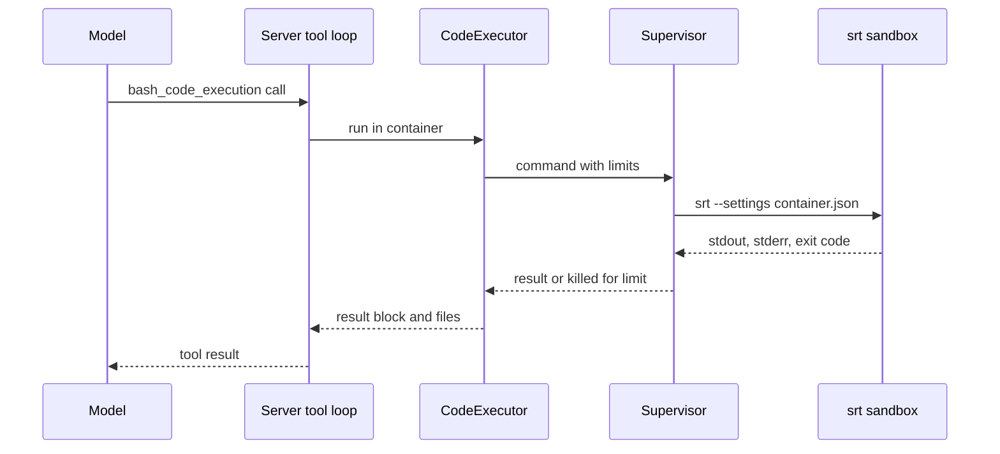

Anthropic 的 `code_execution` 工具讓模型在提供服務的機器上執行指令並編輯檔案。這只有在沙盒內才可接受。本頁說明 Yunshu 如何建立該沙盒、限制了什麼，以及這個工具如何對 API 公開。若要開啟並從用戶端使用，請見[程式碼執行指南](/docs/guides/code-execution)。

## 它做什麼

程式碼位於 `python/yunshu_gateway/sandbox/`，並由 `server_tools/runtime.py` 與 `server_tools/anthropic_loop.py` 接入為伺服器工具。

- **`srt.py`** 在 `PATH` 或 `~/.yunshu/srt` 下尋找 Anthropic 的 `sandbox-runtime` CLI（`srt`，選用，需要 Node 22.12 或更新版本），並為單一容器建立其設定。這些都是純函式，不需要 `srt` 就能測試。
- **`supervisor.py`** 以牆鐘時間、CPU、記憶體與輸出限制執行單一指令，這些是 `srt` 不提供的。
- **`containers.py`** 為每個容器保留一個工作區目錄，具備閒置過期與總大小上限。
- **`executor.py`** 把工具呼叫轉成沙盒化的行程。`bash_code_execution` 在 `srt` 下執行；`text_editor_code_execution`（`view`、`create`、`str_replace`）在行程內執行，路徑被限制在容器之內。

模型在一個宣告的工具（`code_execution_20250825`，同時接受 `20260120` 與 `20260521` 類型，行為相同）之下看到兩個子工具。伺服器執行工具迴圈，並像官方 API 一樣回傳 `server_tool_use` 與結果區塊。

## 為什麼這樣設計

有兩層保護主機。`srt` 使用 macOS 的 `sandbox-exec` 做檔案與網路隔離。Yunshu 補上 `srt` 缺少的部分：因為 macOS 不強制執行 `RLIMIT_AS`，而 `RLIMIT_NPROC` 會計入該使用者的所有行程，所以兩者都不使用；改由監督器取樣整個行程樹的常駐大小，超出時終止，之後再清掃整個 session，確保不會留下任何背景常駐行程。套件開頭的規則是絕對的：沒有任何指令在 `srt` 之外執行。若 `srt` 不存在或無法執行，請求會失敗（`SandboxUnavailableError`），而不是在沒有沙盒的情況下執行。



## 政策：沙盒允許什麼

`build_settings` 為單一容器目錄產生政策：

| 範圍 | 規則 |
|---|---|
| 寫入 | 僅限容器目錄（`work/`、`home/`、`tmp/` 與每次呼叫專屬的 `out/`） |
| 讀取 | `/Users`、`/Volumes`、`/home` 與共用的容器根目錄都被拒絕。只有該容器與 Python 直譯器的前綴會被重新允許，所以你的家目錄、金鑰、`~/.yunshu` 與其他容器都讀不到。其他位置的系統函式庫仍可讀取。 |
| 網路 | 除非列出主機，否則一律沒有。迴路位址永遠無法連到（`allowLocalBinding` 為 false），且允許的名稱不能解析到私有網段（`10/8`、`172.16/12`、`192.168/16`、`100.64/10`、`fc00::/7`）。 |
| 其他 | Unix socket、Apple Events 與 `open` 皆關閉 |
| 環境 | 指令只看得到 `PATH`、`HOME`（容器內）、`TMPDIR`、`OUTPUT_DIR` 與語系變數，絕不包含伺服器的環境 |

允許網域清單並不會檢查流量：允許範圍很廣的主機仍可能洩漏資料，所以請讓清單保持簡短。

## 限制

| 限制 | 數值 | 來源 |
|---|---|---|
| 每次呼叫的牆鐘時間（也是 CPU 時間限制） | `YUNSHU_CODE_EXECUTION_TIMEOUT`，60 秒；超過後為 `execution_time_exceeded` | 設定 |
| 記憶體 | `YUNSHU_CODE_EXECUTION_MEMORY_MB`，2048；整個行程樹的常駐大小，每 100 ms 取樣，超出即終止 | 設定 |
| stdout 與 stderr | 各 64 KiB，超出會截斷並標記 | `supervisor.py` |
| 輸出總量（stdout 加 stderr） | 單次呼叫超過 1 MiB 即終止（`output_file_too_large`） | `supervisor.py` |
| 指令寫入的單一檔案大小 | 256 MiB（`RLIMIT_FSIZE`） | `supervisor.py` |
| 並行呼叫數 | 2（`MAX_CONCURRENT`） | `executor.py` |
| 所有容器合計 | 2 GiB（`MAX_TOTAL_BYTES`），最舊的先移除 | `containers.py` |
| 容器閒置過期 | `YUNSHU_CODE_EXECUTION_TTL_MIN`，20 分鐘 | 設定 |
| 每次呼叫附加的檔案數 | 20（`MAX_FILES_PER_CALL`） | `executor.py` |
| 文字編輯器 view | 200,000 個字元 | `executor.py` |

背景行程會隨呼叫一起結束：指令在自己的 session 中執行，發生逾時、記憶體超出或輸出溢位時，整個行程樹都會被終止。

## 作為伺服器工具對外公開

預設關閉。`YUNSHU_CODE_EXECUTION` 關閉時，宣告此工具的請求會收到指名該設定的 `400`。開啟但沒有 `srt` 時，回應為 `503`（`api_error`）並附上安裝指令。容器以 `container: "<id>"` 指定；未知或已過期的 id 會得到 `400`。`container_upload` 區塊會把 Files API 的檔案複製到工作目錄，而每次 bash 呼叫都會取得全新的 `$OUTPUT_DIR`，其頂層檔案會成為 Files API 項目。

違規只會以中繼資料記錄（容器 id、回傳碼、位元組數）。指令、輸出與檔案內容絕不寫入日誌。

## 保證

- 沒有任何指令在 `srt` 之外執行。
- 呼叫無法讀取使用者的家目錄、`~/.yunshu` 或其他容器，也無法寫到容器之外。
- 呼叫無法超出其牆鐘時間、記憶體或輸出限制；整個行程樹會被終止並清掃。
- 沙盒不會繼承伺服器的環境變數。

## 設定

| 設定 | 預設 | 作用 |
|---|---|---|
| `YUNSHU_CODE_EXECUTION` | 關閉 | 提供此工具 |
| `YUNSHU_CODE_EXECUTION_ROOT` | `~/.yunshu/sandbox` | 容器目錄，每個容器一個子目錄，權限模式 0700 |
| `YUNSHU_CODE_EXECUTION_TIMEOUT` | 60 | 每次呼叫的秒數 |
| `YUNSHU_CODE_EXECUTION_MEMORY_MB` | 2048 | 每次呼叫的記憶體 |
| `YUNSHU_CODE_EXECUTION_NETWORK_ALLOW` | 無 | 沙盒可連線的主機，以逗號分隔 |
| `YUNSHU_CODE_EXECUTION_TTL_MIN` | 20 | 容器被刪除前的閒置分鐘數 |

## 與 Anthropic 容器的差異

- 它在 macOS 上執行，而不是 Linux x86_64。Python 是 Yunshu 本身執行所用的直譯器，只有標準函式庫。
- 呼叫之間沒有 REPL 狀態，也沒有程式化工具呼叫。
- 尚未提供 OpenAI 的 `code_interpreter` 與 `shell`。
- 沙盒依賴 macOS 的 `sandbox-exec`，Apple 已將其標示為棄用，而 `srt` 是 0.0.x 版本（指南記錄測試過的版本為 0.0.81）。

## 如何驗證

```bash
yunshu doctor        # the "code execution" row shows the srt version and a self-test
uv run pytest tests/unit/test_sandbox_core.py tests/unit/test_server_tools_code_execution.py -q
```

`tests/unit/test_sandbox_srt_integration.py` 在安裝了真實 `srt` 時會實際對它進行測試。
