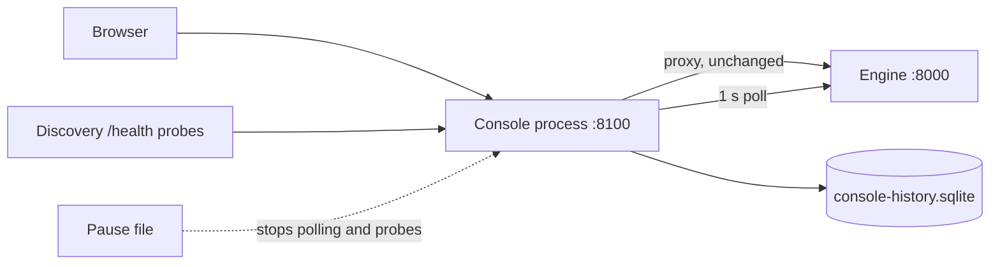

The web console is not part of the engine process. `yunshu console` is a separate, light process that serves the console UI, proxies the engine API on one origin and records the engine's history. This page explains the design and its moving parts. For using the console pages, see the console guide in the app; for the settings, see [Configuration](/docs/guides/configuration).

## What it does

The console process (`python/yunshu_console/`) does four things:

- **Serves** the built console and the docs under `/console/` (`app.py`). The shell is public so you can enter a token; inference, model operations, keys and settings keep their normal authorization.
- **Proxies** the engine API: methods, bodies, `Authorization` and `x-api-key`, SSE streams and WebSockets are forwarded unchanged, so the browser talks to one origin. When the engine is unreachable, the proxy answers `502` with `engine_unreachable` at once instead of hanging.
- **Records** history (`poller.py`, `store.py`). Once a second it reads the engine's cheap endpoints (`/v1/yunshu/status`, finished requests by cursor from `/v1/yunshu/requests/recent?after_seq=`, and about every five seconds the host telemetry) and writes them to SQLite in WAL mode, batched every ten seconds.
- **Remembers outages.** While the engine does not answer, no rows are written. That span is the gap, and it is reported as a gap and never interpolated. Events record engine unreachable and reachable again (with duration), engine restarted, model loaded or unloaded, and a model that failed to load.

It answers `/v1/yunshu/metrics/history`, `/v1/yunshu/requests/history` and `/v1/yunshu/console` itself from the store, so history works while the engine is down.

## Why

A monitoring page that dies with the thing it monitors is useless exactly when needed. The console is a sibling process that never imports MLX, mlx-lm or mlx-vlm (a unit test asserts that in a fresh interpreter), so it starts instantly, idles at a small footprint and cannot be reached by an engine crash. The engine does not depend on it either: if the console dies, the engine is unaffected. The engine itself keeps no history and runs nothing for it; every read is an ordinary HTTP request the engine answers on its event loop, the same ones the web console makes.



## History store

`store.py` keeps three tables, each rolled up from the finer one with SQL `AVG` (and `MAX` for peaks) for the buckets a flush touched, so a restart never loses or doubles a partial bucket:

| Table | Resolution | Retention |
|---|---|---|
| `m1` | 1 s | 1 hour |
| `m10` | 10 s | 24 hours |
| `m60` | 1 minute | `YUNSHU_CONSOLE_RETENTION_DAYS` (30) |

The request log keeps metadata only: id, model, route, status, timestamps, token counts, cached tokens, TTFT, decode speed and finish reason. Prompts and outputs are never stored; the engine's finished-request entries hold none, and `request_row` drops anything not on its whitelist. The file is capped by `YUNSHU_CONSOLE_DB_MAX_MB` (64): when exceeded, the oldest request rows and then the oldest 1-minute rows go first.

The request cursor is `(boot_id, seq)`. The first read after the console starts takes everything in the engine's ring; later reads take only what is new; a changed `boot_id` (the engine restarted) starts the sequence over. Rows are keyed by `(t, request_id)`, so even a replay writes nothing twice.

## Engine auto-discovery

`yunshu console --engine auto` (or `YUNSHU_CONSOLE_ENGINE=auto`) lets one console stay open while engines start and stop on different ports (`discovery.py`).

- Every `YUNSHU_CONSOLE_DISCOVER_S` (2 s) each candidate gets an asynchronous `GET /health` with a short timeout. With `YUNSHU_CONSOLE_DISCOVER_PORTS=all` the candidates are the TCP ports listening on this Mac (via `lsof`, refreshed every 10 s) minus console processes, which proxy `/health` and would look like the engine behind them. An explicit list such as `8000,18990-18999` probes exactly those ports on `127.0.0.1`.
- A port counts only when `/health` answers like a Yunshu engine: `status: "ok"`, an `engine` object, a `server_state` and a numeric `uptime_seconds`. A port that answered as something else is asked again after 60 s.
- Selection is sticky. The followed engine is kept while healthy; when it disappears (two missed probes in a row) the console follows the most recently started live engine (smallest uptime). An engine pinned by the user wins while it is live.
- `/v1/yunshu/console/engines` lists engines; `/v1/yunshu/console/engines (POST)` with `{"url": ...}` or `{"port": ...}` pins, and `{"url": null}` unpins.
- The history stores the engine URL and start time with each request, so a restart shows as a separate session, and an `engine_switched` event marks a move. A stream already open to the old engine is not cut.

## Lifecycle, restarts and launchd

| How you start it | What runs |
|---|---|
| `yunshu serve -m <model>` | the engine, plus the console process as a sibling (`--no-console` skips it, `--console-port` moves it). If a console already answers on the port, none is started. The sibling exits with the engine. |
| `yunshu console --engine URL` | the console alone, to watch an engine elsewhere (`--engine-token` when it needs one) |
| `yunshu service install` | two launchd jobs: the engine and the console as its own always-kept-alive job, so recording continues while the engine restarts. `--no-console` installs the engine only; `yunshu service logs --console` shows the console log. |

Under the service, the engine is started with `--no-console` because the console is its own job.

- **Restart from the console.** A setting that requires a restart is written with `PATCH /v1/yunshu/config`; the response lists `restart_for`. `POST /v1/yunshu/service/restart` with `confirm: true` drains active requests for up to `YUNSHU_DRAIN_TIMEOUT` seconds and then runs `launchctl kickstart -k`. Outside launchd it answers `409 not_under_launchd` with the manual command; the console never owns the engine process. These routes need the `admin` permission.
- **Calm outages.** While the engine is down, the UI shows "Engine restarting" with the typical time (the median of recorded outages, `outages` in `/v1/yunshu/console`), dims stale pages and fills the missed stretch from recorded history when the engine returns. Only 60 s without any live engine becomes a warning.
- **Deployment health.** The recorder also tracks process footprint and its 15 to 30 minute regression slope and the request error rate. A slope above 1 GiB per hour, or at least 5% failed requests among 20 or more completions in the last minute, raises a console alert and one warning event. Cancellation is excluded from the error rate. This is a reason to inspect the memory ledger, not a leak diagnosis.

## Measurement pause

A monitor that polls only one arm of an A/B perturbs the measurement. While the file named by `YUNSHU_CONSOLE_PAUSE_FILE` exists and holds `{"pause": true, "until": <epoch or null>, "reason": "..."}`, the poller and the discovery probes send nothing to any engine (`pause.py`). The file stops counting after `until`, or two hours after its last write when `until` is null, and the console resumes by itself when it is removed. The proxy still forwards requests you make yourself, and the status island shows the reason. `gpuq` writes the file while a quiet or speed job runs.

## Guarantees

- The console never imports MLX and holds no GPU work; an engine crash cannot reach it.
- Gaps are reported as gaps, never interpolated; missing data is shown as unavailable, never as zero.
- Request rows carry metadata only. No prompt or output text is recorded.
- Request cursors never skip or repeat a request across polls, engine restarts or console restarts.

## Knobs

| Setting | Default | Effect |
|---|---|---|
| `YUNSHU_CONSOLE` | on | `yunshu serve` also starts the console process |
| `YUNSHU_CONSOLE_PORT` | 8100 | Console port |
| `YUNSHU_CONSOLE_HOST` | unset | Bind host; unset follows the engine's host for the sibling and 127.0.0.1 standalone |
| `YUNSHU_CONSOLE_ENGINE` | unset | Engine URL to watch; `auto` follows engines |
| `YUNSHU_CONSOLE_ENGINE_TOKEN` | unset | Bearer token for reading the engine; falls back to `YUNSHU_AUTH_TOKEN` |
| `YUNSHU_CONSOLE_DISCOVER_PORTS` | `all` | Ports probed in auto mode |
| `YUNSHU_CONSOLE_DISCOVER_S` | 2.0 | Seconds between probes |
| `YUNSHU_CONSOLE_POLL_S` | 1.0 | Seconds between engine reads |
| `YUNSHU_CONSOLE_HISTORY` | on | Record history and the request log |
| `YUNSHU_CONSOLE_DB` | `~/.yunshu/console-history.sqlite` | History file |
| `YUNSHU_CONSOLE_RETENTION_DAYS` | 30 | Days of 1-minute rows, requests and events |
| `YUNSHU_CONSOLE_DB_MAX_MB` | 64 | Size cap |
| `YUNSHU_CONSOLE_PAUSE_FILE` | unset | Measurement pause file |

## Limits

- It is an operator tool for one machine. Serving the network (`--host 0.0.0.0`) needs a token set.
- Restart from the UI works only when the engine runs under the `yunshu` launchd service.
- History resolution is bounded by the tables above; request detail older than the retention is gone.

## How to verify

```bash
uv run pytest tests/unit/test_console_proxy.py tests/unit/test_console_poller.py \
  tests/unit/test_console_store.py tests/unit/test_console_discovery.py \
  tests/unit/test_console_pause.py tests/unit/test_console_endpoints.py -q
curl -s "$CONSOLE_URL"/v1/yunshu/console | python -m json.tool
```

The no-MLX-import rule is `test_nothing_in_the_console_process_loads_mlx` in `tests/unit/test_console_proxy.py`.
