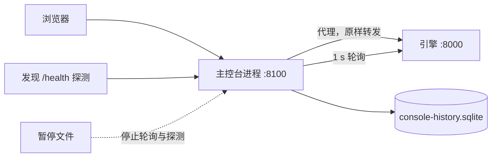

Web 主控台不属于引擎进程。`yunshu console` 是一个独立的轻量进程，它提供主控台 UI、在同一个 origin 上代理引擎 API，并记录引擎的历史。本页说明其设计与各个运作部分。主控台页面的使用请见应用内的主控台指南；设置项请见[配置](/docs/guides/configuration)。

## 它做什么

主控台进程（`python/yunshu_console/`）做四件事：

- **提供服务**：在 `/console/` 下提供构建好的主控台与文档（`app.py`）。外壳是公开的，让你可以输入令牌；推理、模型操作、密钥与设置仍保持其正常授权。
- **代理**引擎 API：方法、请求体、`Authorization` 与 `x-api-key`、SSE 流与 WebSocket 都原样转发，因此浏览器只与一个 origin 通信。引擎无法连接时，代理会立即以 `engine_unreachable` 响应 `502`，而不是一直挂起。
- **记录**历史（`poller.py`、`store.py`）。每秒读取一次引擎的轻量端点（`/v1/yunshu/status`、通过游标从 `/v1/yunshu/requests/recent?after_seq=` 取得已完成的请求，以及大约每五秒一次的主机遥测），并以 WAL 模式写入 SQLite，每十秒批处理写入一次。
- **记住中断**。引擎没有响应期间不写入任何行。这段时间就是缺口，会被报告为缺口，绝不插值。事件会记录引擎无法连接与恢复连接（含持续时间）、引擎重启、模型加载或卸载，以及模型加载失败。

它自己从存储中回答 `/v1/yunshu/metrics/history`、`/v1/yunshu/requests/history` 与 `/v1/yunshu/console`，所以引擎停机时历史仍然可用。

## 为什么这样设计

随着被监控对象一起挂掉的监控页面，恰恰在最需要的时候毫无用处。主控台是一个同级进程，从不导入 MLX、mlx-lm 或 mlx-vlm（单元测试会在全新的解释器中断言这一点），所以它能瞬间启动、闲置时占用很小，也不会被引擎崩溃波及。引擎同样不依赖它：主控台挂掉时，引擎不受影响。引擎自己不保留历史，也不为此运行任何东西；每次读取都是引擎在其事件循环上回答的普通 HTTP 请求，与 Web 主控台发出的是同一批。



## 历史存储

`store.py` 保存三张表，每一张都由更细的一张通过 SQL `AVG`（峰值用 `MAX`）汇总而来，针对一次刷写所触及的桶，所以重启绝不会丢失或重复计算部分桶：

| 表 | 分辨率 | 保留期 |
|---|---|---|
| `m1` | 1 s | 1 小时 |
| `m10` | 10 s | 24 小时 |
| `m60` | 1 分钟 | `YUNSHU_CONSOLE_RETENTION_DAYS`（30） |

请求日志只保留元数据：id、模型、路由、状态、时间戳、token 数、缓存 token、TTFT、解码速度与 finish reason。提示词与输出从不存储；引擎的已完成请求条目不含这些内容，`request_row` 也会丢弃白名单之外的所有内容。文件大小受 `YUNSHU_CONSOLE_DB_MAX_MB`（64）限制：超出时，先删除最旧的请求行，再删除最旧的 1 分钟行。

请求游标是 `(boot_id, seq)`。主控台启动后的第一次读取会取走引擎环形缓冲中的全部内容；之后的读取只取新增的部分；`boot_id` 改变（引擎重启）时序列从头开始。行以 `(t, request_id)` 为键，所以即使重放也不会重复写入。

## 引擎自动发现

`yunshu console --engine auto`（或 `YUNSHU_CONSOLE_ENGINE=auto`）让一个主控台在引擎于不同端口启动与停止时保持打开（`discovery.py`）。

- 每隔 `YUNSHU_CONSOLE_DISCOVER_S`（2 s），每个候选者都会收到一个带短超时的异步 `GET /health`。设置 `YUNSHU_CONSOLE_DISCOVER_PORTS=all` 时，候选者是这台 Mac 上正在监听的 TCP 端口（通过 `lsof`，每 10 s 刷新），减去主控台进程，因为它们会代理 `/health`，看起来会像是其背后的引擎。像 `8000,18990-18999` 这样的明确列表，则恰好探测 `127.0.0.1` 上的这些端口。
- 只有当 `/health` 的回应像 Yunshu 引擎时，端口才会被采信：`status: "ok"`、一个 `engine` 对象、一个 `server_state` 以及数值的 `uptime_seconds`。回应为其他东西的端口，会在 60 s 后再次询问。
- 选择具有粘性。被跟随的引擎在健康时保持不变；当它消失（连续两次探测落空）时，主控台会跟随最近启动的存活引擎（uptime 最小）。用户固定的引擎在存活时优先。
- `/v1/yunshu/console/engines` 列出引擎；`/v1/yunshu/console/engines (POST)` 搭配 `{"url": ...}` 或 `{"port": ...}` 进行固定，`{"url": null}` 取消固定。
- 历史会为每个请求保存引擎 URL 与启动时间，所以重启会显示为独立的会话，而 `engine_switched` 事件标记一次切换。已经连到旧引擎的流不会被切断。

## 生命周期、重启与 launchd

| 启动方式 | 运行内容 |
|---|---|
| `yunshu serve -m <model>` | 引擎，加上作为同级的主控台进程（`--no-console` 跳过，`--console-port` 更改端口）。如果该端口上已有主控台在响应，就不再启动。同级进程随引擎退出。 |
| `yunshu console --engine URL` | 单独的主控台，用来监看别处的引擎（需要时加 `--engine-token`） |
| `yunshu service install` | 两个 launchd 任务：引擎，以及作为自己的常驻任务的主控台，因此引擎重启期间记录仍会继续。`--no-console` 只安装引擎；`yunshu service logs --console` 显示主控台日志。 |

在服务模式下，引擎以 `--no-console` 启动，因为主控台是它自己的任务。

- **从主控台重启。** 需要重启的设置通过 `PATCH /v1/yunshu/config` 写入；响应会列出 `restart_for`。`POST /v1/yunshu/service/restart` 搭配 `confirm: true`，会在最多 `YUNSHU_DRAIN_TIMEOUT` 秒内排空进行中的请求，然后执行 `launchctl kickstart -k`。在 launchd 之外，它会响应 `409 not_under_launchd` 并附上手动命令；主控台从不拥有引擎进程。这些路由需要 `admin` 权限。
- **从容应对中断。** 引擎停机期间，UI 显示“引擎重启中”及典型耗时（已记录中断的中位数，即 `/v1/yunshu/console` 中的 `outages`），让过期页面变暗，并在引擎恢复时用已记录的历史补上错过的时段。只有 60 s 没有任何存活引擎才会变成警告。
- **部署健康。** 记录器还会追踪进程占用量及其 15 到 30 分钟的回归斜率，以及请求错误率。斜率超过每小时 1 GiB，或最近一分钟内 20 次以上完成中至少有 5% 失败，会触发主控台警报与一条警告事件。取消不计入错误率。这是检查内存账本的理由，而不是泄漏诊断。

## 测量暂停

只轮询 A/B 其中一臂的监控会干扰测量。当 `YUNSHU_CONSOLE_PAUSE_FILE` 所指定的文件存在，并包含 `{"pause": true, "until": <epoch or null>, "reason": "..."}` 时，轮询器与发现探测不会向任何引擎发送任何东西（`pause.py`）。该文件在 `until` 之后失效；`until` 为 null 时，则在最后一次写入两小时后失效；文件被移除时，主控台会自行恢复。代理仍会转发你自己发出的请求，状态岛会显示原因。`gpuq` 在运行 quiet 或 speed 任务时会写入该文件。

## 保证

- 主控台从不导入 MLX，也不承担 GPU 工作；引擎崩溃波及不到它。
- 缺口就报告为缺口，绝不插值；缺失的数据显示为不可用，绝不显示为零。
- 请求行只带元数据。不记录任何提示词或输出文本。
- 请求游标在轮询、引擎重启或主控台重启之间，绝不会跳过或重复任何请求。

## 配置项

| 设置 | 默认 | 作用 |
|---|---|---|
| `YUNSHU_CONSOLE` | 开启 | `yunshu serve` 同时启动主控台进程 |
| `YUNSHU_CONSOLE_PORT` | 8100 | 主控台端口 |
| `YUNSHU_CONSOLE_HOST` | 未设置 | 绑定主机；未设置时，同级进程跟随引擎的主机，独立运行时为 127.0.0.1 |
| `YUNSHU_CONSOLE_ENGINE` | 未设置 | 要监看的引擎 URL；`auto` 跟随引擎 |
| `YUNSHU_CONSOLE_ENGINE_TOKEN` | 未设置 | 读取引擎用的 Bearer 令牌；退回使用 `YUNSHU_AUTH_TOKEN` |
| `YUNSHU_CONSOLE_DISCOVER_PORTS` | `all` | 自动模式下探测的端口 |
| `YUNSHU_CONSOLE_DISCOVER_S` | 2.0 | 探测之间的秒数 |
| `YUNSHU_CONSOLE_POLL_S` | 1.0 | 读取引擎之间的秒数 |
| `YUNSHU_CONSOLE_HISTORY` | 开启 | 记录历史与请求日志 |
| `YUNSHU_CONSOLE_DB` | `~/.yunshu/console-history.sqlite` | 历史文件 |
| `YUNSHU_CONSOLE_RETENTION_DAYS` | 30 | 1 分钟行、请求与事件的保留天数 |
| `YUNSHU_CONSOLE_DB_MAX_MB` | 64 | 大小上限 |
| `YUNSHU_CONSOLE_PAUSE_FILE` | 未设置 | 测量暂停文件 |

## 限制

- 它是面向单台机器的运维工具。对网络提供服务（`--host 0.0.0.0`）需要设置令牌。
- 从 UI 重启只有在引擎运行于 `yunshu` launchd 服务下才有效。
- 历史的分辨率受上述各表限制；超出保留期的请求细节已不存在。

## 如何验证

```bash
uv run pytest tests/unit/test_console_proxy.py tests/unit/test_console_poller.py \
  tests/unit/test_console_store.py tests/unit/test_console_discovery.py \
  tests/unit/test_console_pause.py tests/unit/test_console_endpoints.py -q
curl -s "$CONSOLE_URL"/v1/yunshu/console | python -m json.tool
```

不导入 MLX 的规则对应 `tests/unit/test_console_proxy.py` 中的 `test_nothing_in_the_console_process_loads_mlx`。
