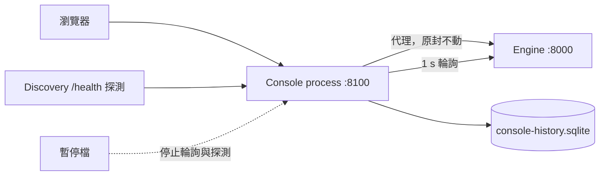

網頁主控台不屬於引擎行程。`yunshu console` 是一個獨立的輕量行程，負責提供主控台介面、在同一個 origin 上代理引擎 API，並記錄引擎的歷史。本頁說明其設計與各個運作部件。主控台各頁面的使用方式請見應用程式內的主控台指南；設定項目請見[設定](/docs/guides/configuration)。

## 它做什麼

主控台行程（`python/yunshu_console/`）做四件事：

- **提供**已建置的主控台與文件，路徑在 `/console/` 之下（`app.py`）。外殼是公開的，讓你可以輸入 token；推論、模型操作、金鑰與設定仍維持原本的授權。
- **代理**引擎 API：方法、內容、`Authorization` 與 `x-api-key`、SSE 串流與 WebSocket 都原封不動轉發，所以瀏覽器只和一個 origin 對話。當引擎無法連線時，代理會立即回應帶有 `engine_unreachable` 的 `502`，而不是卡住。
- **記錄**歷史（`poller.py`、`store.py`）。它每秒讀取一次引擎的低成本端點（`/v1/yunshu/status`、以游標從 `/v1/yunshu/requests/recent?after_seq=` 取得的已完成請求，以及大約每五秒一次的主機遙測），並以 WAL 模式寫入 SQLite，每十秒批次寫入一次。
- **記住中斷。** 引擎沒有回應期間不會寫入任何資料列。這段時間就是空缺，會被回報為空缺，絕不插補。事件會記錄引擎無法連線與恢復連線（含持續時間）、引擎重新啟動、模型載入或卸載，以及模型載入失敗。

它自己從資料庫回應 `/v1/yunshu/metrics/history`、`/v1/yunshu/requests/history` 與 `/v1/yunshu/console`，所以引擎停機時歷史仍然可用。

## 為什麼這樣設計

一個隨著被監控對象一起掛掉的監控頁面，在最需要的時候毫無用處。主控台是同層的獨立行程，從不匯入 MLX、mlx-lm 或 mlx-vlm（單元測試在全新的直譯器中斷言這一點），所以能立即啟動、閒置時佔用很小，也不會被引擎當機波及。引擎同樣不依賴它：主控台掛掉時，引擎不受影響。引擎本身不保留歷史，也不為此執行任何東西；每次讀取都是一般的 HTTP 請求，由引擎在其事件迴圈上回應，和網頁主控台發出的請求相同。



## 歷史儲存

`store.py` 保留三張資料表，每張都以 SQL `AVG`（峰值用 `MAX`）從較細的一張彙總而來，範圍是一次寫入所觸及的區間，所以重新啟動不會遺失或重複計算部分區間：

| 資料表 | 解析度 | 保留期間 |
|---|---|---|
| `m1` | 1 秒 | 1 小時 |
| `m10` | 10 秒 | 24 小時 |
| `m60` | 1 分鐘 | `YUNSHU_CONSOLE_RETENTION_DAYS`（30） |

請求紀錄只保留中繼資料：id、模型、路由、狀態、時間戳、token 數、快取 token 數、首 token 延遲（TTFT）、解碼速度與結束原因。提示詞與輸出絕不儲存；引擎的已完成請求項目本來就不含這些，而 `request_row` 會丟棄任何不在白名單上的欄位。檔案大小以 `YUNSHU_CONSOLE_DB_MAX_MB`（64）為上限：超過時，先移除最舊的請求資料列，再移除最舊的 1 分鐘資料列。

請求游標是 `(boot_id, seq)`。主控台啟動後的第一次讀取會取得引擎環形緩衝中的全部內容；之後的讀取只取新增的部分；`boot_id` 改變（引擎重新啟動）時序列會重新開始。資料列以 `(t, request_id)` 為鍵，所以即使重播也不會重複寫入。

## 引擎自動探索

`yunshu console --engine auto`（或 `YUNSHU_CONSOLE_ENGINE=auto`）讓一個主控台在引擎於不同連接埠啟動與停止時保持開啟（`discovery.py`）。

- 每隔 `YUNSHU_CONSOLE_DISCOVER_S`（2 秒），每個候選者都會收到一次帶短逾時的非同步 `GET /health`。設定 `YUNSHU_CONSOLE_DISCOVER_PORTS=all` 時，候選者是這部 Mac 上正在監聽的 TCP 連接埠（透過 `lsof`，每 10 秒更新），扣除主控台行程（它們會代理 `/health`，看起來就像背後的引擎）。像 `8000,18990-18999` 這樣的明確清單，則只探測 `127.0.0.1` 上的那些連接埠。
- 只有 `/health` 的回應像 Yunshu 引擎時，連接埠才算數：`status: "ok"`、一個 `engine` 物件、一個 `server_state`，以及數值的 `uptime_seconds`。若連接埠的回應像是其他服務，會在 60 秒後再探測一次。
- 選擇具有黏性。正在跟隨的引擎在健康時會被保留；當它消失（連續兩次探測沒回應）時，主控台會跟隨最近啟動的存活引擎（uptime 最短者）。使用者釘選的引擎在存活期間優先。
- `/v1/yunshu/console/engines` 列出引擎；`/v1/yunshu/console/engines (POST)` 搭配 `{"url": ...}` 或 `{"port": ...}` 進行釘選，`{"url": null}` 則取消釘選。
- 歷史會隨每個請求儲存引擎 URL 與啟動時間，所以重新啟動會顯示為獨立的工作階段，而 `engine_switched` 事件標記一次切換。已對舊引擎開啟的串流不會被切斷。

## 生命週期、重新啟動與 launchd

| 啟動方式 | 執行內容 |
|---|---|
| `yunshu serve -m <model>` | 引擎，加上作為同層行程的主控台行程（`--no-console` 略過，`--console-port` 更改連接埠）。若該連接埠上已有主控台在回應，就不會再啟動。同層行程隨引擎一起結束。 |
| `yunshu console --engine URL` | 只啟動主控台，用來監看其他地方的引擎（引擎需要時加上 `--engine-token`） |
| `yunshu service install` | 兩個 launchd 工作：引擎，以及以獨立常駐工作執行的主控台，所以引擎重新啟動期間記錄仍會持續。`--no-console` 只安裝引擎；`yunshu service logs --console` 顯示主控台日誌。 |

在服務模式下，引擎以 `--no-console` 啟動，因為主控台是獨立的工作。

- **從主控台重新啟動。** 需要重新啟動的設定以 `PATCH /v1/yunshu/config` 寫入；回應會列出 `restart_for`。`POST /v1/yunshu/service/restart` 搭配 `confirm: true` 會等待進行中的請求完成，最長 `YUNSHU_DRAIN_TIMEOUT` 秒，然後執行 `launchctl kickstart -k`。在 launchd 之外會回應 `409 not_under_launchd` 並附上手動指令；主控台永遠不擁有引擎行程。這些路由需要 `admin` 權限。
- **從容應對中斷。** 引擎停機期間，介面會顯示「Engine restarting」與一般所需時間（已記錄中斷的中位數，即 `/v1/yunshu/console` 中的 `outages`），讓過期的頁面變暗，並在引擎恢復時用已記錄的歷史補上錯過的區段。只有 60 秒完全沒有存活的引擎才會變成警告。
- **部署健康度。** 記錄器也會追蹤行程佔用量及其 15 到 30 分鐘的迴歸斜率，以及請求錯誤率。斜率超過每小時 1 GiB，或最近一分鐘內 20 個以上完成請求中至少 5% 失敗時，會觸發一個主控台警示與一則警告事件。取消不計入錯誤率。這只是提示你去檢查記憶體帳本，並非洩漏診斷。

## 量測暫停

只輪詢 A/B 其中一邊的監控會擾動量測結果。當 `YUNSHU_CONSOLE_PAUSE_FILE` 所指的檔案存在，且內容為 `{"pause": true, "until": <epoch or null>, "reason": "..."}` 時，輪詢器與探索探測不會向任何引擎送出任何內容（`pause.py`）。該檔案在 `until` 之後失效；若 `until` 為 null，則在最後一次寫入兩小時後失效；檔案被移除時，主控台會自行恢復。代理仍會轉發你自己發出的請求，狀態島會顯示原因。`gpuq` 在執行安靜或速度工作時會寫入此檔案。

## 保證

- 主控台從不匯入 MLX，也不持有 GPU 工作；引擎當機波及不到它。
- 空缺就回報為空缺，絕不插補；缺少的資料顯示為無法取得，絕不顯示為零。
- 請求資料列只帶中繼資料。不會記錄任何提示詞或輸出文字。
- 請求游標在輪詢、引擎重新啟動或主控台重新啟動之間，絕不會跳過或重複任何請求。

## 設定

| 設定 | 預設 | 作用 |
|---|---|---|
| `YUNSHU_CONSOLE` | 開啟 | `yunshu serve` 同時啟動主控台行程 |
| `YUNSHU_CONSOLE_PORT` | 8100 | 主控台連接埠 |
| `YUNSHU_CONSOLE_HOST` | 未設定 | 綁定主機；未設定時，同層行程跟隨引擎的主機，單獨執行時為 127.0.0.1 |
| `YUNSHU_CONSOLE_ENGINE` | 未設定 | 要監看的引擎 URL；`auto` 則跟隨引擎 |
| `YUNSHU_CONSOLE_ENGINE_TOKEN` | 未設定 | 讀取引擎用的 Bearer token；退回使用 `YUNSHU_AUTH_TOKEN` |
| `YUNSHU_CONSOLE_DISCOVER_PORTS` | `all` | 自動模式下探測的連接埠 |
| `YUNSHU_CONSOLE_DISCOVER_S` | 2.0 | 探測間隔秒數 |
| `YUNSHU_CONSOLE_POLL_S` | 1.0 | 讀取引擎的間隔秒數 |
| `YUNSHU_CONSOLE_HISTORY` | 開啟 | 記錄歷史與請求紀錄 |
| `YUNSHU_CONSOLE_DB` | `~/.yunshu/console-history.sqlite` | 歷史檔案 |
| `YUNSHU_CONSOLE_RETENTION_DAYS` | 30 | 1 分鐘資料列、請求與事件的保留天數 |
| `YUNSHU_CONSOLE_DB_MAX_MB` | 64 | 大小上限 |
| `YUNSHU_CONSOLE_PAUSE_FILE` | 未設定 | 量測暫停檔 |

## 限制

- 它是供單一機器使用的操作工具。對網路提供服務（`--host 0.0.0.0`）時需要設定 token。
- 從介面重新啟動，只有在引擎以 `yunshu` launchd 服務執行時才有效。
- 歷史解析度受上述資料表限制；超過保留期限的請求細節就消失了。

## 如何驗證

```bash
uv run pytest tests/unit/test_console_proxy.py tests/unit/test_console_poller.py \
  tests/unit/test_console_store.py tests/unit/test_console_discovery.py \
  tests/unit/test_console_pause.py tests/unit/test_console_endpoints.py -q
curl -s "$CONSOLE_URL"/v1/yunshu/console | python -m json.tool
```

不匯入 MLX 的規則由 `tests/unit/test_console_proxy.py` 中的 `test_nothing_in_the_console_process_loads_mlx` 把關。
