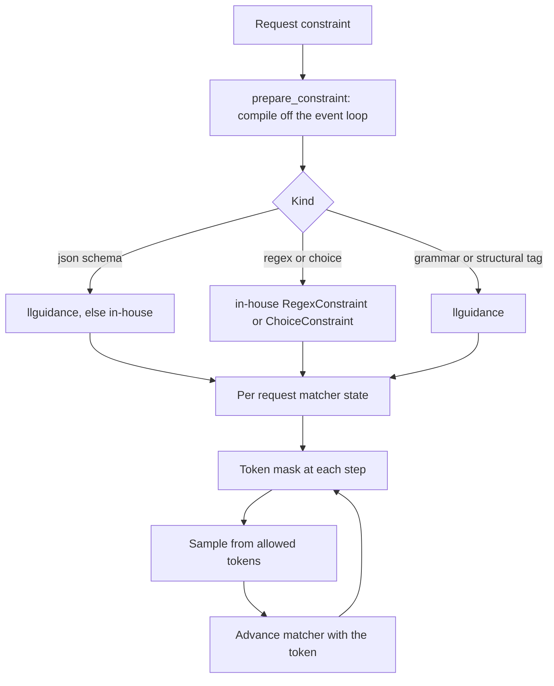

Constrained decoding makes the model's output follow a format by masking the next-token choice at every step. This page explains how Yunshu does it, for people who read or change the code. For the request fields and examples, see [Structured output](/docs/guides/structured-output).

## What it does

A constraint is a small state machine that, given the tokens generated so far, says which tokens may come next. The sampler sets every other token's logit to negative infinity before choosing. The supported constraint kinds are:

| Kind | Request form | Implementation |
|---|---|---|
| JSON schema / `json_object` | `response_format`, `guided_json`, `structured_outputs` | llguidance by default, the in-house state machine as the alternative (`YUNSHU_JSON_SCHEMA_ENGINE`) |
| Regex | `guided_regex` | `RegexConstraint`, an in-house character DFA over a documented regex subset |
| Choice | `guided_choice` | `ChoiceConstraint`, a trie over the strings |
| Context-free grammar | `grammar` (Lark syntax) | `CfgGrammarConstraint` on llguidance |
| Structural tags | `response_format.type = structural_tag` | llguidance, free text until a trigger |
| Tool calls | `tools` with `tool_choice` | `ToolCallGuide` (see [Tool-call parsing](/docs/internals/tool-call-parsing)) |

`ConstraintFactory.create` maps a grammar type to the constraint object. All constraints share one interface: `advance`, `get_allowed_tokens`, `is_done` and `reset`.

## Why

Two engines exist because they trade differently. The llguidance engine is a native Earley/lexer parser: the registry records about 0.25 ms median per-token mask on a 248K vocabulary, properties come out in schema order, and forced literals use canonical tokenization. The in-house Python state machine is slower (about 3 ms median in the registry text), accepts any property order, and is the fallback when llguidance cannot compile a schema or cannot bind a tokenizer (it needs a Hugging Face fast tokenizer). A schema that neither engine can enforce is rejected up front rather than half-applied (`build_json_constraint`, `validate_constraint_spec`).

The text fast path then turns a constraint into a sampler in one of two ways:

- **Allowlist sampler (default).** `ConstrainedSampler` asks the constraint for the allowed token ids at each step and masks the logits.
- **Bitmask engine (opt-in).** `YUNSHU_GRAMMAR_BITMASK=1` selects `BitmaskConstrainedSampler`, which keeps a boolean vocabulary mask and applies it with one vectorised `mx.where`. If building the bitmask engine fails, the code logs at debug level and falls back to the allowlist path.

The VLM runner works on bitmasks natively: `ConstraintGuide` wraps a serial `ConstraintProcessor` and exposes `mask()` as a packed int32 bitmask, which llguidance fills directly.



## Compilation and admission

`prepare_constraint` (`yunshu_engine/grammar_compile.py`) compiles and validates a constraint off the event loop before the request is admitted: at most 32 queued submissions per event loop and two active CPU workers. Compiled artifacts live in a bounded LRU `ArtifactCache` with single-flight construction; failed artifacts are never retained and oversized inputs bypass retention. Mutable matchers always belong to one request, never to the cache. Cancellation never exposes a half-built artifact.

## Interaction with speculation

On the Qwen3.5 speculative lanes (MTP and DFlash) the same constraint object serves both the serial path and the verifier. `yunshu_engine/constrained_spec.py` provides this:

- **Transactions.** `ConstraintGuide.checkpoint`, `feed` and `restore` let the verifier walk a window of drafted tokens, build one mask per position with `plan(drafts, n_pos)`, and then roll back. Walking proposals never changes the committed grammar state.
- **Forced tokens.** `forced_tokens` jumps only over positions whose mask has a single legal token. The module notes that forced bytes can have several BPE tokenizations, so llguidance's byte fast-forward alone would not be token-exact.
- **Arithmetic.** A response-format or logprob row verifies with serial one-row arithmetic (`exact_verify`) so a constrained request decodes the same tokens with speculation on or off. A request whose only guide is a tool-call guide (`invariant_guide`) keeps the batch-invariant kernels: free text under it is unmasked, and inside a call the mask only restricts the argmax of a row whose logits the invariant kernels already make equal.
- **Dead ends.** An empty allowed set is never answered with the unconstrained argmax. At an accepting state the normalised EOS ids are legal; if nothing is legal, `ConstrainedDecodingError` fails the request closed.

## Jump-forward and tool grammar

- `YUNSHU_JUMP_FORWARD` (off): for greedy JSON-schema generation on the text path, tokens the grammar forces are emitted without a forward pass. The code turns it off for LoRA, cancel events, logit bias, suppressed tokens, `min_tokens`, logprobs, sampling and regex/choice/grammar constraints, so those requests use the normal constrained decode.

## Guarantees

- A constrained output is accepted by the constraint, or the request fails; an empty allowed set is never papered over with the unconstrained argmax.
- Speculation on and off give the same tokens for constrained requests (serial verify arithmetic), apart from tool-call-guide-only requests, which keep the invariant arithmetic by design.
- The mask never removes a valid continuation, so constraints do not change what a model would validly have written.
- A parsed tool call is not a strict-schema proof when a grammar and tokenizer combination is unsupported and the unconstrained fallback runs.

## Knobs

| Setting | Default | Effect |
|---|---|---|
| `YUNSHU_JSON_SCHEMA_ENGINE` | `llguidance` | Preferred engine for JSON schema and `json_object`; `inhouse` selects the Python state machine |
| `YUNSHU_GRAMMAR_BITMASK` | off | Text engine: bitmask sampler instead of the allowlist sampler |
| `YUNSHU_JUMP_FORWARD` | off | Text engine: emit grammar-forced tokens without a forward pass |

## Limits

- Regex support is a subset; `UnsupportedRegexError` names what is outside it. Context-free grammars need llguidance.
- A schema neither engine can enforce is rejected, not approximated.
- On the VLM path, tools combined with an ordinary JSON or grammar constraint are rejected, and a forced tool choice combined with structural tags is rejected, so independent contracts cannot silently override each other.
- Constraints add per-token CPU work. They are not free on small models.

## How to verify

```bash
uv run pytest tests/unit/test_grammar_constraint.py tests/unit/test_json_schema_llguidance.py \
  tests/unit/test_constrained_spec.py tests/unit/test_spec_grammar_constraint.py \
  tests/unit/test_grammar_bitmask.py tests/unit/test_structural_tag.py -q
```

The `toolparse` suite of the verify tool checks forced, streaming and lazy structural-tag output over real HTTP (see [Verification](/docs/developers/verification)).
