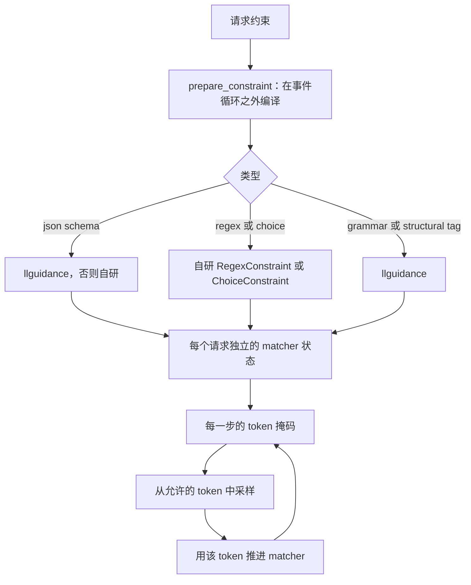

约束解码通过在每一步屏蔽下一个 token 的选择，让模型输出遵循指定格式。本页为阅读或修改代码的人说明 Yunshu 如何做到这一点。请求字段与示例请见[结构化输出](/docs/guides/structured-output)。

## 功能概览

约束是一个小型状态机：给定目前已生成的 token，它会说出下一步可以是哪些 token。采样器在选择之前，把所有其他 token 的 logit 设为负无穷。支持的约束类型如下：

| 类型 | 请求形式 | 实现 |
|---|---|---|
| JSON schema / `json_object` | `response_format`、`guided_json`、`structured_outputs` | 缺省为 llguidance，可改用自研状态机（`YUNSHU_JSON_SCHEMA_ENGINE`） |
| 正则 | `guided_regex` | `RegexConstraint`，基于有文档说明的正则子集的自研字符 DFA |
| 选项 | `guided_choice` | `ChoiceConstraint`，针对这些字符串的 trie |
| 上下文无关语法 | `grammar`（Lark 语法） | 基于 llguidance 的 `CfgGrammarConstraint` |
| 结构标签 | `response_format.type = structural_tag` | llguidance，触发前为自由文本 |
| 工具调用 | `tools` 搭配 `tool_choice` | `ToolCallGuide`（见[工具调用解析](/docs/internals/tool-call-parsing)） |

`ConstraintFactory.create` 把语法类型对应到约束对象。所有约束共用同一个接口：`advance`、`get_allowed_tokens`、`is_done` 与 `reset`。

## 为什么这样设计

存在两个引擎，是因为它们的取舍不同。llguidance 引擎是原生的 Earley/词法解析器：注册表记录在 248K 词表上每个 token 的掩码中位数约为 0.25 ms，属性按 schema 顺序输出，强制的字面量使用规范分词。自研的 Python 状态机较慢（注册表文字中中位数约 3 ms），接受任意属性顺序，并在 llguidance 无法编译 schema 或无法绑定分词器（它需要 Hugging Face fast tokenizer）时作为后备。两个引擎都无法强制执行的 schema 会在一开始就被拒绝，而不是只套用一半（`build_json_constraint`、`validate_constraint_spec`）。

文本快速路径接着以两种方式之一把约束变成采样器：

- **白名单采样器（缺省）。** `ConstrainedSampler` 每一步向约束询问允许的 token id，并屏蔽 logits。
- **位掩码引擎（选用）。** `YUNSHU_GRAMMAR_BITMASK=1` 选择 `BitmaskConstrainedSampler`，它保存一份布尔词表掩码，并用一次向量化的 `mx.where` 套用。如果建立位掩码引擎失败，代码会以 debug 级别记录并退回白名单路径。

VLM runner 原生使用位掩码：`ConstraintGuide` 包装一个串行的 `ConstraintProcessor`，并通过 `mask()` 暴露打包的 int32 位掩码，由 llguidance 直接填入。



## 编译与准入

`prepare_constraint`（`yunshu_engine/grammar_compile.py`）在请求被接纳之前，于事件循环之外编译并验证约束：每个事件循环最多排队 32 个提交，并有两个活动的 CPU worker。编译产物存放在有上限的 LRU `ArtifactCache` 中，采用 single-flight 构建；失败的产物从不保留，过大的输入不进入保留。可变的 matcher 永远属于单个请求，绝不进入缓存。取消操作绝不会暴露构建到一半的产物。

## 与推测解码的互动

在 Qwen3.5 的推测通道（MTP 与 DFlash）上，同一个约束对象同时服务串行路径与验证器。`yunshu_engine/constrained_spec.py` 提供：

- **事务。** `ConstraintGuide.checkpoint`、`feed` 与 `restore` 让验证器遍历一个草稿 token 窗口，用 `plan(drafts, n_pos)` 为每个位置建立一份掩码，然后回滚。遍历提案绝不会改变已提交的语法状态。
- **强制 token。** `forced_tokens` 只会跳过掩码里只有一个合法 token 的位置。该模块指出强制的字节可能有多种 BPE 分词方式，所以单靠 llguidance 的字节快进无法保证 token 精确一致。
- **算术。** 带有 response-format 或 logprob 的行使用串行单行算术验证（`exact_verify`），因此约束请求在开启与关闭推测时解码出相同的 token。只有工具调用 guide 的请求（`invariant_guide`）保留 batch-invariant 内核：其中的自由文本不加掩码，调用内部的掩码只限制某一行的 argmax，而该行的 logits 已被 invariant 内核变得相等。
- **死路。** 允许集合为空时，绝不会用不受约束的 argmax 来回答。在接受状态下，规范化后的 EOS id 是合法的；如果没有任何合法选项，`ConstrainedDecodingError` 会让请求以失败关闭（fail closed）。

## 跳跃前进与工具语法

- `YUNSHU_JUMP_FORWARD`（关闭）：对文本路径上的贪婪 JSON schema 生成，语法强制的 token 不经前向传递就直接输出。代码在 LoRA、取消事件、logit bias、被抑制的 token、`min_tokens`、logprobs、采样以及 regex/choice/grammar 约束时会关闭它，因此这些请求使用一般的约束解码。
- `YUNSHU_TOOL_GRAMMAR`（关闭，实验性）：对 `auto` 工具选择使用工具调用结构标签。强制的 `tool_choice`（`required`、`any` 或指定工具）无论此开关如何都一律受约束。掩码绝不会从模型本可有效写出的调用中移除 token，所以格式正确的无约束调用会被逐 token 重现。

## 保证

- 受约束的输出会被约束接受，否则请求失败；允许集合为空时绝不会用不受约束的 argmax 敷衍过去。
- 对受约束的请求，开启与关闭推测会得到相同的 token（串行验证算术），仅工具调用 guide 的请求例外，它们按设计保留 invariant 算术。
- 掩码绝不会移除有效的后续内容，因此约束不会改变模型本来能有效写出的内容。
- 当语法与分词器的组合不受支持而运行了无约束后备时，解析出的工具调用并不能证明符合严格 schema。

## 配置项

| 设置 | 缺省 | 作用 |
|---|---|---|
| `YUNSHU_JSON_SCHEMA_ENGINE` | `llguidance` | JSON schema 与 `json_object` 的首选引擎；`inhouse` 选择 Python 状态机 |
| `YUNSHU_GRAMMAR_BITMASK` | 关闭 | 文本引擎：用位掩码采样器取代白名单采样器 |
| `YUNSHU_JUMP_FORWARD` | 关闭 | 文本引擎：语法强制的 token 不经前向传递直接输出 |
| `YUNSHU_TOOL_GRAMMAR` | 关闭 | 用结构标签约束 `auto` 工具调用（实验性） |

## 限制

- 正则支持的是子集；`UnsupportedRegexError` 会指出超出范围的部分。上下文无关语法需要 llguidance。
- 两个引擎都无法强制执行的 schema 会被拒绝，而不是近似处理。
- 在 VLM 路径上，工具与一般 JSON 或语法约束组合会被拒绝，强制工具选择与结构标签组合也会被拒绝，这样独立的契约就不会悄悄互相覆盖。
- 约束会增加每个 token 的 CPU 工作量。对小模型来说并非没有代价。

## 如何验证

```bash
uv run pytest tests/unit/test_grammar_constraint.py tests/unit/test_json_schema_llguidance.py \
  tests/unit/test_constrained_spec.py tests/unit/test_spec_grammar_constraint.py \
  tests/unit/test_grammar_bitmask.py tests/unit/test_structural_tag.py -q
```

验证工具的 `toolparse` 套件会通过真实 HTTP 检查强制、流式与惰性结构标签的输出（见[验证](/docs/developers/verification)）。
