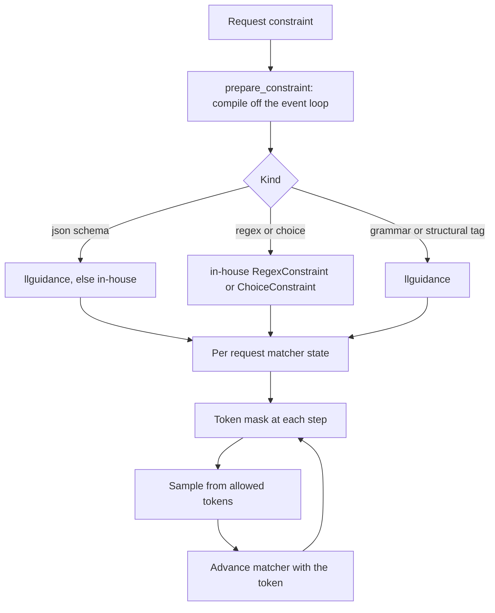

約束解碼會在每一步遮罩下一個 token 的選擇，讓模型輸出遵循指定格式。本頁為閱讀或修改程式碼的人說明 Yunshu 如何做到這一點。請求欄位與範例請見[結構化輸出](/docs/guides/structured-output)。

## 功能概述

約束是一個小型狀態機，根據目前已生成的 token，指出下一步允許哪些 token。取樣器在選擇之前，會把其他所有 token 的 logit 設為負無限大。支援的約束種類如下：

| 種類 | 請求形式 | 實作 |
|---|---|---|
| JSON schema / `json_object` | `response_format`、`guided_json`、`structured_outputs` | 預設使用 llguidance，也可改用自家狀態機（`YUNSHU_JSON_SCHEMA_ENGINE`） |
| Regex | `guided_regex` | `RegexConstraint`，針對文件載明的 regex 子集所做的自家字元 DFA |
| 選項 | `guided_choice` | `ChoiceConstraint`，以字串建立的 trie |
| 無上下文文法 | `grammar`（Lark 語法） | 建立在 llguidance 上的 `CfgGrammarConstraint` |
| 結構標籤 | `response_format.type = structural_tag` | llguidance，觸發前為自由文字 |
| 工具呼叫 | `tools` 搭配 `tool_choice` | `ToolCallGuide`（見[工具呼叫解析](/docs/internals/tool-call-parsing)） |

`ConstraintFactory.create` 會把文法類型對應到約束物件。所有約束共用同一個介面：`advance`、`get_allowed_tokens`、`is_done` 與 `reset`。

## 設計理由

之所以有兩個引擎，是因為它們各有取捨。llguidance 引擎是原生的 Earley/lexer 剖析器：登錄表記錄在 248K 詞彙表上每個 token 遮罩的中位數約 0.25 ms，屬性依 schema 順序輸出，強制的字面值使用標準 tokenization。自家的 Python 狀態機較慢（登錄表文字記載中位數約 3 ms），接受任意屬性順序，並在 llguidance 無法編譯 schema 或無法綁定 tokenizer（它需要 Hugging Face fast tokenizer）時作為後備。兩個引擎都無法強制執行的 schema 會被事先拒絕，而不是只套用一半（`build_json_constraint`、`validate_constraint_spec`）。

接著，純文字快速路徑會用兩種方式之一把約束變成取樣器：

- **允許清單取樣器（預設）。** `ConstrainedSampler` 在每一步向約束詢問允許的 token id，並遮罩 logits。
- **位元遮罩引擎（選用）。** `YUNSHU_GRAMMAR_BITMASK=1` 會選用 `BitmaskConstrainedSampler`，它維護一個布林詞彙遮罩，並以一次向量化的 `mx.where` 套用。若建立位元遮罩引擎失敗，程式碼會以 debug 等級記錄，並退回允許清單路徑。

VLM runner 原生使用位元遮罩：`ConstraintGuide` 包裝一個序列的 `ConstraintProcessor`，並以封裝好的 int32 位元遮罩公開 `mask()`，由 llguidance 直接填入。



## 編譯與准入

`prepare_constraint`（`yunshu_engine/grammar_compile.py`）會在請求被接受之前，於事件迴圈之外編譯並驗證約束：每個事件迴圈最多 32 個排隊中的提交，以及兩個作用中的 CPU worker。編譯產物存放在有上限的 LRU `ArtifactCache` 中，採單一飛行建構；失敗的產物絕不保留，過大的輸入會略過保留。可變的 matcher 永遠屬於單一請求，絕不放進快取。取消絕不會暴露建構到一半的產物。

## 與推測解碼的互動

在 Qwen3.5 的推測通道（MTP 與 DFlash）上，同一個約束物件同時服務序列路徑與驗證器。`yunshu_engine/constrained_spec.py` 提供下列機制：

- **交易。** `ConstraintGuide.checkpoint`、`feed` 與 `restore` 讓驗證器走過一個草稿 token 視窗，以 `plan(drafts, n_pos)` 為每個位置建立一份遮罩，然後回滾。走過提案絕不會改變已提交的文法狀態。
- **強制 token。** `forced_tokens` 只會跳過遮罩內只有單一合法 token 的位置。該模組註記，強制的位元組可能有多種 BPE tokenization，所以單靠 llguidance 的位元組快轉無法做到 token 精確。
- **算術。** 帶有 response-format 或 logprob 的列會以序列單列算術驗證（`exact_verify`），讓受約束的請求在推測開或關時解出相同的 token。只有工具呼叫引導的請求（`invariant_guide`）會保留批次不變核心：其下的自由文字不加遮罩，而在呼叫內部，遮罩只限制那些 logits 已由不變核心保證相等的列的 argmax。
- **死路。** 允許集合為空時，絕不會以未受約束的 argmax 回應。在接受狀態下，正規化後的 EOS id 是合法的；若沒有任何合法 token，`ConstrainedDecodingError` 會讓請求以失敗收場。

## Jump-forward 與工具文法

- `YUNSHU_JUMP_FORWARD`（關閉）：對純文字路徑上的貪婪 JSON schema 生成，文法強制的 token 不經前向傳遞直接輸出。對於 LoRA、取消事件、logit bias、被抑制的 token、`min_tokens`、logprobs、取樣，以及 regex/選項/文法約束，程式碼會關閉此功能，所以這些請求使用一般的約束解碼。
- `YUNSHU_TOOL_GRAMMAR`（關閉，實驗性）：用於 `auto` 工具選擇的工具呼叫結構標籤。強制的 `tool_choice`（`required`、`any` 或指名的工具）一律受約束，不論此旗標為何。遮罩絕不會移除模型本來能合法寫出的呼叫中的任何 token，所以格式正確的無約束呼叫會逐 token 重現。

## 保證

- 受約束的輸出會被約束接受，否則請求失敗；允許集合為空時，絕不會用無約束的 argmax 敷衍過去。
- 受約束的請求在推測開與關時給出相同的 token（序列驗證算術），唯一例外是只有工具呼叫引導的請求，它們依設計保留不變算術。
- 遮罩絕不會移除有效的延續，所以約束不會改變模型原本會合法寫出的內容。
- 當某個文法與 tokenizer 的組合不受支援而執行無約束的後備時，剖析出的工具呼叫並不能證明符合嚴格 schema。

## 調整項目

| 設定 | 預設值 | 作用 |
|---|---|---|
| `YUNSHU_JSON_SCHEMA_ENGINE` | `llguidance` | JSON schema 與 `json_object` 偏好的引擎；`inhouse` 選用 Python 狀態機 |
| `YUNSHU_GRAMMAR_BITMASK` | 關閉 | 純文字引擎：用位元遮罩取樣器取代允許清單取樣器 |
| `YUNSHU_JUMP_FORWARD` | 關閉 | 純文字引擎：不經前向傳遞直接輸出文法強制的 token |
| `YUNSHU_TOOL_GRAMMAR` | 關閉 | 以結構標籤約束 `auto` 工具呼叫（實驗性） |

## 限制

- Regex 支援的是子集；`UnsupportedRegexError` 會指出哪些在範圍之外。無上下文文法需要 llguidance。
- 兩個引擎都無法強制執行的 schema 會被拒絕，而不是近似處理。
- 在 VLM 路徑上，工具搭配一般 JSON 或文法約束會被拒絕，強制工具選擇搭配結構標籤也會被拒絕，這樣彼此獨立的契約就不會悄悄互相覆蓋。
- 約束會增加每個 token 的 CPU 工作量。在小型模型上並非沒有成本。

## 如何驗證

```bash
uv run pytest tests/unit/test_grammar_constraint.py tests/unit/test_json_schema_llguidance.py \
  tests/unit/test_constrained_spec.py tests/unit/test_spec_grammar_constraint.py \
  tests/unit/test_grammar_bitmask.py tests/unit/test_structural_tag.py -q
```

驗證工具的 `toolparse` 套件會透過真實 HTTP 檢查強制、串流與延遲結構標籤的輸出（見[驗證](/docs/developers/verification)）。
