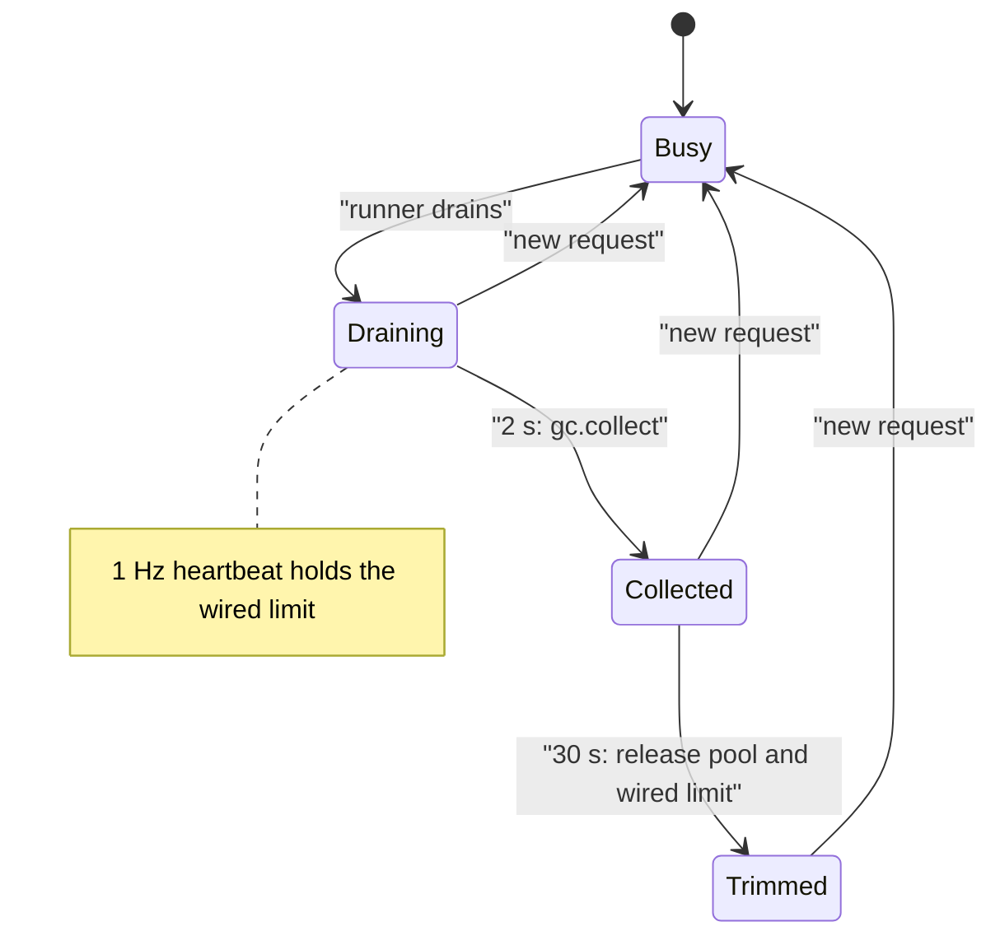

Memory is the first constraint of a local engine: weights, the KV cache, the prefix cache and MLX's own allocator pool all live in the same unified memory as your applications. This page describes how the code budgets that memory, shows who holds it, and returns what is no longer needed. It states only what the code does; for the settings see [Configuration](/docs/guides/configuration).

## What it does

Four mechanisms cooperate. None of them changes model output.

- **Budgets** cap the caches that can grow: the VLM prefix cache (APC) in RAM and on SSD, the MLX freed-buffer pool kept across prefill steps, and, for text models, the prefix cache and SSD cache.
- **Accounting** answers "who holds the memory". `GET /v1/yunshu/memory` returns a ledger of owners (`yunshu_gateway/memory_ledger.py`) built only from counters the process already keeps. A figure with no source is `null`, and an owner attributed by subtraction is marked `estimated: true`.
- **Idle return** (`yunshu_engine/idle_memory.py`) gives memory back after the runner drains: a cycle-garbage collection, then a trim of MLX's buffer pool and free malloc pages.
- **Pressure control** refuses new work that would run the process out of memory, and in multi-model mode evicts models (`ModelManager`, `ProcessMemoryEnforcer`).

## Why

A server that "did not OOM" is not good enough for a machine people also use for other work. The design rule is that every retained GiB has an owner you can name, and that an idle server returns what it does not need. The one exception is deliberate: a bounded pool of freed MLX buffers stays between requests because the next cache restore and prefill reuse those buffers, and it is released by the idle trim.

## Idle return and keep-warm

When the VLM runner has no work left it calls `IdleMemory.drained()`; a new request calls `activity()` and cancels whatever is pending.

- After `COLLECT_AFTER_S` = 2 s one `gc.collect()` runs. Arrays held only by reference cycles (the finished request's generator, closures, caches) would otherwise wait for Python's cyclic collector, which may not run for a long time on an idle server. The delay keeps back-to-back requests from paying for it.
- After `IDLE_TRIM_S` = 30 s without a request the trim runs: restore buffers are cleared, MLX's allocator pool is released, and on macOS `malloc_zone_pressure_relief` returns free malloc pages. Live objects stay allocated.
- Between those, a **keep-warm heartbeat** every `HEARTBEAT_S` = 1 s holds the Metal wired-memory limit at the device's recommended working set and runs a tiny matmul that touches no model array. Without it Metal stops keeping the weights resident after about 2 s and the next request re-pins them. The source records about 200 ms for the 27B (measured 2026-10-22: idle follow-up TTFT 0.23 s within 2 s, 0.44-0.66 s from 4 s on). The trim restores the previous wired limit.

The timer thread only submits work. Every MLX call runs on the serialized MLX executor, and each stage re-checks that the runner is still idle.

The following diagram shows the idle schedule after a request ends.



## Budgets

| Owner | Budget | Default behavior |
|---|---|---|
| APC RAM (VLM runner) | `YUNSHU_VLM_APC_MEMORY_GB` | Half of the memory left after weights and a reserve, capped at a quarter of the machine and 32 GiB; off when under 1 GiB would remain |
| APC SSD tier | `YUNSHU_VLM_APC_DISK_GB` | A quarter of the volume, at most 64 GiB; one budget for the whole directory, least recently used files go first |
| Further APC tiers | `YUNSHU_VLM_APC_DISK_TIERS` | Unset: SSD only |
| MLX freed-buffer pool | `YUNSHU_PREFILL_BUFFER_CACHE_GB` | 5% of RAM, at most 6 GiB; 0.5 GiB when the weights leave little headroom |
| Drafter windows beside APC | `YUNSHU_VLM_APC_DRAFT_WINDOW_GB` | 0.25 GiB |
| Text prefix cache eviction | `YUNSHU_MEM_PRESSURE_THRESHOLD` | Evict entries above 85% memory use |
| Text SSD cache | `YUNSHU_SSD_CACHE_MAX_GB` | 10 GiB |
| Prefill activation peak | `YUNSHU_PREFILL_STEP_SIZE` | 2048 prompt tokens per forward pass |

The RAM and SSD budgets are single budgets: the optional WARM tier takes `YUNSHU_VLM_APC_WARM_SHARE` (default 0.4) of the APC RAM budget, so total APC RAM does not grow. See [Prompt caching](/docs/guides/prompt-caching) for the tiers themselves.

## Pressure control and model eviction

**Admission.** `yunshu_gateway/admission.py` computes pressure as MLX active memory over the recommended Metal working set. While other requests are running and pressure is at or above `YUNSHU_MEMORY_PRESSURE_REJECT` (default 0.95), a new generation request gets `503` with `Retry-After`. An idle server never refuses; `0` turns the check off.

**Multi-model mode.** `ModelManager` loads models lazily and keeps an entry per model with `is_pinned`, an optional `keep_alive_s` and a lease count.

- Before a load, `_ensure_memory_available` evicts least-recently-used models until the new one fits under `max_memory_bytes`. If no victim can be evicted it raises `MemoryError` rather than looping.
- A victim must be loaded, not pinned, not leased by an in-flight request and provably idle (`_find_lru_victim`). A non-forced unload is refused for an engine that cannot be proven idle.
- After an unload the manager polls until Metal has actually released the buffers (a settle barrier, `settle_timeout_s` 5 s) and uses the measured delta.
- Idle unload uses `effective_keep_alive`: the model's own `keep_alive` (the Ollama-style `keep_alive` field on requests), else `YUNSHU_MODEL_TTL_SECONDS` (unset: never). Pinned models are never unloaded for idleness.
- `ProcessMemoryEnforcer` polls MLX active memory against `YUNSHU_MAX_MEMORY_GB` (unset: 80% of unified memory; `disabled` turns it off) and evicts the least-recently-used model when over. When only one unpinned model is loaded it stays loaded and its requests keep running; the enforcer only logs a warning.
- `GET /v1/yunshu/models/{id}/fit` dry-runs the load-time check (`ModelManager.fit_check`).

In single-model mode the model is reported as pinned and is never freed.

## Guarantees

- Idle return, buffer-pool sizing and the keep-warm heartbeat do not change output. The heartbeat's matmul touches no model array, and the pool setting is described in the registry as "allocator only; output unchanged".
- The ledger reads counters only. It runs no GPU work, does not walk the garbage collector and starts no subprocess. All `*_gb` fields are binary GiB with exact `*_bytes` beside them.
- Lossy memory savers are user options with a lossless default, and a benchmark never turns one on: `YUNSHU_KV_PRECISION=int8`, `YUNSHU_VLM_APC_WARM=int8|int4`, `YUNSHU_KV_QUANT_BITS`, `YUNSHU_PREFIX_HOT_LIMIT`, `YUNSHU_SSD_CACHE_PRECISION=int8` and `YUNSHU_QUANT_MODE`.

## Knobs

| Setting | Default | Effect |
|---|---|---|
| `YUNSHU_MAX_MEMORY_GB` | unset (80% of unified memory in multi-model mode) | Process memory ceiling for the enforcer; `disabled` turns it off |
| `YUNSHU_MODEL_TTL_SECONDS` | unset | Multi-model: unload a model idle for this long |
| `YUNSHU_MEMORY_PRESSURE_REJECT` | 0.95 | Refuse new requests above this share of the Metal working set while busy |
| `YUNSHU_VLM_APC_MEMORY_GB` | computed | APC RAM budget; 0 disables the cache |
| `YUNSHU_PREFILL_BUFFER_CACHE_GB` | computed | Freed-buffer pool kept across prefill steps |
| `YUNSHU_PREFILL_STEP_SIZE` | 2048 | Text engine prefill chunk; lower to cap the activation peak |
| `YUNSHU_FOOTPRINT_SAMPLE_MS` | 0 (off) | Sample `phys_footprint` and export the peak on `/metrics` |

On tight hosts the INFERENCE guide's soak measurement used `YUNSHU_VLM_APC_MEMORY_GB=4` and `YUNSHU_PREFILL_BUFFER_CACHE_GB=1` (27B, peak 37.2 to 31.5 GiB). `YUNSHU_MAX_MEMORY_GB` is only needed on multi-model hosts.

## Limits

- The idle schedule belongs to the VLM runner. Text-only `mlx-lm` models have their own prefix-cache eviction (`YUNSHU_MEM_PRESSURE_THRESHOLD`) but not this heartbeat and trim.
- The ledger's weight figure falls back to the model manager's estimate when a measured value is unavailable, and says so with `estimated: true`.
- `yunshu_engine/memory_census.py` can name the holder of each live array, but it walks the object graph and pauses the interpreter, so it is diagnostic only and never runs on the serving path.
- Eviction needs an idle engine. A model with an active request or a lease is never unloaded.

## How to verify

```bash
curl -s localhost:8000/v1/yunshu/memory | python -m json.tool
uv run pytest tests/unit/test_idle_memory.py tests/unit/test_process_memory_enforcer.py \
  tests/unit/test_memory_ledger_counters.py tests/unit/test_memory_guard_rejection.py -q
```

The first command lists every owner with its source and whether it is estimated. In the server log, `idle memory:` lines show the collect, the trim and the wired-limit hold and release. The retained-memory soak test is `tests/unit/test_soak_retained_memory.py`.
