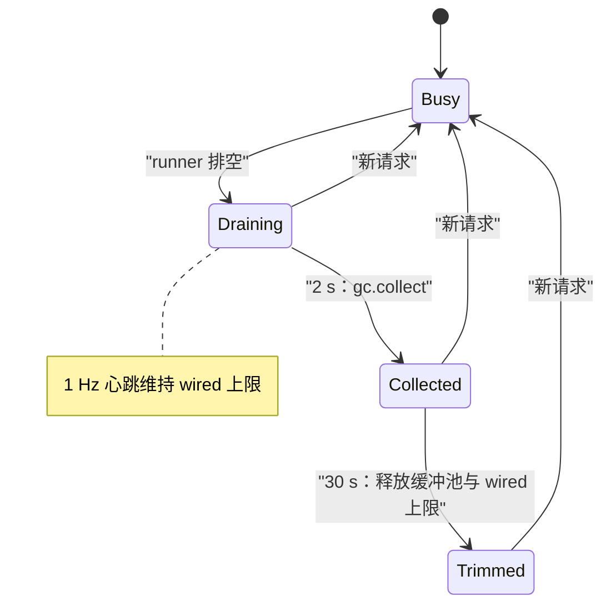

内存是本地引擎的首要约束：权重、KV 缓存、前缀缓存以及 MLX 自己的分配器池，都与你的其他应用共用同一块统一内存。本页说明代码如何为这些内存做预算、显示谁占用了它，并归还不再需要的部分。这里只陈述代码实际做的事；设置项请见[配置](/docs/guides/configuration)。

## 功能概览

四种机制协同工作，都不会改变模型输出。

- **预算**限制会增长的缓存：VLM 前缀缓存（APC）的 RAM 与 SSD、预填步骤之间保留的 MLX 已释放缓冲池，以及纯文本模型的前缀缓存与 SSD 缓存。
- **记账**回答「谁占着内存」。`GET /v1/yunshu/memory` 返回一份占用者账本（`yunshu_gateway/memory_ledger.py`），只使用进程本来就在维护的计数器。没有来源的数字为 `null`，通过相减推算出的占用者会标记 `estimated: true`。
- **闲置归还**（`yunshu_engine/idle_memory.py`）在 runner 排空后归还内存：先做一次循环垃圾回收，再修剪 MLX 的缓冲池与空闲的 malloc 页。
- **压力控制**拒绝会让进程耗尽内存的新工作，并在多模型模式下淘汰模型（`ModelManager`、`ProcessMemoryEnforcer`）。

## 为什么这样设计

对一台还要做其他工作的机器来说，「没有 OOM」的服务器还不够好。设计原则是：每一份被保留的 GiB 都有一个可以指名的占用者，闲置的服务器会归还不需要的内存。有一个刻意的例外：一个有上限的 MLX 已释放缓冲池会在请求之间保留，因为下一次缓存还原与预填会重用这些缓冲，它由闲置修剪释放。

## 闲置归还与保温

VLM runner 没有工作时会调用 `IdleMemory.drained()`；新请求会调用 `activity()` 并取消所有待处理的动作。

- 经过 `COLLECT_AFTER_S` = 2 s 后执行一次 `gc.collect()`。仅被引用循环持有的数组（已完成请求的生成器、闭包、缓存）否则要等 Python 的循环回收器，而在闲置的服务器上它可能很久都不会运行。这段延迟避免了连续请求为此付出代价。
- 经过 `IDLE_TRIM_S` = 30 s 没有请求后执行修剪：清除还原缓冲、释放 MLX 分配器池，并在 macOS 上由 `malloc_zone_pressure_relief` 归还空闲的 malloc 页。仍在使用的对象保持分配。
- 在这之间，**保温心跳**每隔 `HEARTBEAT_S` = 1 s 将 Metal 的 wired 内存上限维持在设备建议的工作集，并执行一个不触碰任何模型数组的小矩阵乘法。没有它，Metal 大约 2 s 后就不再让权重常驻，下一个请求得重新固定它们。源码记录 27B 约为 200 ms（2026-10-22 实测：2 s 内闲置后续请求的 TTFT 为 0.23 s，4 s 之后为 0.44-0.66 s）。修剪会恢复先前的 wired 上限。

计时器线程只负责提交工作。所有 MLX 调用都在串行的 MLX executor 上运行，且每个阶段都会重新确认 runner 仍处于闲置。

下图显示请求结束后的闲置时间表。



## 预算

| 占用者 | 预算 | 缺省行为 |
|---|---|---|
| APC RAM（VLM runner） | `YUNSHU_VLM_APC_MEMORY_GB` | 扣除权重与保留量后剩余内存的一半，上限为机器内存的四分之一与 32 GiB；剩余不足 1 GiB 时关闭 |
| APC SSD 层 | `YUNSHU_VLM_APC_DISK_GB` | 卷容量的四分之一，最多 64 GiB；整个目录共用一份预算，最久未使用的文件先被淘汰 |
| 其他 APC 层 | `YUNSHU_VLM_APC_DISK_TIERS` | 未设置：仅 SSD |
| MLX 已释放缓冲池 | `YUNSHU_PREFILL_BUFFER_CACHE_GB` | RAM 的 5%，最多 6 GiB；权重留下的余量很小时为 0.5 GiB |
| APC 旁的 drafter 窗口 | `YUNSHU_VLM_APC_DRAFT_WINDOW_GB` | 0.25 GiB |
| 文本前缀缓存淘汰 | `YUNSHU_MEM_PRESSURE_THRESHOLD` | 内存使用率超过 85% 时淘汰项目 |
| 文本 SSD 缓存 | `YUNSHU_SSD_CACHE_MAX_GB` | 10 GiB |
| 预填激活峰值 | `YUNSHU_PREFILL_STEP_SIZE` | 每次前向传递 2048 个提示词 token |

RAM 与 SSD 预算都是单一预算：选用的 WARM 层占用 APC RAM 预算的 `YUNSHU_VLM_APC_WARM_SHARE`（缺省 0.4），因此 APC 的 RAM 总量不会增加。各层本身请见[提示词缓存](/docs/guides/prompt-caching)。

## 压力控制与模型淘汰

**准入控制。** `yunshu_gateway/admission.py` 以 MLX 活动内存除以建议的 Metal 工作集来计算压力。当有其他请求正在运行，且压力达到或超过 `YUNSHU_MEMORY_PRESSURE_REJECT`（缺省 0.95）时，新的生成请求会收到带 `Retry-After` 的 `503`。闲置的服务器从不拒绝；设为 `0` 则关闭此检查。

**多模型模式。** `ModelManager` 按需加载模型，并为每个模型保留一个条目，包含 `is_pinned`、可选的 `keep_alive_s` 与租约计数。

- 加载前，`_ensure_memory_available` 会淘汰最久未使用的模型，直到新模型能放进 `max_memory_bytes`。如果找不到可淘汰的对象，它会抛出 `MemoryError`，而不是空转循环。
- 被淘汰的对象必须已加载、未固定、没有被进行中的请求租用，且可证明处于闲置（`_find_lru_victim`）。对无法证明闲置的引擎，非强制的卸载会被拒绝。
- 卸载之后，管理器会轮询直到 Metal 真正释放缓冲（settle 屏障，`settle_timeout_s` 为 5 s），并使用实测的差值。
- 闲置卸载使用 `effective_keep_alive`：模型自己的 `keep_alive`（请求上 Ollama 风格的 `keep_alive` 字段），否则为 `YUNSHU_MODEL_TTL_SECONDS`（未设置：永不卸载）。固定的模型永远不会因闲置而被卸载。
- `ProcessMemoryEnforcer` 会轮询 MLX 活动内存并与 `YUNSHU_MAX_MEMORY_GB`（未设置：统一内存的 80%；`disabled` 关闭）比较，超出时淘汰最久未使用的模型。当只加载了一个未固定的模型时，它保持加载，其请求继续运行；enforcer 只记录一条警告。
- `GET /v1/yunshu/models/{id}/fit` 会预演加载时的检查（`ModelManager.fit_check`）。

在单模型模式下，该模型被报告为已固定，永远不会被释放。

## 保证

- 闲置归还、缓冲池大小与保温心跳都不会改变输出。心跳的矩阵乘法不触碰任何模型数组，而缓冲池设置在注册表中的描述是「allocator only; output unchanged」。
- 账本只读取计数器。它不执行 GPU 工作，不遍历垃圾回收器，也不启动子进程。所有 `*_gb` 字段都是二进制 GiB，旁边附有精确的 `*_bytes`。
- 有损的省内存选项是缺省为无损的用户选项，基准测试绝不会把它们打开：`YUNSHU_KV_PRECISION=int8`、`YUNSHU_VLM_APC_WARM=int8|int4`、`YUNSHU_KV_QUANT_BITS`、`YUNSHU_PREFIX_HOT_LIMIT`、`YUNSHU_SSD_CACHE_PRECISION=int8` 与 `YUNSHU_QUANT_MODE`。

## 配置项

| 设置 | 缺省 | 作用 |
|---|---|---|
| `YUNSHU_MAX_MEMORY_GB` | 未设置（多模型模式下为统一内存的 80%） | enforcer 使用的进程内存上限；`disabled` 关闭 |
| `YUNSHU_MODEL_TTL_SECONDS` | 未设置 | 多模型：卸载闲置达这么久的模型 |
| `YUNSHU_MEMORY_PRESSURE_REJECT` | 0.95 | 忙碌时，超过 Metal 工作集的这个比例就拒绝新请求 |
| `YUNSHU_VLM_APC_MEMORY_GB` | 自动计算 | APC RAM 预算；0 表示关闭缓存 |
| `YUNSHU_PREFILL_BUFFER_CACHE_GB` | 自动计算 | 预填步骤之间保留的已释放缓冲池 |
| `YUNSHU_PREFILL_STEP_SIZE` | 2048 | 文本引擎的预填分块；调低可限制激活峰值 |
| `YUNSHU_FOOTPRINT_SAMPLE_MS` | 0（关闭） | 采样 `phys_footprint` 并在 `/metrics` 导出峰值 |

在内存紧张的主机上，INFERENCE 指南的 soak 测量使用了 `YUNSHU_VLM_APC_MEMORY_GB=4` 与 `YUNSHU_PREFILL_BUFFER_CACHE_GB=1`（27B；峰值因此降低，数字未记录在基准测试日志中）。`YUNSHU_MAX_MEMORY_GB` 只有多模型主机才需要。

## 限制

- 闲置时间表属于 VLM runner。纯文本 `mlx-lm` 模型有自己的前缀缓存淘汰（`YUNSHU_MEM_PRESSURE_THRESHOLD`），但没有这套心跳与修剪。
- 账本里的权重数字在没有实测值时，会退回使用 model manager 的估计值，并以 `estimated: true` 标明。
- `yunshu_engine/memory_census.py` 能指出每个存活数组的持有者，但它会遍历对象图并暂停解释器，所以只用于诊断，绝不会在服务路径上运行。
- 淘汰需要引擎处于闲置。有进行中请求或租约的模型永远不会被卸载。

## 如何验证

```bash
curl -s localhost:8000/v1/yunshu/memory | python -m json.tool
uv run pytest tests/unit/test_idle_memory.py tests/unit/test_process_memory_enforcer.py \
  tests/unit/test_memory_ledger_counters.py tests/unit/test_memory_guard_rejection.py -q
```

第一条命令会列出每个占用者及其来源，以及是否为估计值。在服务器日志中，`idle memory:` 行会显示回收、修剪，以及 wired 上限的维持与释放。保留内存的 soak 测试是 `tests/unit/test_soak_retained_memory.py`。
