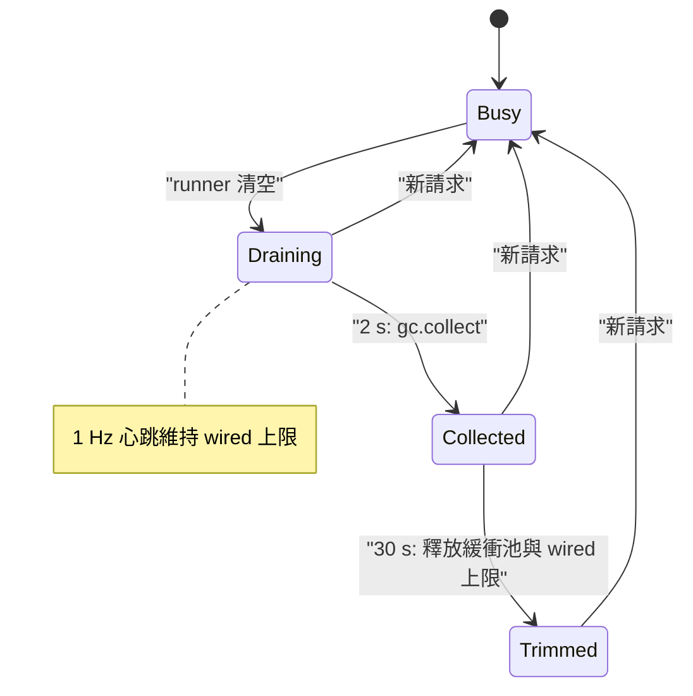

記憶體是本機引擎的第一道限制：權重、KV 快取、前綴快取與 MLX 自己的配置器緩衝池，全都和你的應用程式共用同一塊統一記憶體。本頁說明程式碼如何編列這些記憶體、如何顯示是誰在持有，以及如何歸還不再需要的部分。內容只陳述程式碼實際做的事；設定項目請見[設定](/docs/guides/configuration)。

## 它做什麼

四個機制彼此配合，都不會改變模型輸出。

- **預算**限制可能持續成長的快取：RAM 與 SSD 上的 VLM 前綴快取（APC）、預填步驟之間保留的 MLX 已釋放緩衝池，以及純文字模型的前綴快取與 SSD 快取。
- **記帳**回答「誰持有記憶體」。`GET /v1/yunshu/memory` 會回傳持有者帳本（`yunshu_gateway/memory_ledger.py`），只由行程本來就維護的計數器建立。沒有來源的數字為 `null`，以相減推算出歸屬的持有者會標示 `estimated: true`。
- **閒置歸還**（`yunshu_engine/idle_memory.py`）在 runner 清空工作後歸還記憶體：先做循環垃圾回收，再修剪 MLX 的緩衝池與空閒的 malloc 分頁。
- **壓力控制**會拒絕可能讓行程記憶體耗盡的新工作，並在多模型模式下淘汰模型（`ModelManager`、`ProcessMemoryEnforcer`）。

## 為什麼這樣設計

對一部也會拿來做其他事的機器來說，伺服器「沒有 OOM」還不夠。設計原則是：每一 GiB 被保留的記憶體都有說得出名字的持有者，而閒置的伺服器會歸還不需要的部分。唯一刻意的例外是：有上限的已釋放 MLX 緩衝池會在請求之間保留，因為下一次快取還原與預填會重用這些緩衝區，它由閒置修剪釋放。

## 閒置歸還與保持暖機

VLM runner 沒有工作時會呼叫 `IdleMemory.drained()`；新請求會呼叫 `activity()` 並取消所有待處理的動作。

- 經過 `COLLECT_AFTER_S` = 2 秒後執行一次 `gc.collect()`。只被參照循環持有的陣列（已結束請求的產生器、閉包、快取）否則得等 Python 的循環回收器，而閒置的伺服器上它可能很久都不會執行。這段延遲讓連續到來的請求不必承擔此成本。
- 連續 `IDLE_TRIM_S` = 30 秒沒有請求後執行修剪：清除還原緩衝區、釋放 MLX 的配置器緩衝池，並在 macOS 上以 `malloc_zone_pressure_relief` 歸還空閒的 malloc 分頁。仍在使用中的物件維持配置。
- 兩者之間有一個**保持暖機心跳**，每 `HEARTBEAT_S` = 1 秒把 Metal 的 wired 記憶體上限維持在裝置建議的工作集，並執行一個不碰任何模型陣列的小型 matmul。沒有它的話，Metal 約 2 秒後就不再讓權重常駐，下一個請求得重新鎖定。原始碼記錄 27B 約需 200 ms（2026-10-22 實測：閒置後的追問首 token 延遲在 2 秒內為 0.23 秒，4 秒起為 0.44 至 0.66 秒）。修剪時會還原先前的 wired 上限。

計時器執行緒只負責提交工作。所有 MLX 呼叫都在序列化的 MLX executor 上執行，且每個階段都會再次確認 runner 仍處於閒置。

下圖顯示請求結束後的閒置排程。



## 預算

| 持有者 | 預算 | 預設行為 |
|---|---|---|
| APC RAM（VLM runner） | `YUNSHU_VLM_APC_MEMORY_GB` | 扣除權重與保留量後剩餘記憶體的一半，上限為機器記憶體的四分之一與 32 GiB；若剩下不到 1 GiB 則關閉 |
| APC SSD 層 | `YUNSHU_VLM_APC_DISK_GB` | 磁碟區的四分之一，最多 64 GiB；整個目錄共用一份預算，最久未使用的檔案先被移除 |
| 其他 APC 層 | `YUNSHU_VLM_APC_DISK_TIERS` | 未設定：僅 SSD |
| MLX 已釋放緩衝池 | `YUNSHU_PREFILL_BUFFER_CACHE_GB` | RAM 的 5%，最多 6 GiB；權重佔用後餘裕很小時為 0.5 GiB |
| APC 旁的草稿視窗 | `YUNSHU_VLM_APC_DRAFT_WINDOW_GB` | 0.25 GiB |
| 純文字前綴快取淘汰 | `YUNSHU_MEM_PRESSURE_THRESHOLD` | 記憶體使用率超過 85% 時淘汰項目 |
| 純文字 SSD 快取 | `YUNSHU_SSD_CACHE_MAX_GB` | 10 GiB |
| 預填 activation 峰值 | `YUNSHU_PREFILL_STEP_SIZE` | 每次前向傳遞處理 2048 個提示詞 token |

RAM 與 SSD 預算都是單一預算：選用的 WARM 層佔用 APC RAM 預算的 `YUNSHU_VLM_APC_WARM_SHARE`（預設 0.4），所以 APC 的 RAM 總量不會增加。各層本身請見[提示詞快取](/docs/guides/prompt-caching)。

## 壓力控制與模型淘汰

**准入控制。** `yunshu_gateway/admission.py` 以 MLX 使用中記憶體除以建議的 Metal 工作集來計算壓力。當有其他請求正在執行，且壓力達到或超過 `YUNSHU_MEMORY_PRESSURE_REJECT`（預設 0.95）時，新的生成請求會收到 `503` 並附上 `Retry-After`。閒置的伺服器永遠不會拒絕；設為 `0` 則關閉檢查。

**多模型模式。** `ModelManager` 以延遲方式載入模型，並為每個模型保留一筆含 `is_pinned`、選用的 `keep_alive_s` 與租約計數的項目。

- 載入之前，`_ensure_memory_available` 會淘汰最久未使用的模型，直到新模型能放進 `max_memory_bytes`。若找不到可淘汰的對象，會拋出 `MemoryError` 而不是無限迴圈。
- 被淘汰者必須已載入、未釘選、沒有被進行中的請求租用，且能證明處於閒置（`_find_lru_victim`）。對無法證明閒置的引擎，非強制卸載會被拒絕。
- 卸載之後，管理器會輪詢直到 Metal 真正釋放緩衝區（settle barrier，`settle_timeout_s` 為 5 秒），並使用實測的差值。
- 閒置卸載使用 `effective_keep_alive`：優先採用模型自己的 `keep_alive`（請求上 Ollama 風格的 `keep_alive` 欄位），否則使用 `YUNSHU_MODEL_TTL_SECONDS`（未設定：永不卸載）。已釘選的模型不會因閒置而卸載。
- `ProcessMemoryEnforcer` 會輪詢 MLX 使用中記憶體並與 `YUNSHU_MAX_MEMORY_GB` 比較（未設定：統一記憶體的 80%；`disabled` 則關閉），超過時淘汰最久未使用的模型。若只載入了一個未釘選的模型，它會保持載入，請求照常執行；enforcer 只會記錄警告。
- `GET /v1/yunshu/models/{id}/fit` 會模擬執行載入時的檢查（`ModelManager.fit_check`）。

在單一模型模式下，該模型會被回報為已釘選，永遠不會被釋放。

## 保證

- 閒置歸還、緩衝池大小與保持暖機心跳都不會改變輸出。心跳的 matmul 不碰任何模型陣列，而緩衝池設定在登錄表中的描述是「allocator only; output unchanged」。
- 帳本只讀取計數器。它不執行任何 GPU 工作、不遍歷垃圾回收器，也不啟動子行程。所有 `*_gb` 欄位皆為二進位 GiB，旁邊附有精確的 `*_bytes`。
- 有損的省記憶體手段是使用者選項，預設為無損，基準測試絕不會把它們開啟：`YUNSHU_KV_PRECISION=int8`、`YUNSHU_VLM_APC_WARM=int8|int4`、`YUNSHU_KV_QUANT_BITS`、`YUNSHU_PREFIX_HOT_LIMIT`、`YUNSHU_SSD_CACHE_PRECISION=int8` 與 `YUNSHU_QUANT_MODE`。

## 設定

| 設定 | 預設 | 作用 |
|---|---|---|
| `YUNSHU_MAX_MEMORY_GB` | 未設定（多模型模式下為統一記憶體的 80%） | enforcer 使用的行程記憶體上限；`disabled` 則關閉 |
| `YUNSHU_MODEL_TTL_SECONDS` | 未設定 | 多模型：卸載閒置達此時間的模型 |
| `YUNSHU_MEMORY_PRESSURE_REJECT` | 0.95 | 忙碌時，超過 Metal 工作集此比例就拒絕新請求 |
| `YUNSHU_VLM_APC_MEMORY_GB` | 自動計算 | APC 的 RAM 預算；0 則停用快取 |
| `YUNSHU_PREFILL_BUFFER_CACHE_GB` | 自動計算 | 預填步驟之間保留的已釋放緩衝池 |
| `YUNSHU_PREFILL_STEP_SIZE` | 2048 | 純文字引擎的預填區塊大小；調低可壓低 activation 峰值 |
| `YUNSHU_FOOTPRINT_SAMPLE_MS` | 0（關閉） | 取樣 `phys_footprint` 並在 `/metrics` 匯出峰值 |

在記憶體吃緊的主機上，INFERENCE 指南的長時間測試使用 `YUNSHU_VLM_APC_MEMORY_GB=4` 與 `YUNSHU_PREFILL_BUFFER_CACHE_GB=1`（27B；峰值因此降低，數字未記錄在基準測試紀錄中）。只有多模型主機才需要 `YUNSHU_MAX_MEMORY_GB`。

## 限制

- 閒置排程屬於 VLM runner。純文字 `mlx-lm` 模型有自己的前綴快取淘汰（`YUNSHU_MEM_PRESSURE_THRESHOLD`），但沒有這個心跳與修剪。
- 當沒有實測值時，帳本的權重數字會退回使用模型管理器的估計值，並以 `estimated: true` 標示。
- `yunshu_engine/memory_census.py` 可以指出每個存活陣列的持有者，但它會遍歷物件圖並暫停直譯器，所以只用於診斷，絕不會在服務路徑上執行。
- 淘汰需要引擎處於閒置。有進行中請求或租約的模型絕不會被卸載。

## 如何驗證

```bash
curl -s localhost:8000/v1/yunshu/memory | python -m json.tool
uv run pytest tests/unit/test_idle_memory.py tests/unit/test_process_memory_enforcer.py \
  tests/unit/test_memory_ledger_counters.py tests/unit/test_memory_guard_rejection.py -q
```

第一個指令會列出每個持有者、其來源，以及是否為估計值。在伺服器日誌中，`idle memory:` 開頭的行會顯示回收、修剪，以及 wired 上限的維持與釋放。保留記憶體的長時間測試是 `tests/unit/test_soak_retained_memory.py`。
