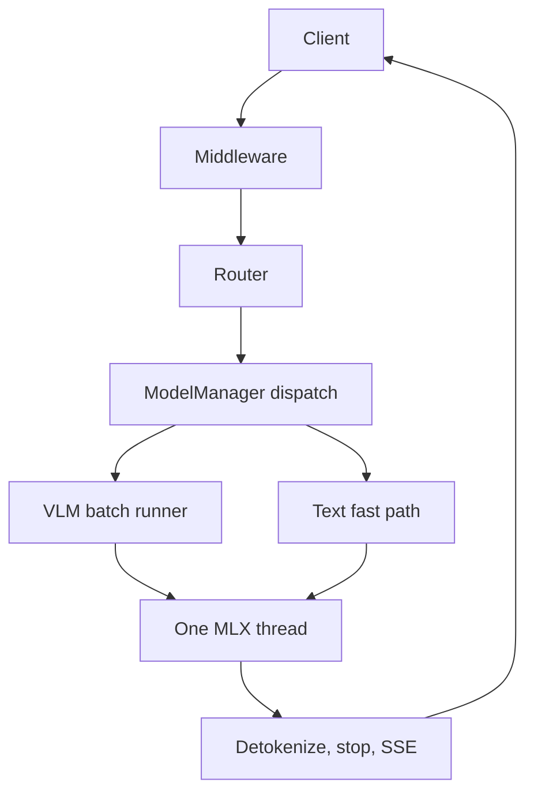

These pages explain how Yunshu works inside, for people who read or change the code or who want to know exactly what a setting does. They state only what the code does. For the package layout see [Architecture](/docs/developers/architecture); for tunable behavior see [Configuration](/docs/guides/configuration).

## What it does

Yunshu is one process: a FastAPI gateway in front of an MLX-based engine on Apple Silicon. A request passes through middleware and a router, is dispatched by `ModelManager` to the engine for its model, and ends as tokens that the gateway turns into the dialect's response or stream. Three ideas shape everything else:

- **Two serving paths.** Every `mlx-vlm` model (`VLMEngine`) is served by the VLM batch runner (`vlm_batch_runner.py`, built by `VLMEngine._build_batch_runner`). Text-only `mlx-lm` models use a single-request fast path (`_generate_fast`, which calls mlx-lm's `generate_step`); concurrent requests to such a model are serialized.
- **One MLX thread.** All GPU work runs on a single-worker executor that owns the Metal stream. Nothing touches MLX arrays from the event loop.
- **Identity rules.** A cache hit equals a miss, speculation on equals speculation off, and rehearsal never changes outputs. Each internals page states which rule applies and how it is checked.

A continuous-batching loop for text models exists behind `YUNSHU_ENGINE_LOOP` (default off, experimental). It is a legacy path, not a feature to build on.

## Why (design decision)

Yunshu is a single-node engine, so it optimizes time to first token, decode speed and prefix reuse for one machine rather than throughput across tenants. Optimizations stay lossless by default; lossy ones (for example int8 KV) are explicit user options. A custom Metal kernel is adopted only when a same-checkpoint comparison shows a real end-to-end win with identical or tolerance-checked output.

The map above shows where each internals page sits on the path of a request.

## Guarantees (identity rules)

| Rule | Page |
|---|---|
| A prefix-cache hit returns the same tokens as a cold prefill | [Prefix cache](/docs/internals/prefix-cache) |
| Greedy output with speculative decoding on equals output with it off | [Speculative decoding](/docs/internals/speculative-decoding) |
| Next-turn rehearsal and prompt piece sizes do not change outputs | [Prefill and rehearsal](/docs/internals/prefill-and-rehearsal) |

## Knobs

| Setting | Default | Effect |
|---|---|---|
| `YUNSHU_ENGINE_LOOP` | off | Legacy text-model batching loop instead of the fast path |
| `YUNSHU_VLM_DRAFT` | unset | Override the speculative drafter for the Qwen3.5 family |
| `YUNSHU_VLM_APC_MEMORY_GB` | derived from free memory | RAM budget of the prefix cache; `0` disables it |

Every setting is registered in `python/yunshu_engine/settings.py`; `yunshu config` prints the effective values and their sources.

## Limits

Yunshu has no multi-node mode and does not aim at multi-tenant throughput. Speculative decoding runs in a single-request lane, so concurrent requests are batched without drafting.

## How to verify

Run `yunshu config` to see effective settings, and read [Verification](/docs/developers/verification) for the `yv` tool that checks each identity rule.

## Pages

<Cards>
  <Card title="Request lifecycle" href="/docs/internals/request-lifecycle">
    Gateway, middleware, router, engine dispatch, the runner, the MLX thread and the stream back.
  </Card>
  <Card title="Prefix cache" href="/docs/internals/prefix-cache">
    Exact checkpoints, 64-aligned cuts, media keys, the RAM and SSD tiers.
  </Card>
  <Card title="Speculative decoding" href="/docs/internals/speculative-decoding">
    DFlash2 and MTP drafting, batch-invariant verify kernels and the single-request lane.
  </Card>
  <Card title="Prefill and rehearsal" href="/docs/internals/prefill-and-rehearsal">
    Split-invariant prefill and next-turn rehearsal.
  </Card>
  <Card title="Memory" href="/docs/internals/memory">
    Where memory goes and how idle memory is returned.
  </Card>
  <Card title="Constrained decoding" href="/docs/internals/constrained-decoding">
    JSON schema, regex and grammar enforcement while decoding.
  </Card>
  <Card title="Tool-call parsing" href="/docs/internals/tool-call-parsing">
    How model output becomes tool calls.
  </Card>
  <Card title="Console process" href="/docs/internals/console-process">
    The separate lightweight process behind the web console.
  </Card>
  <Card title="Code execution sandbox" href="/docs/internals/code-execution-sandbox">
    How server-side code execution is isolated.
  </Card>
</Cards>
