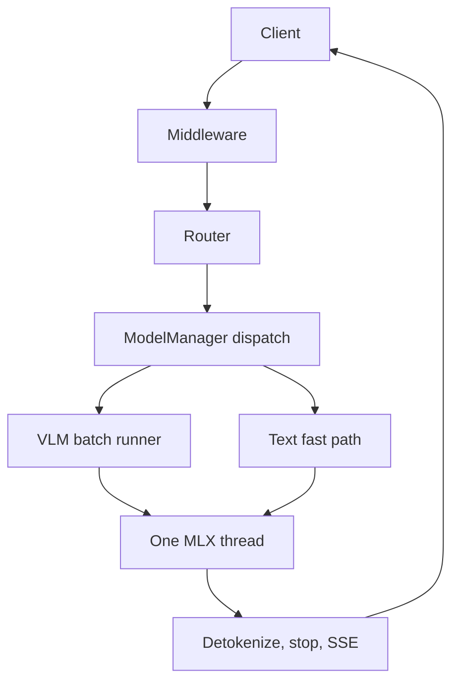

这些页面说明云舒的内部运作，面向阅读或修改代码的人，以及想精确了解某个设置作用的人。内容只陈述代码实际的行为。包结构请见[架构](/docs/developers/architecture)；可调整的行为请见[配置](/docs/guides/configuration)。

## 它做什么

云舒是单个进程：在 Apple Silicon 上，FastAPI 网关位于基于 MLX 的引擎之前。请求经过中间件与路由器，由 `ModelManager` 分发到对应模型的引擎，最后变成 token，再由网关转成该 API 方言的响应或流。三个想法决定了其余的设计：

- **两条服务路径。** 每个 `mlx-vlm` 模型（`VLMEngine`）都由 VLM batch runner 服务（`vlm_batch_runner.py`，由 `VLMEngine._build_batch_runner` 构建）。纯文本 `mlx-lm` 模型走单请求快速路径（`_generate_fast`，直接调用 mlx-lm 的 `generate_step`）；对这类模型的并发请求会被串行化。
- **单一 MLX 线程。** 所有 GPU 工作都在拥有 Metal stream 的单 worker 执行器上运行，事件循环不会接触 MLX 数组。
- **一致性规则。** 缓存命中等于未命中、推测开启等于推测关闭、预演（rehearsal）不改变输出。每个内部页面都会说明适用哪条规则以及如何检查。

文本模型的 continuous batching 循环藏在 `YUNSHU_ENGINE_LOOP` 之后（默认关闭、实验性）。它是遗留路径，不是要扩展的功能。

## 为什么这样设计

云舒是单节点引擎，因此针对单台机器优化首 token 时间、解码速度与前缀复用，而不是多租户吞吐量。优化默认保持无损；有损的（例如 int8 KV）是明确的用户选项。自定义 Metal kernel 只有在相同 checkpoint 的对照显示端到端确实有收益、且输出相同或在容差内时才会采用。

上图标出每个内部页面位于请求路径的哪个位置。

## 保证（一致性规则）

| 规则 | 页面 |
|---|---|
| 前缀缓存命中返回的 token 与冷预填相同 | [前缀缓存](/docs/internals/prefix-cache) |
| 开启推测解码的 greedy 输出与关闭时相同 | [推测解码](/docs/internals/speculative-decoding) |
| 下一轮预演与提示分段大小不会改变输出 | [预填与预演](/docs/internals/prefill-and-rehearsal) |

## 设置

| 设置 | 默认 | 作用 |
|---|---|---|
| `YUNSHU_ENGINE_LOOP` | 关闭 | 用遗留的文本模型批处理循环取代快速路径 |
| `YUNSHU_VLM_DRAFT` | 未设置 | 覆盖 Qwen3.5 系列的推测 drafter |
| `YUNSHU_VLM_APC_MEMORY_GB` | 按剩余内存推算 | 前缀缓存的 RAM 预算；`0` 表示禁用 |

所有设置都登记在 `python/yunshu_engine/settings.py`；`yunshu config` 会列出实际生效的值与来源。

## 限制

云舒没有多节点模式，也不以多租户吞吐量为目标。推测解码在单请求通道中运行，因此并发请求会以不做 draft 的方式批处理。

## 如何验证

运行 `yunshu config` 查看生效的设置，并阅读[验证](/docs/developers/verification)了解检查各项一致性规则的 `yv` 工具。

## 页面

<Cards>
  <Card title="请求生命周期" href="/docs/internals/request-lifecycle">
    网关、中间件、路由器、引擎分发、runner、MLX 线程与回传流。
  </Card>
  <Card title="前缀缓存" href="/docs/internals/prefix-cache">
    精确 checkpoint、64 对齐切点、媒体 key、RAM 与 SSD 层。
  </Card>
  <Card title="推测解码" href="/docs/internals/speculative-decoding">
    DFlash2 与 MTP 草稿、batch-invariant 验证 kernel 与单请求通道。
  </Card>
  <Card title="预填与预演" href="/docs/internals/prefill-and-rehearsal">
    Split-invariant 预填与下一轮预演。
  </Card>
  <Card title="内存" href="/docs/internals/memory">
    内存用在哪里，以及空闲内存如何归还。
  </Card>
  <Card title="受限解码" href="/docs/internals/constrained-decoding">
    解码时强制 JSON schema、regex 与文法。
  </Card>
  <Card title="工具调用解析" href="/docs/internals/tool-call-parsing">
    模型输出如何变成工具调用。
  </Card>
  <Card title="控制台进程" href="/docs/internals/console-process">
    网页控制台背后独立的轻量进程。
  </Card>
  <Card title="代码执行沙箱" href="/docs/internals/code-execution-sandbox">
    服务器端代码执行如何隔离。
  </Card>
</Cards>
