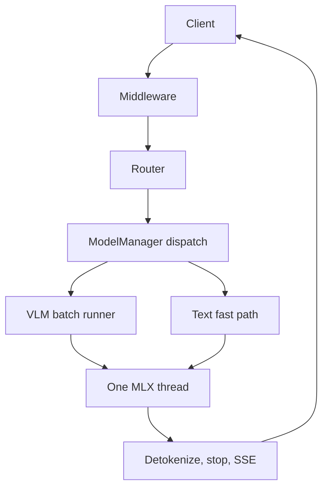

這些頁面說明雲舒的內部運作，給閱讀或修改程式碼的人，以及想精確知道某個設定做了什麼的人。內容只陳述程式碼實際的行為。套件結構請見[架構](/docs/developers/architecture)；可調整的行為請見[設定](/docs/guides/configuration)。

## 它做什麼

雲舒是單一行程：在 Apple Silicon 上，FastAPI 閘道器在以 MLX 為基礎的引擎之前。請求經過中介層與路由器，由 `ModelManager` 派送到對應模型的引擎，最後變成 token，再由閘道器轉成該 API 方言的回應或串流。三個想法決定了其餘的設計：

- **兩條服務路徑。** 每個 `mlx-vlm` 模型（`VLMEngine`）都由 VLM batch runner 服務（`vlm_batch_runner.py`，由 `VLMEngine._build_batch_runner` 建立）。純文字 `mlx-lm` 模型走單請求快速路徑（`_generate_fast`，直接呼叫 mlx-lm 的 `generate_step`）；對這類模型的並行請求會被序列化。
- **單一 MLX 執行緒。** 所有 GPU 工作都在擁有 Metal stream 的單一 worker 執行器上執行，事件迴圈不會碰 MLX 陣列。
- **一致性規則。** 快取命中等於未命中、推測開啟等於推測關閉、預演（rehearsal）不改變輸出。每個內部頁面都會說明適用哪條規則以及如何檢查。

文字模型的 continuous batching 迴圈藏在 `YUNSHU_ENGINE_LOOP` 後面（預設關閉）。它是穩定的使用者選項，輸出不保證與快速路徑相同（見[可能改變輸出的選項](/docs/guides/options)）；它是舊有路徑，不是要擴充的功能。

## 為什麼這樣設計

雲舒是單節點引擎，因此針對單一機器最佳化首 token 時間、解碼速度與前綴重用，而不是多租戶吞吐量。最佳化預設維持無損；有損的（例如 int8 KV）是明確的使用者選項。自訂 Metal kernel 只有在相同 checkpoint 的對照顯示端到端確實有收益、且輸出相同或在容差內時才會採用。

上圖標出每個內部頁面位於請求路徑的哪個位置。

## 保證（一致性規則）

| 規則 | 頁面 |
|---|---|
| 前綴快取命中回傳的 token 與冷預填相同 | [前綴快取](/docs/internals/prefix-cache) |
| 開啟推測解碼的 greedy 輸出與關閉時相同 | [推測解碼](/docs/internals/speculative-decoding) |
| 下一輪預演與提示分段大小不會改變輸出 | [預填與預演](/docs/internals/prefill-and-rehearsal) |

## 設定

| 設定 | 預設 | 作用 |
|---|---|---|
| `YUNSHU_ENGINE_LOOP` | 關閉 | 以舊有的文字模型批次迴圈取代快速路徑 |
| `YUNSHU_VLM_DRAFT` | 未設定 | 覆寫 Qwen3.5 系列的推測 drafter |
| `YUNSHU_VLM_APC_MEMORY_GB` | 依剩餘記憶體推算 | 前綴快取的 RAM 預算；`0` 表示停用 |

所有設定都登錄在 `python/yunshu_engine/settings.py`；`yunshu config` 會列出實際生效的值與來源。

## 限制

雲舒沒有多節點模式，也不以多租戶吞吐量為目標。推測解碼在單請求通道中執行，因此並行請求會以不做 draft 的方式批次處理。

## 如何驗證

執行 `yunshu config` 查看生效的設定，並閱讀[驗證](/docs/developers/verification)了解檢查各項一致性規則的 `yv` 工具。

## 頁面

<Cards>
  <Card title="請求生命週期" href="/docs/internals/request-lifecycle">
    閘道器、中介層、路由器、引擎派送、runner、MLX 執行緒與回傳串流。
  </Card>
  <Card title="前綴快取" href="/docs/internals/prefix-cache">
    精確 checkpoint、64 對齊切點、媒體 key、RAM 與 SSD 層。
  </Card>
  <Card title="推測解碼" href="/docs/internals/speculative-decoding">
    DFlash2 與 MTP 草稿、batch-invariant 驗證 kernel 與單請求通道。
  </Card>
  <Card title="預填與預演" href="/docs/internals/prefill-and-rehearsal">
    Split-invariant 預填與下一輪預演。
  </Card>
  <Card title="記憶體" href="/docs/internals/memory">
    記憶體用在哪裡，以及閒置記憶體如何歸還。
  </Card>
  <Card title="受限解碼" href="/docs/internals/constrained-decoding">
    解碼時強制 JSON schema、regex 與文法。
  </Card>
  <Card title="工具呼叫解析" href="/docs/internals/tool-call-parsing">
    模型輸出如何變成工具呼叫。
  </Card>
  <Card title="主控台行程" href="/docs/internals/console-process">
    網頁主控台背後獨立的輕量行程。
  </Card>
  <Card title="程式碼執行沙箱" href="/docs/internals/code-execution-sandbox">
    伺服器端程式碼執行如何隔離。
  </Card>
</Cards>
