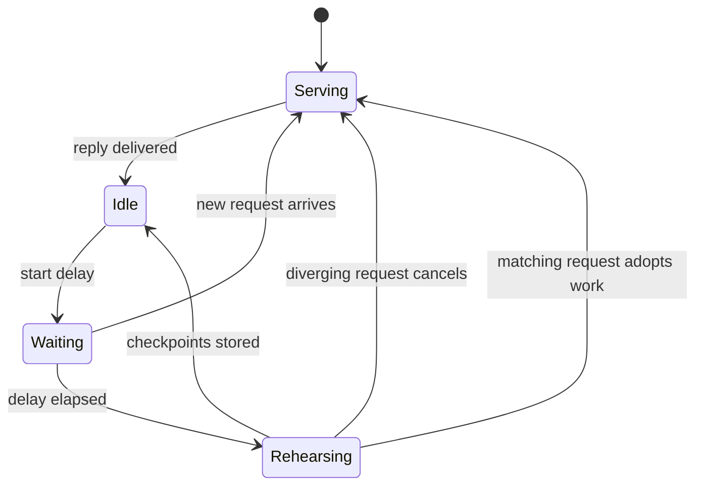

Prefill turns a prompt into KV state. Two features make long, repeated prompts cheap without changing what the model says: split-invariant prefill, which makes cached and cold runs arithmetically the same, and next-turn rehearsal, which does the prefill of the next turn while the engine is idle.

## What it does

**Split-invariant prefill.** On the qualified path (Qwen3.8-27B on an M5-class Mac with the MLX version Yunshu pins), prefill uses one kernel family for every piece length:

- matmul: native NAX GEMM, with short pieces padded to 64 rows and the output cropped (`YUNSHU_PREFILL_MATMUL`);
- attention: BQ32 tile attention for any query length (`YUNSHU_PREFILL_ATTENTION`);
- GatedDeltaNet recurrence: the chunked update, with short tails padded to 64 using identity updates that keep the fp32 state exact (`YUNSHU_PREFILL_GDN`).

Prompt pieces and APC checkpoints are cut at **absolute 64-token boundaries**, so a prompt computed in one go, in pieces, or resumed from a checkpoint passes through the same arithmetic. Kernels live in `python/yunshu_engine/kernels/` (`nax_prefill.py`, `gdn_prefill.py`, `attn_prefill.py`).

**Next-turn rehearsal** (`python/yunshu_engine/next_turn.py`, driven from `VLMEngine`). A chat follow-up resends the conversation including the reply the engine just decoded. The cache holds the prompt of the finished turn, so the follow-up would have to prefill that reply. Decode-time KV cannot be reused, because decode and prefill arithmetic differ. Instead, after a reply is delivered and the engine is idle, it renders the conversation with the reply where it will sit next turn and prefills it as an ordinary request with `max_tokens=1`, which stores exact APC checkpoints. A request that arrives later restores them and prefills only the remainder and its new message.

- `YUNSHU_NEXT_TURN_PREFILL` defaults to `stride`: rehearsal stops at the last absolute 64-token boundary at or before the end of the assistant text. A short reply that adds no full atom triggers no replay of an older prefix.
- Rehearsal starts after `YUNSHU_NEXT_TURN_DELAY_S` (default 0.3 s), so an immediate follow-up, as in an agent loop, arrives before any rehearsal work starts and prefills once. A matching request that arrives during rehearsal adopts the work in progress; a diverging one cancels it at the next preemptible boundary.
- Only plain-text chats are rehearsed: the reply must finish with `stop` or `length`, have 16 to 4096 tokens, and the request must have no media, no tools and no constrained decoding (`next_turn.ineligible_reason`).

**Batch-lane promotion.** When a shared batch drains to one eligible request, the runner moves it onto the single-request speculative lane at a step boundary (`VLMBatchRunner._maybe_promote`; see [Speculative decoding](/docs/internals/speculative-decoding)).



The diagram shows the lifecycle of a rehearsal: it only runs while nothing else does, and any real request takes priority.

## Why (design decision)

A cache hit can only equal a miss if both run the same arithmetic. Making prefill split-invariant removes the dependence on where a prompt was cut, which is what lets a stored checkpoint, a rehearsed prefix and a cold prefill agree. Rehearsal then spends idle GPU time on work the next request would otherwise do on the critical path. Cross-version drift in cold outputs is accepted when the accuracy gate passes, while identity within one version is the hard gate.

## Guarantees

- **Rehearsal is an ordinary request whose result is discarded.** It uses the normal prefill path, so it cannot change an output; it only decides what is already cached when the next request arrives.
- **Cold, cached and rehearsed prefixes yield the same tokens** on the split-invariant path.
- **Decode-time KV is never stored** by rehearsal, only prefill checkpoints.
- `boundary` and `exact` add assistant-end splits and can change multi-turn floating-point rounding. They are explicit opt-ins, not defaults.
- Rehearsal costs idle GPU time and one extra cached prefix. It does not remove the measured latency of an immediate follow-up in every case; see [Benchmarks](/docs/guides/benchmarks).

## Knobs

| Setting | Default | Effect |
|---|---|---|
| `YUNSHU_NEXT_TURN_PREFILL` | `stride` | `off`, `stride`, `boundary` or `exact` |
| `YUNSHU_NEXT_TURN_DELAY_S` | `0.3` | Seconds between a finished reply and rehearsal; `0` starts as soon as idle |
| `YUNSHU_PREFILL_MATMUL` | `stock` | Prefill matmul on the qualified path (native NAX, short pieces padded to 64) |
| `YUNSHU_PREFILL_GDN` | `chunked` | Prefill recurrence; short tails padded with identity updates |
| `YUNSHU_PREFILL_ATTENTION` | `tile` | BQ32 NAX attention for any query length |
| `YUNSHU_PREFILL_STEP_SIZE` | `2048` | Text engine only: prompt tokens per prefill pass |

## Limits

- The split-invariant path is qualified for one model, chip family and MLX version; elsewhere the older prefill atom grid is kept.
- Rehearsal covers plain-text chats on the VLM runner, not media, tool or constrained requests, and not text-only `mlx-lm` models.
- Changing the prefill arithmetic starts a new APC namespace, so checkpoints from an earlier arithmetic are not reused.

## How to verify

```bash
uv run pytest tests/unit/test_next_turn.py tests/unit/test_gdn_span_invariance.py tests/unit/test_apc_canonical_prefill.py -q
```

Check a real server by sending the same conversation cold and after a rehearsal, with `temperature` 0, and compare tokens; `x_yunshu.cache` and `usage` show the cached tokens. The `yv` tool runs this class of check as its cache-exact stage (see [Verification](/docs/developers/verification)). Cache storage is described in [Prefix cache](/docs/internals/prefix-cache).
