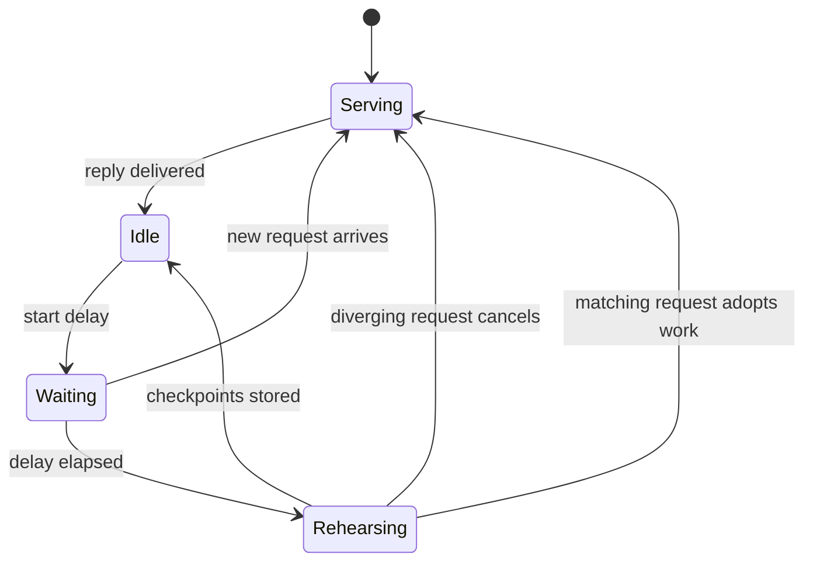

预填把提示转成 KV 状态。两项功能让长且重复的提示变便宜，却不改变模型的输出：split-invariant 预填使缓存运行与冷运行的算术相同；下一轮预演则在引擎空闲时先做下一轮的预填。

## 它做什么

**Split-invariant 预填。** 在合格路径上（Apple M5 级 Mac 上的 Qwen3.8-27B，使用云舒固定的 MLX 版本），预填对每种分段长度都使用同一组 kernel：

- matmul：原生 NAX GEMM，短分段补到 64 行并裁剪输出（`YUNSHU_PREFILL_MATMUL`）；
- 注意力：任何 query 长度都用 BQ32 tile 注意力（`YUNSHU_PREFILL_ATTENTION`）；
- GatedDeltaNet 递归：分块更新，短尾部以恒等更新补到 64，使 fp32 状态保持精确（`YUNSHU_PREFILL_GDN`）。

提示分段与 APC checkpoint 都切在**绝对 64 token 边界**，因此一次算完、分段算，或从 checkpoint 接续的提示，都经过相同的算术。Kernel 位于 `python/yunshu_engine/kernels/`（`nax_prefill.py`、`gdn_prefill.py`、`attn_prefill.py`）。

**下一轮预演**（`python/yunshu_engine/next_turn.py`，由 `VLMEngine` 驱动）。聊天的后续请求会重发包含引擎刚解码回复的对话。缓存里存的是上一轮的提示，所以后续请求得预填那段回复。解码期间的 KV 不能复用，因为解码与预填的算术不同。因此，回复送出且引擎空闲后，引擎会把回复放在下一轮的位置来渲染对话，并以 `max_tokens=1` 当作普通请求预填，存储精确的 APC checkpoint。之后到达的请求恢复它们，只预填其余部分与新消息。

- `YUNSHU_NEXT_TURN_PREFILL` 默认为 `stride`：预演停在助手文本结尾当下或之前的最后一个绝对 64 token 边界。短回复若没有新增完整的 atom，就不会触发重放较旧的前缀。
- 预演在 `YUNSHU_NEXT_TURN_DELAY_S`（默认 0.3 秒）之后开始，所以立即的后续请求（如 agent 循环）会在任何预演工作开始前到达，只预填一次。预演期间到达的相符请求会接手进行中的工作；不相符的则在下个可抢占边界取消它。
- 只预演纯文本聊天：回复必须以 `stop` 或 `length` 结束、长度为 16 到 4096 个 token，且请求不可有媒体、工具或受限解码（`next_turn.ineligible_reason`）。

**批次通道升级。** 共享批次只剩一个合格请求时，runner 会在步骤边界把它移到单请求推测通道（`VLMBatchRunner._maybe_promote`；见[推测解码](/docs/internals/speculative-decoding)）。



此图显示预演的生命周期：它只在没有其他工作时运行，任何真实请求都优先。

## 为什么这样设计

缓存命中要等于未命中，两者必须使用相同的算术。让预填 split-invariant，移除了结果对提示切在哪里的依赖，这才让存储的 checkpoint、预演的前缀与冷预填彼此一致。预演再把空闲的 GPU 时间，用在下一个请求原本要在关键路径上做的工作。只要准确度门槛通过，冷输出的跨版本漂移是可接受的；同一版本内的一致性才是硬性门槛。

## 保证

- **预演是结果被丢弃的普通请求。** 它走正常的预填路径，所以不可能改变输出；它只决定下一个请求到达时缓存里已有什么。
- 在 split-invariant 路径上，**冷、缓存与预演的前缀产生相同的 token**。
- 预演**从不存储解码期间的 KV**，只存储预填 checkpoint。
- `boundary` 与 `exact` 会增加助手结尾的切分，可能改变多轮的浮点舍入。它们是明确的选用，不是默认。
- 预演花费空闲 GPU 时间与一份额外的缓存前缀。它并不在所有情况下消除立即后续请求的实测延迟；见[基准测试](/docs/guides/benchmarks)。

## 设置

| 设置 | 默认 | 作用 |
|---|---|---|
| `YUNSHU_NEXT_TURN_PREFILL` | `stride` | `off`、`stride`、`boundary` 或 `exact` |
| `YUNSHU_NEXT_TURN_DELAY_S` | `0.3` | 回复结束到预演之间的秒数；`0` 表示一空闲就开始 |
| `YUNSHU_PREFILL_MATMUL` | `stock` | 合格路径上的预填 matmul（原生 NAX，短分段补到 64） |
| `YUNSHU_PREFILL_GDN` | `chunked` | 预填递归；短尾部以恒等更新补齐 |
| `YUNSHU_PREFILL_ATTENTION` | `tile` | 任何 query 长度皆用 BQ32 NAX 注意力 |
| `YUNSHU_PREFILL_STEP_SIZE` | `2048` | 仅文本引擎：每次预填传递的提示 token 数 |

## 限制

- Split-invariant 路径只针对一种模型、芯片系列与 MLX 版本合格；其他情况保持较旧的预填 atom 网格。
- 预演覆盖 VLM runner 上的纯文本聊天，不含媒体、工具或受限请求，也不含纯文本 `mlx-lm` 模型。
- 更改预填算术会开启新的 APC 命名空间，因此较早算术产生的 checkpoint 不会被复用。

## 如何验证

```bash
uv run pytest tests/unit/test_next_turn.py tests/unit/test_gdn_span_invariance.py tests/unit/test_apc_canonical_prefill.py -q
```

在真实服务器上，以 `temperature` 0 分别发送冷的与预演后的同一段对话并比较 token；`x_yunshu.cache` 与 `usage` 会显示缓存的 token 数。`yv` 工具以其 cache-exact 阶段执行这类检查（见[验证](/docs/developers/verification)）。缓存存储方式见[前缀缓存](/docs/internals/prefix-cache)。
