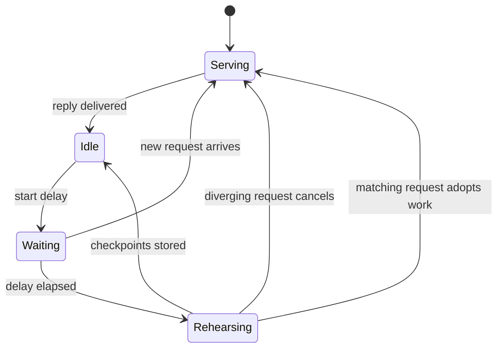

預填把提示轉成 KV 狀態。兩項功能讓長且重複的提示變便宜，卻不改變模型的輸出：split-invariant 預填使快取執行與冷執行的算術相同；下一輪預演則在引擎閒置時先做下一輪的預填。

## 它做什麼

**Split-invariant 預填。** 在合格路徑上（Apple M5 級 Mac 上的 Qwen3.8-27B，使用雲舒釘選的 MLX 版本），預填對每種分段長度都使用同一組 kernel：

- matmul：原生 NAX GEMM，短分段補到 64 列並裁切輸出（`YUNSHU_PREFILL_MATMUL`）；
- 注意力：任何 query 長度都用 BQ32 tile 注意力（`YUNSHU_PREFILL_ATTENTION`）；
- GatedDeltaNet 遞迴：分塊更新，短尾端以恆等更新補到 64，使 fp32 狀態保持精確（`YUNSHU_PREFILL_GDN`）。

提示分段與 APC checkpoint 都切在**絕對 64 token 邊界**，因此一次算完、分段算，或從 checkpoint 接續的提示，都經過相同的算術。Kernel 位於 `python/yunshu_engine/kernels/`（`nax_prefill.py`、`gdn_prefill.py`、`attn_prefill.py`）。

**下一輪預演**（`python/yunshu_engine/next_turn.py`，由 `VLMEngine` 驅動）。聊天的後續請求會重送包含引擎剛解碼回覆的對話。快取裡存的是上一輪的提示，所以後續請求得預填那段回覆。解碼期間的 KV 不能重用，因為解碼與預填的算術不同。因此，回覆送出且引擎閒置後，引擎會把回覆放在下一輪的位置來渲染對話，並以 `max_tokens=1` 當作一般請求預填，儲存精確的 APC checkpoint。之後到達的請求還原它們，只預填其餘部分與新訊息。

- `YUNSHU_NEXT_TURN_PREFILL` 預設為 `stride`：預演停在助理文字結尾當下或之前的最後一個絕對 64 token 邊界。短回覆若沒有新增完整的 atom，就不會觸發重放較舊的前綴。
- 預演在 `YUNSHU_NEXT_TURN_DELAY_S`（預設 0.3 秒）之後開始，所以立即的後續請求（如 agent 迴圈）會在任何預演工作開始前到達，只預填一次。預演期間到達的相符請求會接手進行中的工作；不相符的則在下個可搶佔邊界取消它。
- 只預演純文字聊天：回覆必須以 `stop` 或 `length` 結束、長度為 16 到 4096 個 token，且請求不可有媒體、工具或受限解碼（`next_turn.ineligible_reason`）。

**批次通道升級。** 共用批次只剩一個合格請求時，runner 會在步驟邊界把它移到單請求推測通道（`VLMBatchRunner._maybe_promote`；見[推測解碼](/docs/internals/speculative-decoding)）。



此圖顯示預演的生命週期：它只在沒有其他工作時執行，任何真實請求都優先。

## 為什麼這樣設計

快取命中要等於未命中，兩者必須使用相同的算術。讓預填 split-invariant，移除了結果對提示切在哪裡的依賴，這才讓儲存的 checkpoint、預演的前綴與冷預填彼此一致。預演再把閒置的 GPU 時間，用在下一個請求原本要在關鍵路徑上做的工作。只要準確度門檻通過，冷輸出的跨版本漂移是可接受的；同一版本內的一致性才是硬性門檻。

## 保證

- **預演是結果被丟棄的一般請求。** 它走正常的預填路徑，所以不可能改變輸出；它只決定下一個請求到達時快取裡已有什麼。
- 在 split-invariant 路徑上，**冷、快取與預演的前綴產生相同的 token**。
- 預演**從不儲存解碼期間的 KV**，只儲存預填 checkpoint。
- `boundary` 與 `exact` 會增加助理結尾的切分，可能改變多輪的浮點捨入。它們是明確的選用，不是預設。
- 預演花費閒置 GPU 時間與一份額外的快取前綴。它並不在所有情況下消除立即後續請求的實測延遲；見[基準測試](/docs/guides/benchmarks)。

## 設定

| 設定 | 預設 | 作用 |
|---|---|---|
| `YUNSHU_NEXT_TURN_PREFILL` | `stride` | `off`、`stride`、`boundary` 或 `exact` |
| `YUNSHU_NEXT_TURN_DELAY_S` | `0.3` | 回覆結束到預演之間的秒數；`0` 表示一閒置就開始 |
| `YUNSHU_PREFILL_MATMUL` | `stock` | 合格路徑上的預填 matmul（原生 NAX，短分段補到 64） |
| `YUNSHU_PREFILL_GDN` | `chunked` | 預填遞迴；短尾端以恆等更新補齊 |
| `YUNSHU_PREFILL_ATTENTION` | `tile` | 任何 query 長度皆用 BQ32 NAX 注意力 |
| `YUNSHU_PREFILL_STEP_SIZE` | `2048` | 僅文字引擎：每次預填傳遞的提示 token 數 |

## 限制

- Split-invariant 路徑只針對一種模型、晶片系列與 MLX 版本合格；其他情況維持較舊的預填 atom 格線。
- 預演涵蓋 VLM runner 上的純文字聊天，不含媒體、工具或受限請求，也不含純文字 `mlx-lm` 模型。
- 更改預填算術會開啟新的 APC 命名空間，因此較早算術產生的 checkpoint 不會被重用。

## 如何驗證

```bash
uv run pytest tests/unit/test_next_turn.py tests/unit/test_gdn_span_invariance.py tests/unit/test_apc_canonical_prefill.py -q
```

在真實伺服器上，以 `temperature` 0 分別送出冷的與預演後的同一段對話並比較 token；`x_yunshu.cache` 與 `usage` 會顯示快取的 token 數。`yv` 工具以其 cache-exact 階段執行這類檢查（見[驗證](/docs/developers/verification)）。快取儲存方式見[前綴快取](/docs/internals/prefix-cache)。
