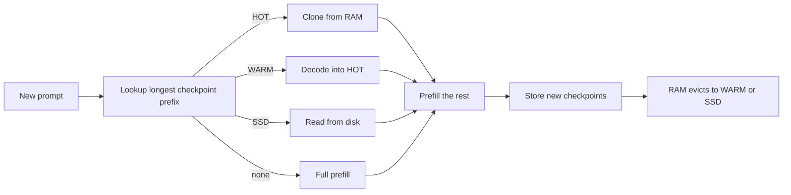

This page explains the internals of the prefix cache on the VLM batch runner. For the client-facing side (usage fields, `cache_control`, headers) see [Prompt caching](/docs/guides/prompt-caching); that content is not repeated here.

## What it does

When a new prompt starts with the same tokens as an earlier one, the engine restores the stored state for that prefix and prefills only the rest. The state is an **exact checkpoint**: the attention KV plus, for hybrid models such as the Qwen3.5 family (attention mixed with GatedDeltaNet layers), the recurrent state, both at one token position. A checkpoint is reusable only by a prompt that begins with exactly those tokens.

- **Keys.** Text is keyed by token ids. Image input is keyed by a hash of the pixel values (`VLMBatchRunner._image_hash`, from the source image digest), audio by its features, so the same picture reuses the cache and a different one does not.
- **Cut points.** Prompt pieces and checkpoints are cut at absolute 64-token boundaries on the qualified split-invariant path, so a cold run and a cached run process the same pieces. See [Prefill and rehearsal](/docs/internals/prefill-and-rehearsal).
- **Policy** (`python/yunshu_engine/apc_manager.py`, `YunshuAPCManager`): a byte budget limits RAM; a request's checkpoints supersede earlier checkpoints that are prefixes of it, so a long session holds one copy; the end of the system turn (system prompt plus tool list) is kept as its own head checkpoint per distinct head, so a new session in the same project reuses it.
- **Tiers.** HOT is full-precision RAM. WARM is an optional compact RAM form (`apc_warm.py`). SSD is the persistent tier (`apc_storage.py`); further directories can be added as lower storage tiers.



The lookup picks the cheapest candidate over all tiers, then prefills only the part that no checkpoint covers.

## Why (design decision)

- **Exact checkpoints, not approximate reuse.** A restored checkpoint is the stored arrays, so a hit does not introduce error. Decode-time KV is never reused for the next turn, because decode and prefill arithmetic differ and the cache would not equal a miss.
- **Budget, not entry count.** The RAM budget is bytes. Unset, it is half of the memory left after weights and an OS and activation reserve, at most a quarter of the machine and 32 GiB, and the cache turns itself off when under 1 GiB would remain.
- **SSD on by default.** A reload is far cheaper than recomputing a long prefix, and it survives a restart. Evicted checkpoints go to disk when RAM drops them, and resident ones are written at shutdown, within a time limit. Stored states are namespaced by the checkpoint's weights (path, file sizes, modification times), so replacing a model in place never reads old states.
- **Cost model per lookup.** With several storage tiers, a lookup takes the cheapest of restore time plus prefill of the remainder, using observed restore speed.

## Guarantees

- **Hit equals miss.** A hit restores the stored checkpoint exactly, and on the split-invariant path the pieces a cold prefill uses are the same, so tokens match. The tests `tests/unit/test_apc_identity_probe.py` and `tests/unit/test_apc_canonical_prefill.py` cover this, and the output-identity check of the cache work compared greedy text across HOT, WARM-lossless, SSD and cold requests.
- **WARM lossless and SSD are bit-exact.** The SSD tier always stores exact states, including when WARM is lossy. A corrupt or failed-checksum entry is dropped and the lookup falls through to the next tier or to recompute.
- **Lossy is opt-in.** `YUNSHU_VLM_APC_WARM=int8` or `int4` quantizes K/V in the WARM tier and is never a default.
- **Disk safety.** One budget covers a whole cache root; stale namespaces go first; a free-space reserve is kept; a write error drops that checkpoint without affecting the request in flight.

## Knobs

| Setting | Default | Effect |
|---|---|---|
| `YUNSHU_VLM_APC_MEMORY_GB` | derived (see above) | RAM budget in GiB; `0` disables the cache |
| `YUNSHU_VLM_APC_DISK` | on | SSD tier; `0` keeps the cache in RAM only |
| `YUNSHU_VLM_APC_DISK_GB` | a quarter of the volume, at most 64 GiB | Cap for the whole cache directory |
| `YUNSHU_VLM_APC_WARM` | `off` | `lossless`, `int8` or `int4` compact RAM tier |
| `YUNSHU_VLM_APC_WARM_SHARE` | `0.4` | Share of the APC RAM budget the WARM tier takes |
| `YUNSHU_VLM_APC_DISK_TIERS` | unset | Lower storage tiers, `PATH[@GiB],...` |
| `YUNSHU_PREFIX_MAX_ENTRIES` | `64` | Entry count of the text fast path's `KVPrefixCache` |

The text fast path has its own cache (`KVPrefixCache`), with an SSD tier that is opt-in (`YUNSHU_SSD_CACHE`).

## Limits

- **Families with a sliding-window cache are excluded** from the VLM runner's APC, because a rotating cache cannot be assembled from dense KV blocks. The exception is `gemma4`, whose native snapshot includes the window, absolute offset and ring index; its exact-window restore is checkpoint-specific and has scoped parity checks rather than a blanket claim for every sliding-window model. `VLMEngine._build_batch_runner` decides this per model from `model_apc_plan` and the backend cache capabilities.
- Apple Paravirtual Metal runs the stock runner with no APC.
- A hit needs an exact token prefix: anything that changes early in the prompt moves everything after it.
- WARM lossless compresses by about 1.4x and, in the recorded replay of 2026-10-02 on Qwen3.8-27B, did not beat the SSD tier on time to first token, which is why it is off by default.

## How to verify

```bash
uv run pytest tests/unit/test_apc_manager.py tests/unit/test_apc_warm.py tests/unit/test_apc_storage.py -q
yunshu cache status
```

`yunshu cache status` shows what is on disk, and `GET /v1/yunshu/cache` and the console Cache page show entries, tiers and hits. Each response says which tier served it in `x_yunshu.cache.tier`. The cache-exact rule is one of the checks described in [Verification](/docs/developers/verification).
