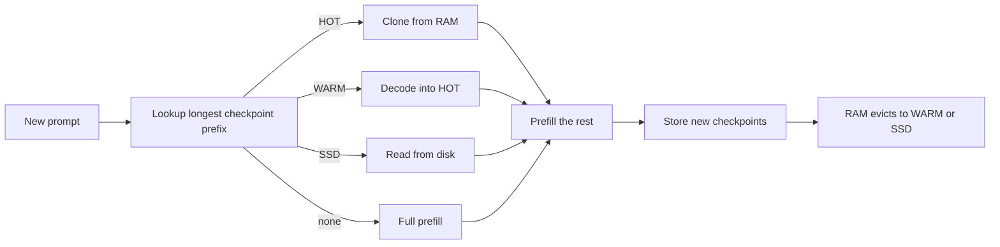

本页说明 VLM batch runner 上前缀缓存的内部机制。面向客户端的部分（usage 字段、`cache_control`、头部）请见[提示缓存](/docs/guides/prompt-caching)，这里不重复。

## 它做什么

新提示的开头与之前某个提示相同时，引擎会恢复该前缀存储的状态，只对其余部分做预填。这个状态是**精确 checkpoint**：注意力 KV，加上混合模型（例如混合注意力与 GatedDeltaNet 层的 Qwen3.5 系列）的递归状态，两者都在同一个 token 位置。checkpoint 只有以完全相同 token 开头的提示才能复用。

- **Key。** 文本以 token id 作为 key。图像输入以像素值的哈希作为 key（`VLMBatchRunner._image_hash`，来自源图像摘要），音频以其特征作为 key，所以同一张图会复用缓存，不同的图则不会。
- **切点。** 在合格的 split-invariant 路径上，提示分段与 checkpoint 都切在绝对 64 token 的边界，使冷运行与缓存运行处理相同的分段。见[预填与预演](/docs/internals/prefill-and-rehearsal)。
- **策略**（`python/yunshu_engine/apc_manager.py`，`YunshuAPCManager`）：以字节预算限制 RAM；请求的 checkpoint 会取代之前属于其前缀的 checkpoint，所以长对话只保留一份；系统轮结尾（系统提示加工具列表）按每个不同的 head 各自保留为独立的 head checkpoint，同项目的新会话可复用它。
- **层级。** HOT 是全精度 RAM。WARM 是可选的紧凑 RAM 形式（`apc_warm.py`）。SSD 是持久层（`apc_storage.py`）；还可再加入其他目录作为较低的存储层。



查询会在所有层级中挑成本最低的候选，再只预填没有任何 checkpoint 覆盖的部分。

## 为什么这样设计

- **精确 checkpoint，而非近似复用。** 恢复出来的 checkpoint 就是存储的数组，所以命中不会引入误差。解码期间的 KV 不会用于下一轮，因为解码与预填的算术不同，缓存就不会等于未命中。
- **预算而非条数。** RAM 预算以字节计。未设置时，是权重与操作系统及激活预留之后剩余内存的一半，最多为机器内存的四分之一与 32 GiB；若剩余不足 1 GiB 则自动关闭缓存。
- **默认开启 SSD。** 重新加载远比重算长前缀便宜，而且重启后仍在。RAM 淘汰 checkpoint 时写入磁盘，常驻的则在关机时于时限内写出。存储的状态以 checkpoint 权重（路径、文件大小、修改时间）做命名空间，因此原地替换模型不会读到旧状态。
- **每次查询用成本模型。** 有多个存储层时，查询会依观察到的恢复速度，挑“恢复时间加上剩余部分预填”最低者。

## 保证

- **命中等于未命中。** 命中会精确恢复存储的 checkpoint，而在 split-invariant 路径上冷预填使用的分段相同，所以 token 一致。`tests/unit/test_apc_identity_probe.py` 与 `tests/unit/test_apc_canonical_prefill.py` 覆盖此项，缓存工作的输出一致性检查也比较了 HOT、WARM-lossless、SSD 与冷请求的 greedy 文本。
- **WARM lossless 与 SSD 比特精确。** SSD 层永远存储精确状态，即使 WARM 是有损的。损坏或校验失败的条目会被丢弃，查询会落到下一层或重算。
- **有损需明确启用。** `YUNSHU_VLM_APC_WARM=int8` 或 `int4` 会量化 WARM 层的 K/V，且永远不会成为默认。
- **磁盘安全。** 一个预算覆盖整个缓存根目录；过期的命名空间优先清除；保留剩余空间下限；写入错误只丢弃该 checkpoint，不影响进行中的请求。

## 设置

| 设置 | 默认 | 作用 |
|---|---|---|
| `YUNSHU_VLM_APC_MEMORY_GB` | 推算（见上） | RAM 预算（GiB）；`0` 禁用缓存 |
| `YUNSHU_VLM_APC_DISK` | 开启 | SSD 层；`0` 表示仅用 RAM |
| `YUNSHU_VLM_APC_DISK_GB` | 磁盘卷的四分之一，最多 64 GiB | 整个缓存目录的容量上限 |
| `YUNSHU_VLM_APC_WARM` | `off` | `lossless`、`int8` 或 `int4` 紧凑 RAM 层 |
| `YUNSHU_VLM_APC_WARM_SHARE` | `0.4` | WARM 层占 APC RAM 预算的比例 |
| `YUNSHU_VLM_APC_DISK_TIERS` | 未设置 | 较低的存储层，`PATH[@GiB],...` |
| `YUNSHU_PREFIX_MAX_ENTRIES` | `64` | 文本快速路径 `KVPrefixCache` 的条目数 |

文本快速路径有自己的缓存（`KVPrefixCache`），其 SSD 层需明确启用（`YUNSHU_SSD_CACHE`）。

## 限制

- **使用滑动窗口（sliding-window）缓存的模型系列不在 VLM runner 的 APC 范围内**，因为轮转缓存无法由稠密 KV 块组装。例外是 `gemma4`：其原生快照包含窗口、绝对 offset 与环形索引；它的精确窗口恢复是针对 checkpoint 的，有范围明确的一致性检查，而不是对所有滑动窗口模型的全面声明。`VLMEngine._build_batch_runner` 依 `model_apc_plan` 与后端缓存能力逐模型判断。
- Apple Paravirtual Metal 使用原生 runner，没有 APC。
- 命中需要精确的 token 前缀：提示前段有任何变动，其后所有内容都会位移。
- WARM lossless 约压缩 1.4 倍；在 2026-10-02 于 Qwen3.8-27B 上记录的重放中，它的首 token 时间并未胜过 SSD 层，因此默认关闭。

## 如何验证

```bash
uv run pytest tests/unit/test_apc_manager.py tests/unit/test_apc_warm.py tests/unit/test_apc_storage.py -q
yunshu cache status
```

`yunshu cache status` 显示磁盘上有什么，`GET /v1/yunshu/cache` 与控制台 Cache 页面显示条目、层级与命中。每个响应都在 `x_yunshu.cache.tier` 说明由哪一层服务。缓存精确（cache-exact）规则是[验证](/docs/developers/verification)所述检查之一。
