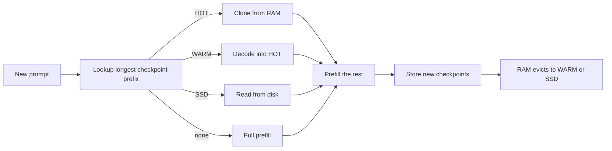

本頁說明 VLM batch runner 上前綴快取的內部機制。面向客戶端的部分（usage 欄位、`cache_control`、標頭）請見[提示快取](/docs/guides/prompt-caching)，這裡不重複。

## 它做什麼

新提示的開頭與先前某個提示相同時，引擎會還原該前綴儲存的狀態，只對其餘部分做預填。這個狀態是**精確 checkpoint**：注意力 KV，加上混合模型（例如混合注意力與 GatedDeltaNet 層的 Qwen3.5 系列）的遞迴狀態，兩者都在同一個 token 位置。checkpoint 只有以完全相同 token 開頭的提示才能重用。

- **Key。** 文字以 token id 作為 key。影像輸入以像素值的雜湊作為 key（`VLMBatchRunner._image_hash`，由來源影像摘要而來），音訊以其特徵作為 key，所以同一張圖會重用快取，不同的圖則不會。
- **切點。** 在合格的 split-invariant 路徑上，提示分段與 checkpoint 都切在絕對 64 token 的邊界，使冷執行與快取執行處理相同的分段。見[預填與預演](/docs/internals/prefill-and-rehearsal)。
- **策略**（`python/yunshu_engine/apc_manager.py`，`YunshuAPCManager`）：以位元組預算限制 RAM；請求的 checkpoint 會取代先前屬於其前綴的 checkpoint，所以長對話只保留一份；系統回合結尾（系統提示加工具清單）依每個不同的 head 各自保留為獨立的 head checkpoint，同專案的新工作階段可重用它。
- **層級。** HOT 是全精度 RAM。WARM 是選用的緊湊 RAM 形式（`apc_warm.py`）。SSD 是持久層（`apc_storage.py`）；還可再加入其他目錄作為較低的儲存層。



查詢會在所有層級中挑成本最低的候選，再只預填沒有任何 checkpoint 涵蓋的部分。

## 為什麼這樣設計

- **精確 checkpoint，而非近似重用。** 還原出來的 checkpoint 就是儲存的陣列，所以命中不會引入誤差。解碼期間的 KV 不會用於下一輪，因為解碼與預填的算術不同，快取就不會等於未命中。
- **預算而非筆數。** RAM 預算以位元組計。未設定時，是權重與 OS 及啟動緩衝之後剩餘記憶體的一半，最多為機器記憶體的四分之一與 32 GiB；若剩餘不足 1 GiB 則自動關閉快取。
- **預設開啟 SSD。** 重新載入遠比重算長前綴便宜，而且重啟後仍在。RAM 淘汰 checkpoint 時寫入磁碟，常駐的則在關機時於時限內寫出。儲存的狀態以 checkpoint 權重（路徑、檔案大小、修改時間）做命名空間，因此原地替換模型不會讀到舊狀態。
- **每次查詢用成本模型。** 有多個儲存層時，查詢會依觀察到的還原速度，挑「還原時間加上剩餘部分預填」最低者。

## 保證

- **命中等於未命中。** 命中會精確還原儲存的 checkpoint，而在 split-invariant 路徑上冷預填使用的分段相同，所以 token 一致。`tests/unit/test_apc_identity_probe.py` 與 `tests/unit/test_apc_canonical_prefill.py` 涵蓋此項，快取工作的輸出一致性檢查也比較了 HOT、WARM-lossless、SSD 與冷請求的 greedy 文字。
- **WARM lossless 與 SSD 位元精確。** SSD 層永遠儲存精確狀態，即使 WARM 是有損的。損毀或校驗失敗的條目會被丟棄，查詢會落到下一層或重算。
- **有損需明確啟用。** `YUNSHU_VLM_APC_WARM=int8` 或 `int4` 會量化 WARM 層的 K/V，且永遠不會成為預設。
- **磁碟安全。** 一個預算涵蓋整個快取根目錄；過期的命名空間優先清除；保留剩餘空間下限；寫入錯誤只丟棄該 checkpoint，不影響進行中的請求。

## 設定

| 設定 | 預設 | 作用 |
|---|---|---|
| `YUNSHU_VLM_APC_MEMORY_GB` | 推算（見上） | RAM 預算（GiB）；`0` 停用快取 |
| `YUNSHU_VLM_APC_DISK` | 開啟 | SSD 層；`0` 表示僅用 RAM |
| `YUNSHU_VLM_APC_DISK_GB` | 磁碟區的四分之一，最多 64 GiB | 整個快取目錄的容量上限 |
| `YUNSHU_VLM_APC_WARM` | `off` | `lossless`、`int8` 或 `int4` 緊湊 RAM 層 |
| `YUNSHU_VLM_APC_WARM_SHARE` | `0.4` | WARM 層佔 APC RAM 預算的比例 |
| `YUNSHU_VLM_APC_DISK_TIERS` | 未設定 | 較低的儲存層，`PATH[@GiB],...` |
| `YUNSHU_PREFIX_MAX_ENTRIES` | `64` | 文字快速路徑 `KVPrefixCache` 的條目數 |

文字快速路徑有自己的快取（`KVPrefixCache`），其 SSD 層需明確啟用（`YUNSHU_SSD_CACHE`）。

## 限制

- **使用滑動視窗（sliding-window）快取的模型系列不在 VLM runner 的 APC 範圍內**，因為輪替快取無法由稠密 KV 區塊組裝。例外是 `gemma4`：其原生快照包含視窗、絕對 offset 與環形索引；它的精確視窗還原是針對 checkpoint 的，有範圍明確的一致性檢查，而不是對所有滑動視窗模型的全面宣稱。`VLMEngine._build_batch_runner` 依 `model_apc_plan` 與後端快取能力逐模型判斷。
- Apple Paravirtual Metal 使用原生 runner，沒有 APC。
- 命中需要精確的 token 前綴：提示前段有任何變動，其後所有內容都會位移。
- WARM lossless 約壓縮 1.4 倍；在 2026-10-02 於 Qwen3.8-27B 上記錄的重放中，它的首 token 時間並未勝過 SSD 層，因此預設關閉。

## 如何驗證

```bash
uv run pytest tests/unit/test_apc_manager.py tests/unit/test_apc_warm.py tests/unit/test_apc_storage.py -q
yunshu cache status
```

`yunshu cache status` 顯示磁碟上有什麼，`GET /v1/yunshu/cache` 與主控台 Cache 頁面顯示條目、層級與命中。每個回應都在 `x_yunshu.cache.tier` 說明由哪一層服務。快取精確（cache-exact）規則是[驗證](/docs/developers/verification)所述檢查之一。
