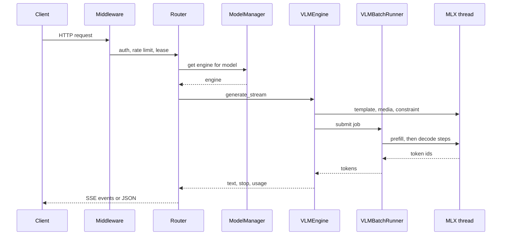

This page follows one request from the socket to the last byte of the response, and names the module that owns each step.

## What it does

1. **Middleware.** `create_app()` in `python/yunshu_gateway/main.py` stacks the layers. Because `add_middleware` prepends, the last one added is outermost. From the outside in: `DisconnectWatchMiddleware`, `MetricsMiddleware`, `LiveCORSMiddleware`, `ModelLeaseMiddleware`, `ResidentActivityMiddleware`, `YunshuExtensionsMiddleware` (request id, queue headers, per-response `x_yunshu` stats), `AuthMiddleware`, `RateLimitMiddleware` (only when `YUNSHU_RATE_LIMIT_RPM` is above 0) and `RequestLoggingMiddleware`. Metrics sits outside auth on purpose, so a 401, 429 or 413 is counted. The disconnect watcher is outermost because Starlette's `BaseHTTPMiddleware` hides a client hang-up; it records it in `scope["yunshu.client_gone"]`.
2. **Router.** A router under `python/yunshu_gateway/routers/` (`chat.py`, `anthropic.py`, the Responses router and others) validates the body, normalizes it into one internal request and resolves the model.
3. **Engine dispatch.** `ModelManager` (`python/yunshu_engine/model_manager.py`) loads models lazily, evicts by least recent use under memory pressure, and hands out a lease. `ModelLeaseMiddleware` holds a lease on every model the request acquires until the response ends, so an unload, TTL expiry or eviction cannot pull the model mid-response.
4. **VLM batch runner.** For an `mlx-vlm` model, `VLMEngine.generate_stream` prepares the prompt (chat template, media encoding, constraint compilation) on the MLX thread and submits a job to `VLMBatchRunner`. The runner admits one prompt at a time for prefill, consults the prefix cache, and decodes all active rows together; the Qwen3.5 family can run a lone request on the speculative lane. Text-only `mlx-lm` models take `_generate_fast` instead.
5. **MLX thread.** All GPU work runs on a single-worker executor (`python/yunshu_engine/mlx_executor.py`) that owns the Metal generation stream.
6. **Detokenize, stop, deliver.** The runner yields token ids. `VLMEngine` runs the per-request detokenizer, stop-string and reasoning-state tracking, and pushes `RequestOutput` items through a bounded queue to the async consumer. The router turns them into the dialect's JSON or SSE events, including usage and the additive `x_yunshu` fields.

The diagram shows the ordering of the hand-offs for a streamed request; a non-streaming request collects the same outputs and returns one body.

## Why (design decision)

- **One GPU thread.** mlx-lm's generation stream is module-level state bound to the thread that created it, so every engine submits work to one executor. This is what makes serving several models in one process safe.
- **Runner emits ids, engine emits text.** Keeping detokenizing and stop logic in `VLMEngine` means the text path and the VLM path report results the same way.
- **Bounded delivery.** The engine delivers through a queue with a blocking put that watches the cancel event, so a slow client cannot make the GPU thread buffer without limit.

## Guarantees

- A client that disconnects cancels its generation instead of decoding to `max_tokens`; the disconnect watcher sets an event, and the router's disconnect guard (`run_with_disconnect_guard`, `client_disconnected`) cancels the generation when it is set.
- A model cannot be unloaded while a request holds its lease.
- A stream that fails inside the engine ends with an error event and `finish_reason: "error"` rather than silently truncating.
- Per-request sampler, detokenizer and stop state are never shared between requests; detokenizers are not pooled.

## Knobs

| Setting | Default | Effect |
|---|---|---|
| `YUNSHU_RATE_LIMIT_RPM` | `0` | Requests per minute limit; the middleware is only installed above 0 |
| `YUNSHU_AUTH_TOKEN` | unset | Admin token; auth is enforced only when set (named API keys are separate) |
| `YUNSHU_ENGINE_LOOP` | off | Legacy continuous-batching loop for text models |

## Limits

- Text-only `mlx-lm` requests are served one at a time.
- LoRA adapters and custom logits processors are rejected for VLM models.
- Prefill admits one request at a time, interleaved with decode of the other rows.

## How to verify

`tests/unit/test_client_disconnect_watch.py` and `tests/unit/test_disconnect_guard.py` cover cancellation on disconnect. Run `uv run pytest tests/unit/test_client_disconnect_watch.py -q`. For the live path, a response's `X-Request-Id` header and `x_yunshu` object show the id, queue state and cache tier of a real request. See also [Architecture](/docs/developers/architecture).
