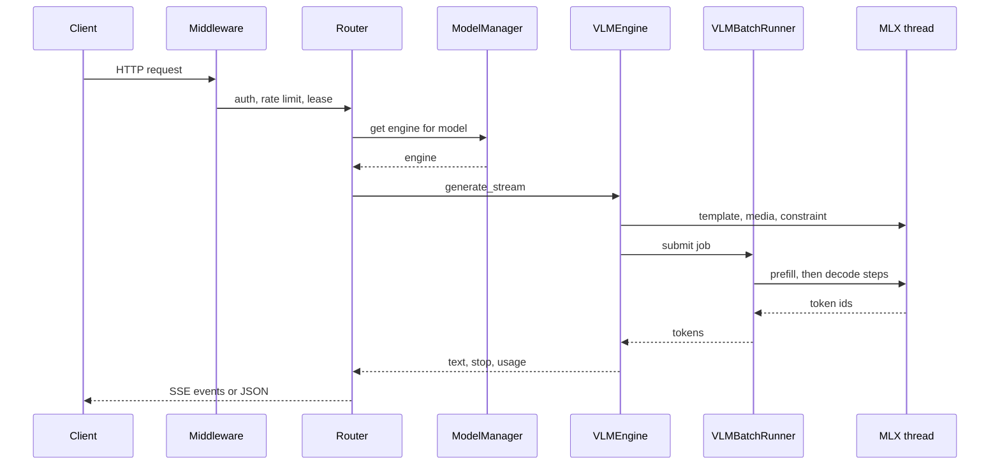

本页沿着一个请求从 socket 走到响应的最后一个字节，并指出每个步骤由哪个模块负责。

## 它做什么

1. **中间件。** `python/yunshu_gateway/main.py` 的 `create_app()` 堆叠各层。因为 `add_middleware` 是向前插入，最后加入的在最外层。由外到内：`DisconnectWatchMiddleware`、`MetricsMiddleware`、`LiveCORSMiddleware`、`ModelLeaseMiddleware`、`ResidentActivityMiddleware`、`YunshuExtensionsMiddleware`（请求 id、队列标头、每个响应的 `x_yunshu` 统计）、`AuthMiddleware`、`RateLimitMiddleware`（仅在 `YUNSHU_RATE_LIMIT_RPM` 大于 0 时）以及 `RequestLoggingMiddleware`。Metrics 刻意放在 auth 之外，让 401、429、413 也被计入。断连监视层在最外面，因为 Starlette 的 `BaseHTTPMiddleware` 会隐藏客户端断连；它把断连记录在 `scope["yunshu.client_gone"]`。
2. **路由器。** `python/yunshu_gateway/routers/` 下的路由器（`chat.py`、`anthropic.py`、Responses 路由器等）校验 body，规范化为一个内部请求并解析模型。
3. **引擎分发。** `ModelManager`（`python/yunshu_engine/model_manager.py`）延迟加载模型、在内存压力下按最近最少使用淘汰，并发放租约（lease）。`ModelLeaseMiddleware` 让请求获取的每个模型在响应结束前都持有租约，因此卸载、TTL 到期或淘汰都不会在响应途中抽走模型。
4. **VLM batch runner。** 对 `mlx-vlm` 模型，`VLMEngine.generate_stream` 在 MLX 线程上准备提示（chat template、媒体编码、约束编译），并把 job 提交给 `VLMBatchRunner`。runner 一次接纳一个提示做预填、查询前缀缓存，并让所有活跃的行一起解码；Qwen3.5 系列可让单独的请求跑在推测通道。纯文本 `mlx-lm` 模型则改走 `_generate_fast`。
5. **MLX 线程。** 所有 GPU 工作都在单 worker 执行器上运行（`python/yunshu_engine/mlx_executor.py`），它拥有 Metal generation stream。
6. **还原文本、停止、投递。** runner 产出 token id。`VLMEngine` 运行每个请求的 detokenizer、stop 字符串与推理状态跟踪，并通过有界队列把 `RequestOutput` 推给异步消费者。路由器再把它们转成该方言的 JSON 或 SSE 事件，包含 usage 与附加的 `x_yunshu` 字段。

此图呈现流式请求各交接点的顺序；非流式请求会收集相同的输出，返回单个 body。

## 为什么这样设计

- **单一 GPU 线程。** mlx-lm 的 generation stream 是绑定创建它的线程的模块级状态，所以每个引擎都把工作提交到同一个执行器。这让单个进程同时服务多个模型也很安全。
- **runner 产 id，引擎产文本。** 把 detokenize 与 stop 逻辑放在 `VLMEngine`，让文本路径与 VLM 路径用相同方式报告结果。
- **有界投递。** 引擎通过会监视取消事件的阻塞式 put 写入队列，所以慢速客户端不会让 GPU 线程无限制地缓冲。

## 保证

- 客户端断连会取消其生成，而不是一路解码到 `max_tokens`；断连监视层设置一个事件，路由器的断连防护（`run_with_disconnect_guard`、`client_disconnected`）在事件被设置时取消生成。
- 请求持有租约期间，模型不会被卸载。
- 在引擎内失败的流会以错误事件与 `finish_reason: "error"` 结束，而不是悄悄截断。
- 每个请求的 sampler、detokenizer 与 stop 状态不会在请求间共享；detokenizer 不做池化。

## 设置

| 设置 | 默认 | 作用 |
|---|---|---|
| `YUNSHU_RATE_LIMIT_RPM` | `0` | 每分钟请求数上限；大于 0 才安装此中间件 |
| `YUNSHU_AUTH_TOKEN` | 未设置 | 管理 token；设置后才强制验证（具名 API key 是另一套） |
| `YUNSHU_ENGINE_LOOP` | 关闭 | 文本模型遗留的 continuous batching 循环 |

## 限制

- 纯文本 `mlx-lm` 请求一次只服务一个。
- VLM 模型会拒绝 LoRA adapter 与自定义 logits processor。
- 预填一次接纳一个请求，并与其他行的解码交错进行。

## 如何验证

`tests/unit/test_client_disconnect_watch.py` 与 `tests/unit/test_disconnect_guard.py` 覆盖断连取消。运行 `uv run pytest tests/unit/test_client_disconnect_watch.py -q`。对真实路径，响应的 `X-Request-Id` 标头与 `x_yunshu` 对象会显示真实请求的 id、队列状态与缓存层。另见[架构](/docs/developers/architecture)。

让每个路由彼此保持一致的 API 层功能矩阵，请见 [API 一致性矩阵](/docs/developers/api-parity)。
