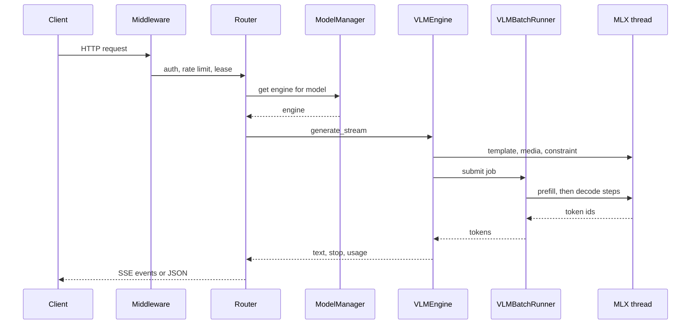

本頁追蹤一個請求，從 socket 一路走到回應的最後一個位元組，並標出每個步驟由哪個模組負責。

## 它做什麼

1. **中介層。** `python/yunshu_gateway/main.py` 的 `create_app()` 堆疊各層。因為 `add_middleware` 是往前插入，最後加入的在最外層。由外到內：`DisconnectWatchMiddleware`、`MetricsMiddleware`、`LiveCORSMiddleware`、`ModelLeaseMiddleware`、`ResidentActivityMiddleware`、`YunshuExtensionsMiddleware`（請求 id、佇列標頭、每個回應的 `x_yunshu` 統計）、`AuthMiddleware`、`RateLimitMiddleware`（僅在 `YUNSHU_RATE_LIMIT_RPM` 大於 0 時）以及 `RequestLoggingMiddleware`。Metrics 刻意放在 auth 之外，讓 401、429、413 也被計入。斷線監看層在最外面，因為 Starlette 的 `BaseHTTPMiddleware` 會隱藏用戶端斷線；它把斷線記錄在 `scope["yunshu.client_gone"]`。
2. **路由器。** `python/yunshu_gateway/routers/` 下的路由器（`chat.py`、`anthropic.py`、Responses 路由器等）驗證 body，正規化成一個內部請求並解析模型。
3. **引擎派送。** `ModelManager`（`python/yunshu_engine/model_manager.py`）延遲載入模型、在記憶體壓力下依最近最少使用淘汰，並發出租約（lease）。`ModelLeaseMiddleware` 讓請求取得的每個模型在回應結束前都持有租約，因此卸載、TTL 到期或淘汰都不會在回應途中抽走模型。
4. **VLM batch runner。** 對 `mlx-vlm` 模型，`VLMEngine.generate_stream` 在 MLX 執行緒上準備提示（chat template、媒體編碼、約束編譯），並把 job 提交給 `VLMBatchRunner`。runner 一次接納一個提示做預填、查詢前綴快取，並讓所有活躍的列一起解碼；Qwen3.5 系列可讓單獨的請求跑在推測通道。純文字 `mlx-lm` 模型則改走 `_generate_fast`。
5. **MLX 執行緒。** 所有 GPU 工作都在單一 worker 執行器上執行（`python/yunshu_engine/mlx_executor.py`），它擁有 Metal generation stream。
6. **還原文字、停止、遞送。** runner 產出 token id。`VLMEngine` 執行每個請求的 detokenizer、stop 字串與推理狀態追蹤，並透過有界佇列把 `RequestOutput` 推給非同步消費者。路由器再把它們轉成該方言的 JSON 或 SSE 事件，包含 usage 與附加的 `x_yunshu` 欄位。

此圖呈現串流請求各交接點的順序；非串流請求會收集相同的輸出，回傳單一 body。

## 為什麼這樣設計

- **單一 GPU 執行緒。** mlx-lm 的 generation stream 是綁定建立它的執行緒的模組層級狀態，所以每個引擎都把工作提交到同一個執行器。這讓單一行程同時服務多個模型也很安全。
- **runner 產 id，引擎產文字。** 把 detokenize 與 stop 邏輯放在 `VLMEngine`，讓文字路徑與 VLM 路徑以相同方式回報結果。
- **有界遞送。** 引擎透過會監看取消事件的阻塞式 put 寫入佇列，所以慢速用戶端不會讓 GPU 執行緒無限制地緩衝。

## 保證

- 用戶端斷線會取消其生成，而不是一路解碼到 `max_tokens`；斷線監看層設定一個事件，路由器的斷線防護（`run_with_disconnect_guard`、`client_disconnected`）在事件被設定時取消生成。
- 請求持有租約期間，模型不會被卸載。
- 在引擎內失敗的串流會以錯誤事件與 `finish_reason: "error"` 結束，而不是默默截斷。
- 每個請求的 sampler、detokenizer 與 stop 狀態不會在請求間共用；detokenizer 不做池化。

## 設定

| 設定 | 預設 | 作用 |
|---|---|---|
| `YUNSHU_RATE_LIMIT_RPM` | `0` | 每分鐘請求數上限；大於 0 才安裝此中介層 |
| `YUNSHU_AUTH_TOKEN` | 未設定 | 管理 token；設定後才強制驗證（具名 API key 是另一套） |
| `YUNSHU_ENGINE_LOOP` | 關閉 | 文字模型舊有的 continuous batching 迴圈 |

## 限制

- 純文字 `mlx-lm` 請求一次只服務一個。
- VLM 模型會拒絕 LoRA adapter 與自訂 logits processor。
- 預填一次接納一個請求，並與其他列的解碼交錯進行。

## 如何驗證

`tests/unit/test_client_disconnect_watch.py` 與 `tests/unit/test_disconnect_guard.py` 涵蓋斷線取消。執行 `uv run pytest tests/unit/test_client_disconnect_watch.py -q`。對真實路徑，回應的 `X-Request-Id` 標頭與 `x_yunshu` 物件會顯示真實請求的 id、佇列狀態與快取層。另見[架構](/docs/developers/architecture)。
