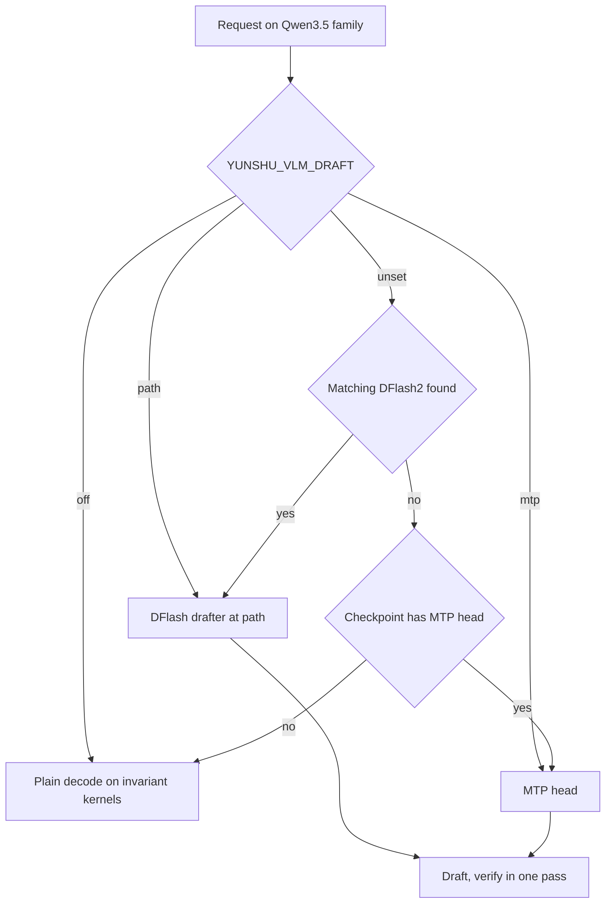

Speculative decoding drafts several tokens cheaply and verifies them in one forward pass of the target model. Yunshu uses it so that decode runs faster without changing the output.

## What it does

For the **Qwen3.5 family on the VLM runner** (model types in `VLMEngine._SPEC_MODEL_TYPES`: `qwen3_5`, `qwen3_6`, `qwen3_5_moe`, `qwen4_exp`), `spec_select.choose` picks a drafter in this order:

1. `YUNSHU_VLM_DRAFT`: a drafter directory, `mtp` to force the checkpoint's MTP head, or `off` to disable drafting.
2. Otherwise, a **DFlash2 drafter** found in the models directory or the Hugging Face cache whose `config.json` matches the target (same layer count and hidden size). This is automatic.
3. Otherwise, the checkpoint's own **MTP head** when it has one (`YUNSHU_MTP`).
4. Otherwise, plain decode.

The block size is the drafter's trained block for DFlash and 6 for MTP unless `YUNSHU_MTP_BLOCK_SIZE` is set. Drafting runs in a **single-request lane**: the runner admits a request, prefills it, and runs draft-and-verify rounds. When a shared batch drains to one eligible request, `VLMBatchRunner._maybe_promote` moves that row onto the lane at a step boundary; the lane's first round is a plain one-row verify that captures the hidden states the drafter needs, so promotion is lossless.

Other drafting sources:

- **Prompt-copy rounds.** A round can propose the continuation of the longest earlier occurrence of the current tail in the request's prompt plus generated text. The same verify checks it. `YUNSHU_SPEC_COPY_ROWS` sets the verify rows (default 32; `0` turns it off).
- **Draft tree.** `YUNSHU_SPEC_TREE` (`auto`) uses a draft-tree verifier for eligible greedy requests with the DFlash2 drafter.
- **Text-only `mlx-lm` models.** Lossless n-gram or suffix speculation on greedy requests (`YUNSHU_NGRAM_DEFAULT`, off by default; a request can ask for it with `spec_decode`; `YUNSHU_SPEC_PROPOSER` is `ngram` or `suffix`), and an assistant drafter directory for Gemma 4 text models (`YUNSHU_GEMMA4_ASSISTANT`).
- **Jump-forward** is a different mechanism for constrained output (tokens forced by a grammar are emitted without a forward pass). See [Constrained decoding](/docs/internals/constrained-decoding).

The diagram shows how the drafter is chosen when a model loads; speculation is then used per request on the single-request lane.

## Why (design decision)

Speculation is only worth shipping if it is invisible to the user. Yunshu therefore makes the verify step arithmetically identical to ordinary decode instead of accepting small numerical differences. Drafts are always verified by the target, so a wrong draft costs time, never correctness.

## Guarantees

- **Spec on equals spec off.** With speculative decoding on, greedy output is token-identical to the same engine with it off. Every target-model matmul for decode (one row) and verify (a few rows) goes through one kernel whose per-row result does not depend on how many rows share the call, and the attention and GatedDeltaNet verify paths are bit-exact against single-row decode. These batch-invariant kernels are Metal kernels compiled at runtime under `python/yunshu_engine/kernels/`. A spec-family model with drafting off still runs the lane's plain-decode arithmetic, so the identity holds for that case too.
- **Sampled requests** draw position-keyed noise, so the result does not depend on which tokens were drafted.
- **Draft models keep stock kernels**; only target modules are rerouted, and prefill chunks keep their own kernels.
- **Not claimed:** bit-identity to stock MLX single-row decoding. Different reductions move logits by rounding-level amounts, and that drift is accepted. The hard gate is identity within one Yunshu version.
- **Drafter quantization is lossless in effect.** `YUNSHU_DRAFT_BITS` (default 8) changes only the drafter's weights; drafts are verified, so output is token-identical for every value.

## Knobs

| Setting | Default | Effect |
|---|---|---|
| `YUNSHU_VLM_DRAFT` | unset | Drafter directory, `mtp`, or `off` |
| `YUNSHU_MTP` | on | Use the checkpoint's MTP head |
| `YUNSHU_MTP_BLOCK_SIZE` | unset | Draft block; unset means 6 for MTP and the trained block for DFlash |
| `YUNSHU_SPEC_TREE` | `auto` | `off`, `tree` or `auto` draft-tree verifier |
| `YUNSHU_SPEC_COPY_ROWS` | `32` | Verify rows for prompt-copy rounds; `0` disables |
| `YUNSHU_DRAFT_BITS` | `8` | DFlash drafter weight bits (`8`, `4`, or `0` for shipped bf16) |
| `YUNSHU_NGRAM_DEFAULT` | off | Text models: n-gram speculation on greedy requests |
| `YUNSHU_SPEC_PROPOSER` | `ngram` | `ngram` or `suffix` for text models |
| `YUNSHU_GEMMA4_ASSISTANT` | unset | Assistant drafter directory for Gemma 4 text models |
| `YUNSHU_SPEC_UNVERIFIED`, `YUNSHU_DRAFT_MODEL` | off, unset | Stable user options, not lossless: external `mlx-lm` draft model for greedy text requests; see [Options that can change output](/docs/guides/options) |
| `YUNSHU_ROUND_DRIVER` | off | Experimental row-wise round driver; see [Round driver](/docs/developers/round-driver) |

## Limits

- The lossless guarantee does not cover `YUNSHU_SPEC_UNVERIFIED` with an external draft model: its output can differ from plain decode. See [Options that can change output](/docs/guides/options).
- Qwen3.5 family only on the VLM runner; other VLM families decode without drafting.
- The lane serves one request at a time. Concurrent requests share a batch and do not draft together.
- An Apple Paravirtual Metal host runs the stock runner without speculation.
- LoRA adapters and custom logits processors are rejected for VLMs, and processors that are not draft-safe keep a request off the lane.

## How to verify

Counters are available at `GET /v1/yunshu/spec-decode`, as Prometheus `yunshu_spec_decode_*` metrics, and per request in `x_yunshu.speculative`. The startup log prints the chosen path ("Speculative decoding: ..."). Identity is checked by the `yv` tool (see [Verification](/docs/developers/verification)); relevant unit tests are `tests/unit/test_spec_off_invariant.py`, `tests/unit/test_spec_select.py`, `tests/unit/test_invariant_wide_decode.py`, `tests/unit/test_dflash_draft.py` and `tests/unit/test_dflash_copy.py`. Measured decode numbers are in [Benchmarks](/docs/guides/benchmarks).
