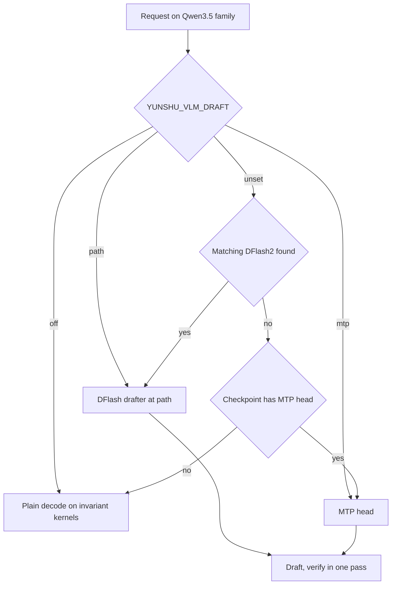

推测解码先以低成本起草若干 token，再用目标模型的一次前向传递验证。云舒用它让解码更快，且不改变输出。

## 它做什么

对于 **VLM runner 上的 Qwen3.5 系列**（`VLMEngine._SPEC_MODEL_TYPES` 中的模型类型：`qwen3_5`、`qwen3_6`、`qwen3_5_moe`、`qwen4_exp`），`spec_select.choose` 按下列顺序挑选 drafter：

1. `YUNSHU_VLM_DRAFT`：drafter 目录、`mtp`（强制使用 checkpoint 的 MTP head）或 `off`（禁用起草）。
2. 否则，在 models 目录或 Hugging Face 缓存中找到、且 `config.json` 与目标相符（层数与 hidden size 相同）的 **DFlash2 drafter**。这是自动的。
3. 否则，若 checkpoint 自带 **MTP head** 就用它（`YUNSHU_MTP`）。
4. 否则，使用普通解码。

块大小：DFlash 使用 drafter 训练时的块，MTP 为 6，除非设置了 `YUNSHU_MTP_BLOCK_SIZE`。起草在**单请求通道**中进行：runner 接纳请求、预填，然后执行起草与验证回合。当共享批次只剩一个合格请求时，`VLMBatchRunner._maybe_promote` 会在步骤边界把该行移到通道上；通道的第一回合是单行的普通验证，用来捕获 drafter 需要的 hidden state，因此升级是无损的。

其他起草来源：

- **提示复制回合。** 回合可以提议：在请求的提示加已生成文本中，当前尾部最长的先前出现处之后的接续内容。由同一个验证步骤检查。`YUNSHU_SPEC_COPY_ROWS` 设置验证行数（默认 32；`0` 关闭）。
- **草稿树。** `YUNSHU_SPEC_TREE`（`auto`）对符合条件、使用 DFlash2 drafter 的 greedy 请求使用草稿树验证器。
- **纯文本 `mlx-lm` 模型。** 对 greedy 请求的无损 n-gram 或 suffix 推测（`YUNSHU_NGRAM_DEFAULT`，默认关闭；请求也可用 `spec_decode` 要求；`YUNSHU_SPEC_PROPOSER` 为 `ngram` 或 `suffix`），以及 Gemma 4 文本模型的 assistant drafter 目录（`YUNSHU_GEMMA4_ASSISTANT`）。
- **Jump-forward** 是针对受限输出的另一种机制（文法强制的 token 无需前向传递即可输出）。见[受限解码](/docs/internals/constrained-decoding)。

此图显示模型加载时如何选择 drafter；之后在单请求通道上按请求使用推测。

## 为什么这样设计

推测解码只有在用户看不出差异时才值得提供。因此云舒让验证步骤的算术与普通解码完全相同，而不是接受微小的数值差异。草稿一律由目标模型验证，所以错误的草稿只浪费时间，不影响正确性。

## 保证

- **推测开等于推测关。** 开启推测解码时，greedy 输出与同一引擎关闭时 token 完全一致。解码（一行）与验证（若干行）时，目标模型的每个 matmul 都走同一个 kernel，其每行结果与共用该次调用的行数无关，且注意力与 GatedDeltaNet 的验证路径与单行解码比特精确一致。这些 batch-invariant kernel 是运行时编译的 Metal kernel，位于 `python/yunshu_engine/kernels/`。关闭起草的推测系列模型仍使用通道的普通解码算术，所以此情况下一致性也成立。
- **采样请求**使用以位置为 key 的噪声，因此结果与哪些 token 被起草无关。
- **Draft 模型使用原生 kernel**；只有目标模块会被改接，预填块保持自己的 kernel。
- **不声明：** 与原生 MLX 单行解码比特一致。不同的归约顺序会让 logits 有舍入级别的差异，这种漂移是可接受的。硬性门槛是同一个云舒版本内的一致性。
- **Drafter 量化在效果上无损。** `YUNSHU_DRAFT_BITS`（默认 8）只改变 drafter 的权重；草稿会被验证，所以任何值的输出 token 都相同。

## 设置

| 设置 | 默认 | 作用 |
|---|---|---|
| `YUNSHU_VLM_DRAFT` | 未设置 | drafter 目录、`mtp` 或 `off` |
| `YUNSHU_MTP` | 开启 | 使用 checkpoint 的 MTP head |
| `YUNSHU_MTP_BLOCK_SIZE` | 未设置 | 草稿块；未设置时 MTP 为 6，DFlash 为训练块 |
| `YUNSHU_SPEC_TREE` | `auto` | `off`、`tree` 或 `auto` 草稿树验证器 |
| `YUNSHU_SPEC_COPY_ROWS` | `32` | 提示复制回合的验证行数；`0` 禁用 |
| `YUNSHU_DRAFT_BITS` | `8` | DFlash drafter 权重位数（`8`、`4`，或 `0` 保留原始 bf16） |
| `YUNSHU_NGRAM_DEFAULT` | 关闭 | 文本模型：对 greedy 请求使用 n-gram 推测 |
| `YUNSHU_SPEC_PROPOSER` | `ngram` | 文本模型的 `ngram` 或 `suffix` |
| `YUNSHU_GEMMA4_ASSISTANT` | 未设置 | Gemma 4 文本模型的 assistant drafter 目录 |
| `YUNSHU_SPEC_UNVERIFIED`、`YUNSHU_DRAFT_MODEL` | 关闭、未设置 | 稳定的用户选项，非无损：贪婪文本请求使用外部 `mlx-lm` draft 模型；见[可能改变输出的选项](/docs/guides/options) |
| `YUNSHU_ROUND_DRIVER` | 关闭 | 实验性的逐行 round driver；见 [Round driver](/docs/developers/round-driver) |

## 限制

- 无损保证不涵盖搭配外部 draft 模型的 `YUNSHU_SPEC_UNVERIFIED`：其输出可能与普通解码不同。见[可能改变输出的选项](/docs/guides/options)。
- 在 VLM runner 上仅限 Qwen3.5 系列；其他 VLM 系列不起草直接解码。
- 通道一次只服务一个请求。并发请求共享批次，不一起起草。
- Apple Paravirtual Metal 主机使用原生 runner，没有推测。
- VLM 会拒绝 LoRA adapter 与自定义 logits processor，而不安全于起草的 processor 会让请求留在通道之外。

## 如何验证

计数器可由 `GET /v1/yunshu/spec-decode`、Prometheus 的 `yunshu_spec_decode_*` 指标获取，每个请求的数据在 `x_yunshu.speculative`。启动日志会打印所选路径（“Speculative decoding: ...”）。一致性由 `yv` 工具检查（见[验证](/docs/developers/verification)）；相关单元测试有 `tests/unit/test_spec_off_invariant.py`、`tests/unit/test_spec_select.py`、`tests/unit/test_invariant_wide_decode.py`、`tests/unit/test_dflash_draft.py` 与 `tests/unit/test_dflash_copy.py`。实测的解码数字见[基准测试](/docs/guides/benchmarks)。
