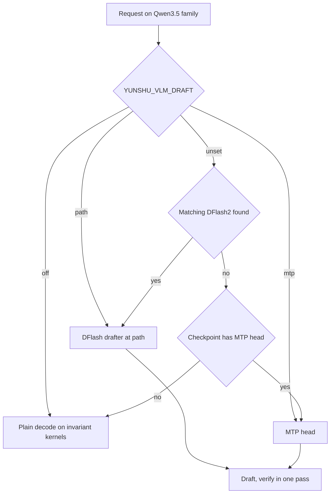

推測解碼先以低成本起草數個 token，再用目標模型的一次前向傳遞驗證。雲樞用它讓解碼更快，且不改變輸出。

## 它做什麼

對於 **VLM runner 上的 Qwen3.5 系列**（`VLMEngine._SPEC_MODEL_TYPES` 中的模型類型：`qwen3_5`、`qwen3_6`、`qwen3_5_moe`、`qwen4_exp`），`spec_select.choose` 依下列順序挑選 drafter：

1. `YUNSHU_VLM_DRAFT`：drafter 目錄、`mtp`（強制使用 checkpoint 的 MTP head）或 `off`（停用起草）。
2. 否則，在 models 目錄或 Hugging Face 快取中找到、且 `config.json` 與目標相符（層數與 hidden size 相同）的 **DFlash2 drafter**。這是自動的。
3. 否則，若 checkpoint 自帶 **MTP head** 就用它（`YUNSHU_MTP`）。
4. 否則，使用一般解碼。

區塊大小：DFlash 使用 drafter 訓練時的區塊，MTP 為 6，除非設定了 `YUNSHU_MTP_BLOCK_SIZE`。起草在**單請求通道**中進行：runner 接納請求、預填，然後執行起草與驗證回合。當共用批次只剩一個合格請求時，`VLMBatchRunner._maybe_promote` 會在步驟邊界把該列移到通道上；通道的第一回合是單列的一般驗證，用來擷取 drafter 需要的 hidden state，因此移入通道是無損的。

其他起草來源：

- **提示複製回合。** 回合可以直接提議接續內容：在請求的提示與已生成文字中，找出目前尾端最長的先前出現處，提議其後的內容。同樣交由驗證步驟檢查。`YUNSHU_SPEC_COPY_ROWS` 設定驗證列數（預設 32；`0` 關閉）。
- **草稿樹。** `YUNSHU_SPEC_TREE`（`auto`）對符合條件、使用 DFlash2 drafter 的 greedy 請求使用草稿樹驗證器。
- **純文字 `mlx-lm` 模型。** 對 greedy 請求的無損 n-gram 或 suffix 推測（`YUNSHU_NGRAM_DEFAULT`，預設關閉；請求也可用 `spec_decode` 要求；`YUNSHU_SPEC_PROPOSER` 為 `ngram` 或 `suffix`），以及 Gemma 4 文字模型的 assistant drafter 目錄（`YUNSHU_GEMMA4_ASSISTANT`）。
- **Jump-forward** 是針對受限輸出的另一種機制（文法強制的 token 不需前向傳遞即可輸出）。見[受限解碼](/docs/internals/constrained-decoding)。

此圖顯示模型載入時如何選擇 drafter；之後在單請求通道上依請求使用推測。

## 為什麼這樣設計

推測解碼只有在使用者看不出差異時才值得提供。因此雲樞讓驗證步驟的算術與一般解碼完全相同，而不是接受微小的數值差異。草稿一律由目標模型驗證，所以錯誤的草稿只浪費時間，不影響正確性。

## 保證

- **推測開等於推測關。** 開啟推測解碼時，greedy 輸出與同一引擎關閉時 token 完全一致。解碼（一列）與驗證（數列）時，目標模型的每個 matmul 都走同一個 kernel，其每列結果與共用該次呼叫的列數無關，且注意力與 GatedDeltaNet 的驗證路徑與單列解碼位元精確相符。這些 batch-invariant kernel 是執行時編譯的 Metal kernel，位於 `python/yunshu_engine/kernels/`。關閉起草的推測系列模型仍使用通道的一般解碼算術，所以這種情況下一致性同樣成立。
- **取樣請求**使用以位置為 key 的雜訊，因此結果與哪些 token 被起草無關。
- **Draft 模型沿用原版 kernel**；只有目標模組會被改接，預填區塊維持自己的 kernel。
- **不宣稱：** 與原生 MLX 單列解碼逐位元相同。不同的歸約順序會讓 logits 有捨入等級的差異，這種漂移是可接受的。硬性門檻是同一個雲樞版本內的一致性。
- **Drafter 量化在效果上無損。** `YUNSHU_DRAFT_BITS`（預設 8）只改變 drafter 的權重；草稿會被驗證，所以任何值的輸出 token 都相同。

## 設定

| 設定 | 預設 | 作用 |
|---|---|---|
| `YUNSHU_VLM_DRAFT` | 未設定 | drafter 目錄、`mtp` 或 `off` |
| `YUNSHU_MTP` | 開啟 | 使用 checkpoint 的 MTP head |
| `YUNSHU_MTP_BLOCK_SIZE` | 未設定 | 草稿區塊；未設定時 MTP 為 6，DFlash 為訓練區塊 |
| `YUNSHU_SPEC_TREE` | `auto` | `off`、`tree` 或 `auto` 草稿樹驗證器 |
| `YUNSHU_SPEC_COPY_ROWS` | `32` | 提示複製回合的驗證列數；`0` 停用 |
| `YUNSHU_DRAFT_BITS` | `8` | DFlash drafter 權重位元數（`8`、`4`，或 `0` 保留原始 bf16） |
| `YUNSHU_NGRAM_DEFAULT` | 關閉 | 文字模型：對 greedy 請求使用 n-gram 推測 |
| `YUNSHU_SPEC_PROPOSER` | `ngram` | 文字模型的 `ngram` 或 `suffix` |
| `YUNSHU_GEMMA4_ASSISTANT` | 未設定 | Gemma 4 文字模型的 assistant drafter 目錄 |
| `YUNSHU_SPEC_UNVERIFIED`、`YUNSHU_DRAFT_MODEL` | 關閉、未設定 | 穩定的使用者選項，非無損：greedy 文字請求使用外部 `mlx-lm` draft 模型；見[可能改變輸出的選項](/docs/guides/options) |

## 限制

- 無損保證不涵蓋搭配外部 draft 模型的 `YUNSHU_SPEC_UNVERIFIED`：其輸出可能與一般解碼不同。見[可能改變輸出的選項](/docs/guides/options)。
- 在 VLM runner 上僅限 Qwen3.5 系列；其他 VLM 系列不起草直接解碼。
- 通道一次只服務一個請求。並行請求共用批次，不一起起草。
- Apple Paravirtual Metal 主機使用原生 runner，沒有推測。
- VLM 會拒絕 LoRA adapter 與自訂 logits processor，而不適合起草（not draft-safe）的 processor 會讓請求無法進入該通道。

## 如何驗證

計數器可由 `GET /v1/yunshu/spec-decode`、Prometheus 的 `yunshu_spec_decode_*` 指標取得，每個請求的資料在 `x_yunshu.speculative`。啟動日誌會印出所選路徑（「Speculative decoding: ...」）。一致性由 `yv` 工具檢查（見[驗證](/docs/developers/verification)）；相關單元測試有 `tests/unit/test_spec_off_invariant.py`、`tests/unit/test_spec_select.py`、`tests/unit/test_invariant_wide_decode.py`、`tests/unit/test_dflash_draft.py` 與 `tests/unit/test_dflash_copy.py`。實測的解碼數字見[基準測試](/docs/guides/benchmarks)。
