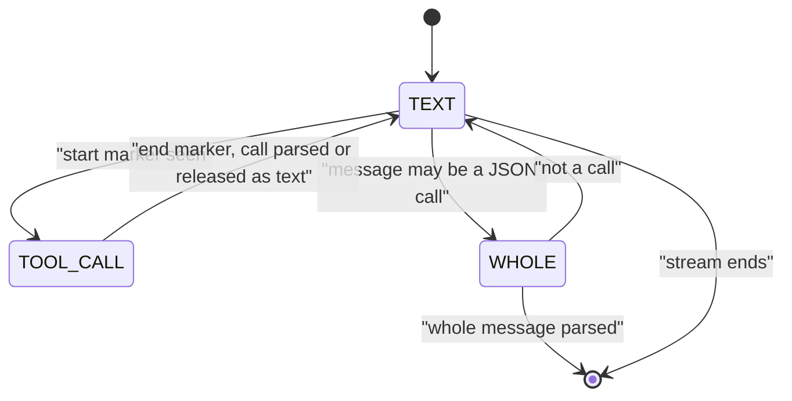

A model writes a tool call as text in its own wire format. Yunshu reads that text back into structured calls, so OpenAI-, Anthropic- and Ollama-style clients all see ordinary tool-call fields. This page describes the readers, the streaming parser and the outcome rules. For constraining the call while it is generated, see [Constrained decoding](/docs/internals/constrained-decoding).

## What it does

`yunshu_engine/tool_format.py` is the registry. A `ToolFormat` is a start marker, an end marker (empty means "to the end of the line", as in Mistral) and a parse function for the text between them. A `whole` format has no start marker: the entire message is the call (Llama 3 JSON).

- **Detection.** `native_format` reads the model's chat template and returns the format the template teaches, or `None`. It checks Llama header templates first, then marker strings (`_OWN_TEMPLATE_MARKERS`), then Hermes/GLM `<tool_call>` shapes, then falls back to the upstream registries of `mlx-vlm` and `mlx-lm` (`_infer_tool_parser`).
- **Order to try.** `formats_for_tokenizer` returns the native format, then `yunshu_json` (the `<tool_call>{"name", "arguments"}</tool_call>` form Yunshu's injected tool prompt asks for), then `json_message` (a message that is only a JSON call object). Harmony also tries a suffix form.
- **Parsing a finished output.** `parse_tool_output` returns the calls in output order, with arguments typed by the request's tool schemas, and the text with every parsed call span removed.
- **Streaming.** `ToolCallStreamer` (`tool_call_streamer.py`) moves between text, inside-a-call and whole-message states.

## Formats and families

Detection is from the chat template, not from a model-name list; the table gives the format and the families it serves.

| Format name | Wire shape | Families |
|---|---|---|
| Qwen XML (upstream reader plus tolerant fallbacks) | `<tool_call><function=f><parameter=p>v</parameter></function></tool_call>` | Qwen3.x and Qwen3-Coder style templates |
| `hermes` / `yunshu_json` | `<tool_call>{"name": ..., "arguments": ...}</tool_call>` | Hermes-style JSON templates; models with no template tool format (injected prompt) |
| `glm47` | `<tool_call>` with `<arg_key>` / `<arg_value>` or newline JSON | GLM |
| `mistral` | `[TOOL_CALLS]` followed by JSON, or `[ARGS]` | Mistral |
| `kimi_k2` | `<\|tool_calls_section_begin\|>` ... `<\|tool_calls_section_end\|>` | Kimi K2 |
| `harmony` / `harmony_suffix` | Harmony messages ending in `<\|call\|>`, or a `to=` / `<\|channel\|>` suffix | Harmony-template models |
| `deepseek` | `<｜tool▁calls▁begin｜>` blocks | DeepSeek V3, R1, V3.1 |
| `deepseek_v32` | `<｜DSML｜function_calls>` | DeepSeek V3.2 |
| `deepseek_v4` | `<｜DSML｜tool_calls>` | DeepSeek V4 |
| `llama3_json` | the whole message is a JSON call, optionally after `<\|python_tag\|>` | Llama 3.x JSON templates |
| `llama3_pythonic` / `pythonic` | literal Python calls such as `[f(a=1)]`, bare or between `<\|tool_call_start\|>` and `<\|tool_call_end\|>` | Llama Python-list templates; tagged pythonic templates |
| `json_message` | a message that is nothing but a JSON call object | models without a marker format, such as Qwen3-Omni |

Formats not listed here come from the upstream parser registries of `mlx-vlm` and `mlx-lm`. Families without a locally available checkpoint are tested with fixtures and not claimed as real-model validated.

## Why

The format is a property of the model, so it is read from the template the way upstream does, and Yunshu only adds readers upstream lacks. The readers are independent implementations (`tool_family_parsers.py`) and never execute model output: the Python-call reader accepts only keyword arguments that are JSON-style literals and rejects positional arguments, expansions and any non-literal name. Fixture shapes are inspired by vLLM's parser tests, with the reviewed upstream revision recorded in `vendor.json`.

## Streaming parse and call IDs

The following diagram shows the streaming states.



- Text outside calls streams as soon as it cannot be the start of a marker. From a start marker on, text is held until the end marker, then the call is parsed.
- Each call is emitted as a start (id and name) followed by its complete arguments. Arguments are buffered until a complete call is available, then sent after the name. Each call gets its own ID.
- A span that no format can read is released as text. Tool markup never reaches the content stream.
- Request constraints apply at the source: a named `tool_choice` drops calls to other functions, `parallel_tool_calls=false` keeps only the first call, and tool names are filtered against the request.
- Arguments are always a JSON object string. `tool_arguments.py` types text-valued parameters (Qwen's `<parameter=days>3` arrives as `"3"`) using the request's JSON schema: integer, number, boolean, array, object and null convert when they convert cleanly; string and unknown types stay unchanged.
- For GLM, `tool_thinking.py` recovers trailing calls inside reasoning only when generation ends on the observation EOS token. Length stops, cancels, user stops, malformed calls and quoted examples stay reasoning.

## How finish_reason and the outcome are decided

- If at least one call survives parsing and the `tool_choice` / parallel filters, the OpenAI chat route reports `finish_reason` `tool_calls` (`chat.py`: `"tool_calls" if tool_calls else finish`). For a stream this is decided per choice when any call was emitted. The Anthropic route maps the same condition to `stop_reason` `tool_use` (`_map_stop_reason`).
- Otherwise the engine's own reason (`stop`, `length`, ...) is reported, and a markup block that yielded no call is released as text rather than dropped.
- Every parse records counts, never text, on the request: `tool_calls_parsed` and `tool_markup_failed` (`record_tool_outcome`). They are logged and exposed through the finished-request record in `x_yunshu`, so a dropped call is visible instead of silent.

## Guarantees

- Calls to names the request did not declare are filtered out. Tool markup does not leak into content.
- Python-style calls are parsed as data and never executed.
- A forced `tool_choice` uses a native llguidance grammar. Native envelopes can span several tokenizer tokens; unsupported grammar and tokenizer combinations keep the unconstrained fallback, and a parsed call is not a strict-schema proof.

## Knobs

| Setting | Default | Effect |
|---|---|---|

Parsing itself has no setting; it follows the chat template.

## Limits

- A template with no recognizable tool format falls back to `yunshu_json` and `json_message`, which depend on the model following the injected prompt.
- Python-literal arguments are limited to JSON-style literals.
- Formats for families without a local checkpoint have fixture coverage only.

## How to verify

```bash
uv run pytest tests/unit/test_tool_format.py tests/unit/test_tool_family_parsers.py \
  tests/unit/test_tool_streamer_tool_choice.py tests/unit/test_tool_call_grammar.py -q
```

The optional capability stage runs four real HTTP checks (forced, streaming, lazy output and lazy auto-tools): `scripts/dev/yv ab --suite preflight,toolparse --model /path/to/small-model`. See [Verification](/docs/developers/verification).
