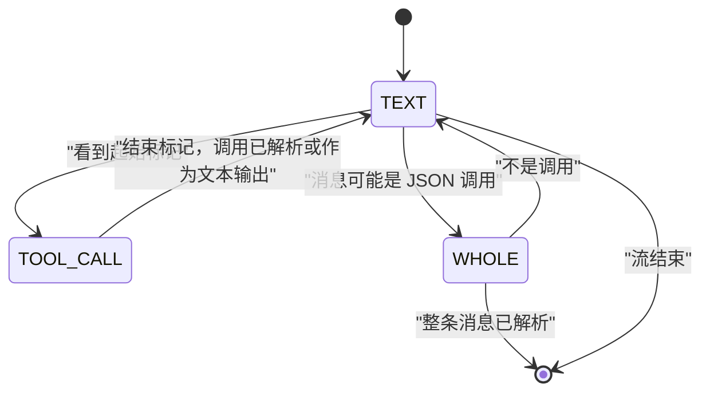

模型会以自己的线路格式把工具调用写成文本。Yunshu 把这段文本读回结构化的调用，让 OpenAI、Anthropic 与 Ollama 风格的客户端都看到普通的工具调用字段。本页说明读取器、流式解析器与结果判定规则。关于在生成时约束调用，请见[约束解码](/docs/internals/constrained-decoding)。

## 它做什么

`yunshu_engine/tool_format.py` 是注册表。一个 `ToolFormat` 由起始标记、结束标记（为空表示“到行尾”，如 Mistral）以及解析两者之间文本的解析函数组成。`whole` 格式没有起始标记：整条消息就是调用（Llama 3 JSON）。

- **检测。** `native_format` 读取模型的聊天模板，返回模板所教的格式，否则返回 `None`。它先检查 Llama 标头模板，再检查标记字符串（`_OWN_TEMPLATE_MARKERS`），然后是 Hermes/GLM 的 `<tool_call>` 形态，最后退回 `mlx-vlm` 与 `mlx-lm` 上游的注册表（`_infer_tool_parser`）。
- **尝试顺序。** `formats_for_tokenizer` 先返回原生格式，再是 `yunshu_json`（Yunshu 注入的工具提示词所要求的 `<tool_call>{"name", "arguments"}</tool_call>` 形式），然后是 `json_message`（仅由一个 JSON 调用对象构成的消息）。Harmony 还会尝试后缀形式。
- **解析完整输出。** `parse_tool_output` 按输出顺序返回调用，参数按请求的工具 schema 标注类型，并返回移除所有已解析调用片段后的文本。
- **流式。** `ToolCallStreamer`（`tool_call_streamer.py`）在文本、调用内部与整条消息这几种状态之间转换。

## 格式与模型家族

检测来自聊天模板，而不是模型名称清单；下表列出格式及其服务的家族。

| 格式名称 | 线路形态 | 家族 |
|---|---|---|
| Qwen XML（上游读取器加宽容的后备） | `<tool_call><function=f><parameter=p>v</parameter></function></tool_call>` | Qwen3.x 与 Qwen3-Coder 风格模板 |
| `hermes` / `yunshu_json` | `<tool_call>{"name": ..., "arguments": ...}</tool_call>` | Hermes 风格 JSON 模板；模板没有工具格式的模型（注入提示词） |
| `glm47` | `<tool_call>` 搭配 `<arg_key>` / `<arg_value>` 或换行 JSON | GLM |
| `mistral` | `[TOOL_CALLS]` 后接 JSON，或 `[ARGS]` | Mistral |
| `kimi_k2` | `<\|tool_calls_section_begin\|>` ... `<\|tool_calls_section_end\|>` | Kimi K2 |
| `harmony` / `harmony_suffix` | 以 `<\|call\|>` 结尾的 Harmony 消息，或 `to=` / `<\|channel\|>` 后缀 | Harmony 模板的模型 |
| `deepseek` | `<｜tool▁calls▁begin｜>` 区块 | DeepSeek V3、R1、V3.1 |
| `deepseek_v32` | `<｜DSML｜function_calls>` | DeepSeek V3.2 |
| `deepseek_v4` | `<｜DSML｜tool_calls>` | DeepSeek V4 |
| `llama3_json` | 整条消息是一个 JSON 调用，可选地位于 `<\|python_tag\|>` 之后 | Llama 3.x JSON 模板 |
| `llama3_pythonic` / `pythonic` | 字面的 Python 调用，如 `[f(a=1)]`，裸写或位于 `<\|tool_call_start\|>` 与 `<\|tool_call_end\|>` 之间 | Llama Python 列表模板；带标签的 pythonic 模板 |
| `json_message` | 整条消息只有一个 JSON 调用对象 | 没有标记格式的模型，如 Qwen3-Omni |

未列在此处的格式来自 `mlx-vlm` 与 `mlx-lm` 的上游解析器注册表。没有本地可用检查点的家族以 fixture 测试，不宣称经过真实模型验证。

## 为什么这样设计

格式是模型的属性，所以与上游一样从模板读取，Yunshu 只补上上游缺少的读取器。这些读取器是独立实现（`tool_family_parsers.py`），绝不执行模型输出：Python 调用读取器只接受 JSON 风格字面量的关键字参数，并拒绝位置参数、展开以及任何非字面量的名称。fixture 的形态参考 vLLM 的解析器测试，已审阅的上游版本记录在 `vendor.json` 中。

## 流式解析与调用 ID

下图显示流式状态。



- 调用之外的文本，一旦不可能是标记的开头就立即流出。从起始标记开始，文本会被保留到结束标记，然后解析该调用。
- 每个调用以一个起始事件（id 与名称）加上其完整参数的形式输出。参数会先缓冲，直到有完整的调用，再于名称之后送出。每个调用都有自己的 ID。
- 没有任何格式能读懂的片段会作为文本输出。工具标记永远不会进入内容流。
- 请求的约束在源头生效：指定名称的 `tool_choice` 会丢弃对其他函数的调用，`parallel_tool_calls=false` 只保留第一个调用，工具名称会按请求过滤。
- 参数永远是 JSON 对象字符串。`tool_arguments.py` 依据请求的 JSON schema 为文本值的参数标注类型（Qwen 的 `<parameter=days>3` 到达时是 `"3"`）：integer、number、boolean、array、object 与 null 在能干净转换时才转换；string 与未知类型保持不变。
- 对 GLM，`tool_thinking.py` 只在生成以观察 EOS token 结束时，才会从推理内容中找回结尾的调用。长度停止、取消、用户停止、格式错误的调用以及被引用的示例，都仍然算作推理。

## finish_reason 与结果如何判定

- 如果至少有一个调用通过了解析以及 `tool_choice` / 并行过滤，OpenAI chat 路由会报告 `finish_reason` 为 `tool_calls`（`chat.py`：`"tool_calls" if tool_calls else finish`）。对流而言，只要输出过任何调用，就按每个 choice 判定。Anthropic 路由把同样的条件映射到 `stop_reason` 的 `tool_use`（`_map_stop_reason`）。
- 否则报告引擎自己的原因（`stop`、`length` 等），而没有产生调用的标记区块会作为文本输出，而不是丢弃。
- 每次解析都会在请求上记录次数而非文本：`tool_calls_parsed` 与 `tool_markup_failed`（`record_tool_outcome`）。它们会被记入日志，并通过 `x_yunshu` 中的已完成请求记录公开，所以被丢弃的调用是看得见的，而不是悄悄消失。

## 保证

- 对请求未声明的名称发起的调用会被过滤掉。工具标记不会泄漏到内容中。
- Python 风格的调用当作数据解析，绝不执行。
- 强制的 `tool_choice` 使用原生 llguidance 语法。原生外层包装可能跨越多个分词器 token；不受支持的语法与分词器组合保留无约束后备，解析出的调用并不能证明符合严格 schema。

## 配置项

| 设置 | 默认 | 作用 |
|---|---|---|

解析本身没有设置项；它跟随聊天模板。

## 限制

- 没有可识别工具格式的模板会退回 `yunshu_json` 与 `json_message`，这取决于模型是否遵循注入的提示词。
- Python 字面量参数仅限于 JSON 风格字面量。
- 没有本地检查点的家族，其格式只有 fixture 覆盖。

## 如何验证

```bash
uv run pytest tests/unit/test_tool_format.py tests/unit/test_tool_family_parsers.py \
  tests/unit/test_tool_streamer_tool_choice.py tests/unit/test_tool_call_grammar.py -q
```

可选的能力阶段会执行四项真实 HTTP 检查（强制、流式、惰性输出与惰性 auto 工具）：`scripts/dev/yv ab --suite preflight,toolparse --model /path/to/small-model`。请见[验证](/docs/developers/verification)。
