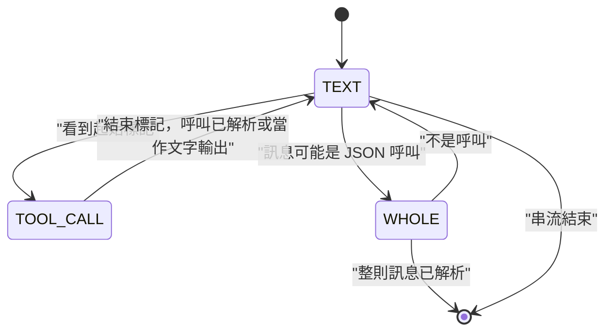

模型會以自己的傳輸格式把工具呼叫寫成文字。Yunshu 把這些文字讀回結構化的呼叫，讓 OpenAI、Anthropic 與 Ollama 風格的用戶端都看到一般的工具呼叫欄位。本頁說明各個讀取器、串流解析器與結果判定規則。若要在生成過程中約束呼叫，請見[約束解碼](/docs/internals/constrained-decoding)。

## 它做什麼

`yunshu_engine/tool_format.py` 是登錄表。一個 `ToolFormat` 包含起始標記、結束標記（空值表示「到行尾」，如 Mistral）以及解析兩者之間文字的函式。`whole` 格式沒有起始標記：整則訊息就是呼叫（Llama 3 JSON）。

- **偵測。** `native_format` 讀取模型的聊天模板，回傳模板所教的格式，或 `None`。它先檢查 Llama 標頭模板，再檢查標記字串（`_OWN_TEMPLATE_MARKERS`），接著是 Hermes/GLM 的 `<tool_call>` 形狀，最後退回使用 `mlx-vlm` 與 `mlx-lm` 的上游登錄表（`_infer_tool_parser`）。
- **嘗試順序。** `formats_for_tokenizer` 依序回傳原生格式、`yunshu_json`（Yunshu 注入的工具提示詞所要求的 `<tool_call>{"name", "arguments"}</tool_call>` 形式），然後是 `json_message`（整則訊息只是一個 JSON 呼叫物件）。Harmony 還會嘗試後綴形式。
- **解析完成的輸出。** `parse_tool_output` 依輸出順序回傳呼叫，參數依請求的工具 schema 指定型別，並回傳移除所有已解析呼叫區段後的文字。
- **串流。** `ToolCallStreamer`（`tool_call_streamer.py`）在文字、呼叫內部與整則訊息這幾種狀態之間切換。

## 格式與模型家族

偵測依據是聊天模板，而不是模型名稱清單；下表列出格式與其服務的家族。

| 格式名稱 | 傳輸形狀 | 家族 |
|---|---|---|
| Qwen XML（上游讀取器加上寬容的後備） | `<tool_call><function=f><parameter=p>v</parameter></function></tool_call>` | Qwen3.x 與 Qwen3-Coder 風格模板 |
| `hermes` / `yunshu_json` | `<tool_call>{"name": ..., "arguments": ...}</tool_call>` | Hermes 風格 JSON 模板；模板沒有工具格式的模型（注入提示詞） |
| `glm47` | `<tool_call>` 搭配 `<arg_key>` / `<arg_value>` 或換行 JSON | GLM |
| `mistral` | `[TOOL_CALLS]` 後接 JSON，或 `[ARGS]` | Mistral |
| `kimi_k2` | `<\|tool_calls_section_begin\|>` ... `<\|tool_calls_section_end\|>` | Kimi K2 |
| `harmony` / `harmony_suffix` | 以 `<\|call\|>` 結尾的 Harmony 訊息，或 `to=` / `<\|channel\|>` 後綴 | 使用 Harmony 模板的模型 |
| `deepseek` | `<｜tool▁calls▁begin｜>` 區塊 | DeepSeek V3、R1、V3.1 |
| `deepseek_v32` | `<｜DSML｜function_calls>` | DeepSeek V3.2 |
| `deepseek_v4` | `<｜DSML｜tool_calls>` | DeepSeek V4 |
| `llama3_json` | 整則訊息是一個 JSON 呼叫，前面可選擇性加上 `<\|python_tag\|>` | Llama 3.x JSON 模板 |
| `llama3_pythonic` / `pythonic` | 字面的 Python 呼叫，例如 `[f(a=1)]`，可單獨出現或夾在 `<\|tool_call_start\|>` 與 `<\|tool_call_end\|>` 之間 | Llama Python 清單模板；有標籤的 pythonic 模板 |
| `json_message` | 整則訊息只是一個 JSON 呼叫物件 | 沒有標記格式的模型，例如 Qwen3-Omni |

未列於此的格式來自 `mlx-vlm` 與 `mlx-lm` 的上游解析器登錄表。沒有本機可用檢查點的家族以測試資料（fixture）測試，不宣稱已通過真實模型驗證。

## 為什麼這樣設計

格式是模型的屬性，所以像上游一樣從模板讀取，Yunshu 只補上上游缺少的讀取器。這些讀取器是獨立的實作（`tool_family_parsers.py`），且絕不執行模型輸出：Python 呼叫讀取器只接受 JSON 風格字面值的關鍵字引數，拒絕位置引數、展開與任何非字面值的名稱。測試資料的形狀參考 vLLM 的解析器測試，所審閱的上游版本記錄在 `vendor.json`。

## 串流解析與呼叫 ID

下圖顯示串流狀態。



- 呼叫之外的文字，只要不可能是標記的開頭就立即串流。從起始標記起，文字會被保留到結束標記，然後解析呼叫。
- 每個呼叫以一個起始事件（id 與名稱）加上其完整參數送出。參數會先緩衝到取得完整呼叫，再接在名稱之後送出。每個呼叫都有自己的 ID。
- 沒有任何格式能讀取的區段會當作文字輸出。工具標記絕不會進入內容串流。
- 請求的約束在來源處就生效：指名的 `tool_choice` 會丟棄對其他函式的呼叫，`parallel_tool_calls=false` 只保留第一個呼叫，工具名稱則依請求過濾。
- 參數永遠是 JSON 物件字串。`tool_arguments.py` 依請求的 JSON schema 為文字型參數指定型別（Qwen 的 `<parameter=days>3` 會以 `"3"` 送達）：整數、數字、布林、陣列、物件與 null 在能乾淨轉換時就轉換；字串與未知型別維持不變。
- 對 GLM，`tool_thinking.py` 只在生成結束於觀察 EOS token 時，才會從推理內容中找回結尾的呼叫。長度上限、取消、使用者停止、格式錯誤的呼叫與被引用的範例，一律仍視為推理內容。

## finish_reason 與結果如何判定

- 若至少有一個呼叫通過解析以及 `tool_choice` / 平行呼叫的過濾，OpenAI chat 路由會回報 `finish_reason` 為 `tool_calls`（`chat.py`：`"tool_calls" if tool_calls else finish`）。對串流而言，只要有任何呼叫送出，就依每個 choice 決定。Anthropic 路由則把同樣的條件對應為 `stop_reason` 的 `tool_use`（`_map_stop_reason`）。
- 否則回報引擎自己的原因（`stop`、`length` 等），而沒有產生呼叫的標記區塊會當作文字輸出，而不是被丟棄。
- 每次解析都會在請求上記錄計數而非文字：`tool_calls_parsed` 與 `tool_markup_failed`（`record_tool_outcome`）。它們會寫入日誌，並透過 `x_yunshu` 中已完成請求的紀錄公開，所以被丟棄的呼叫看得見，不會悄悄消失。

## 保證

- 對請求未宣告之名稱的呼叫會被過濾掉。工具標記不會洩漏到內容中。
- Python 風格的呼叫當作資料解析，絕不執行。
- 強制的 `tool_choice` 使用原生 llguidance 文法。原生外層包裝可能跨越數個 tokenizer token；不支援的文法與 tokenizer 組合會保留無約束的後備，且解析出的呼叫並不能證明符合嚴格 schema。

## 設定

| 設定 | 預設 | 作用 |
|---|---|---|

解析本身沒有設定；它遵循聊天模板。

## 限制

- 沒有可辨識工具格式的模板會退回使用 `yunshu_json` 與 `json_message`，這取決於模型是否遵循注入的提示詞。
- Python 字面值引數僅限 JSON 風格的字面值。
- 沒有本機檢查點的家族，其格式只有測試資料的涵蓋。

## 如何驗證

```bash
uv run pytest tests/unit/test_tool_format.py tests/unit/test_tool_family_parsers.py \
  tests/unit/test_tool_streamer_tool_choice.py tests/unit/test_tool_call_grammar.py -q
```

選用的能力階段會執行四項真實 HTTP 檢查（強制、串流、延遲輸出與延遲 auto 工具）：`scripts/dev/yv ab --suite preflight,toolparse --model /path/to/small-model`。請見[驗證](/docs/developers/verification)。
